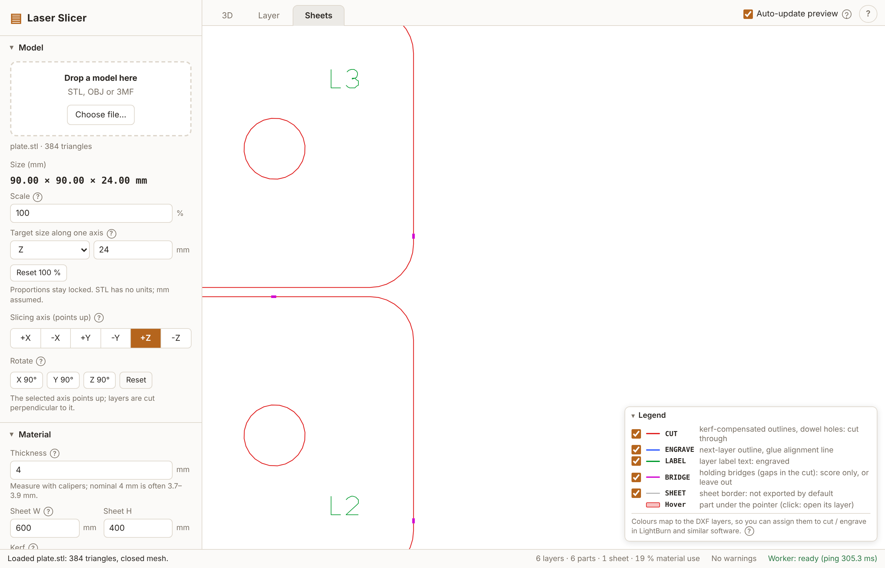

# Laser Slicer

Slices a 3D model (STL, OBJ, 3MF) into flat layers and exports laser-ready files (DXF, SVG, PNG, JPG in one ZIP) for
plywood that is stacked and glued into the shape. It is one offline HTML file: no server, no network, no install for users.





Full technical documentation (features, settings, pipeline, output formats, architecture, limitations): [docs/TECHNICAL.md](docs/TECHNICAL.md).

## Build

```
npm install
npm run build      # type check + produces dist/index.html (one self-contained file, about 1 MB)
npm run check      # verifies dist/ has no network references
npm test           # unit tests (Vitest)
```

Open `dist/index.html` by double-click (`file://` works; nothing is fetched). Copy that single file anywhere.
`npm run dev` starts the Vite dev server.

## Use

1. Drop a model on the page (or "Choose file..."). STL and OBJ have no units, so choose the **Import unit** (mm, cm, m, inch, ...) if the model loads at the wrong size; a 3MF file sets it from its own unit. Use scale or target size for the rest.
2. Pick the slicing axis (the selected axis points up) and rotate in 90 degree steps.
3. Enter the **measured** plywood thickness (calipers; "4 mm" is often 3.7-3.9), sheet size and kerf.
4. Choose an outline mode, optionally hollowing and dowels, and look at the result in the tabs: **3D** (original model or
   stacked layers), **Layer** (one layer: cut red, next layer blue dashed, labels green, dowel holes) and **Sheets** (the nested sheets).
   The **Sheets** and **Layer** tabs have a small legend (bottom right, collapsible): the trace colours are the DXF layers
   `CUT` (red), `ENGRAVE` (blue), `LABEL` (green) and, with holding bridges, `BRIDGE` (magenta); the legend also lists the export-only `CUT_INNER` (orange), so they can be assigned to cut / engrave in LightBurn and similar software.
   The checkbox in front of each legend row shows or hides that trace in both tabs (view only: it does not re-slice and
   does not change the files; remembered in the browser).
   Not sure about kerf or dowel diameter? **Download calibration sheet** (Material group, works without a model) gives a small ZIP
   (DXF, SVG, README.txt) to cut from scrap: seven 20 mm squares with matching holes for kerf 0 to 0.30 mm, and five round holes around your dowel
   diameter. The pair that fits snugly shows your kerf; the hole that fits your rod gives the dowel diameter. Do the kerf test first.
   **Estimates**: with a model sliced, the summary line shows the cut length and, once you enter them in the Material group, a rough
   cutting time (**density, cut speed, engrave speed, price per sheet**; 0 = not set, that estimate is hidden) and the material cost
   (price x sheets used, a partly used sheet counts whole). Hover the summary for the full list (cut and engrave length, glued volume, weight,
   time, cost); the same list is in the Export section and in the ZIP's README.txt. The time ignores travel moves and acceleration, so a real job is longer.
   Changing these four values does not re-slice.
5. Optional **Holding bridges** (panel group of that name): short uncut tabs that keep each part attached to the sheet until you
   break it out, so it cannot fall or tilt mid-cut. Set bridges per outline (1-8), width, minimum outline length, optionally inner holes
   and a maximum spacing. They sit on straight edges, evenly spaced; the gaps are on the separate `BRIDGE` layer. In LightBurn give
   `BRIDGE` a low power / fast speed so it only scores the plywood (the web stays and snaps), or leave `BRIDGE` out of the export
   for plain uncut tabs. Width is the material left after the kerf (the gap in the path is width + kerf). The screenshot above uses
   a 1.5 mm width for visibility; the default is 0.5 mm.
6. Export: pick formats, the layers that go into the files (CUT, ENGRAVE, LABEL, BRIDGE and, off by default, a SHEET border; applies
   to DXF, SVG, PNG and JPG, independent of the legend checkboxes) and "Download all (ZIP)". Warnings are in the status bar; click one to jump to its layer.

**Auto-update preview** (checkbox in the tab bar, on by default) re-slices after every change. For large models turn it off:
changes are then collected, an **Update preview** button appears at the top right of every tab (or press U), and slicing
only runs when you click it. A newly loaded model is shown in 3D but not sliced until you update, and "Download all (ZIP)"
updates first, so the files always match the settings you see. The checkbox is remembered in the browser; it is not part of
the project file.

Press `?` in the app for the shortcuts: 1/2/3 tabs, arrows / PgUp / PgDn / Home / End step layers, M toggles model and stacked
result, F frames the model, U updates the preview (auto-update off). "Project" in the panel saves and loads the settings as a `.json` file; tick "Include the model in the project file" to embed the model too (the file grows by about a third of the model size), and loading it brings back model and settings together.
The last settings and the last model are also kept in this browser, so reloading the page brings you back to where you were (switch off with "Restore the last model when the page opens"; models over 50 MB are not remembered).

### Modes

- **Oversize** (default): each part covers the model everywhere inside its layer (union of the sample planes); glue up, then sand down to shape.
- **Mid-plane**: the section at the middle of the layer; closest on average.
- **Undersize**: the part never sticks out of the model (intersection of the sample planes).

Hollowing removes a cavity from inner layers, keeping a wall of the set width at every glue joint and solid cap layers at both ends.
Dowels put holes at identical positions in every layer of a run so a rod aligns the stack.

## Stacking guide

1. Cut every part **face-up** and never flip a part.
2. Stack **bottom-up**: L0 first. Each part is labelled (e.g. `L12`, `L12-b` for a second island in layer 12).
3. Glue each part **exactly on the engraved outline** that the part below carries (the outline of the next layer).
4. With dowels, thread a dowel through the holes while gluing.
5. Oversize mode: sand the glued block to the final shape.

## Export notes

- **DXF** (R12, mm, Y up) is the file to cut with: layers `CUT` (red, outlines and dowel `CIRCLE`s), `ENGRAVE` (blue), `LABEL` (green, polylines, no text entities), `BRIDGE` (magenta, holding-bridge segments, only when bridges are on), `CUT_INNER` (orange, only with "Inner cuts on own layer") and `SHEET` (grey border, off by default). Choose which layers go into the files under "Layers in the files". In DXF and SVG the holes and dowel circles of each part are always written before its outline; "Inner cuts on own layer" (off by default) moves them to `CUT_INNER`, so you can cut that layer first and `CUT` last and the part cannot drop before its holes are cut. PNG/JPG ignore it.
- **SVG**: 1 unit = 1 mm, same layers as `<g>` groups. **PNG/JPG**: rendered at the chosen DPI with the DPI stored in the file; for engraving or reference, not for cutting without tracing.
- Per sheet (default) or per layer. The ZIP also has a `README.txt` with the settings, stacking order and warnings.
- Bridged outlines are open polylines on `CUT` plus one short open polyline per gap on `BRIDGE`. PNG/JPG: outline style draws the gaps magenta (or leaves them open without BRIDGE); filled style always shows the whole part.
- The calibration sheet uses only `CUT` and `LABEL`; its labels use a decimal point glyph added to the font.
- Kerf is applied to the cut outlines only (holes shrink, outlines grow); engrave lines are never offset.

## Limitations

- Nesting packs each part's minimum-area **rectangle** (MaxRects); round parts waste sheet area. A part larger than the sheet is reported and left out.
- Developed and tested in **Chromium** only (headless Playwright). Firefox and Edge, and LightBurn / LibreCAD import of the DXF, are not tested.
- The Hershey-style font is a hand-redrawn reconstruction, see `DECISIONS.md`. clipper2-js bugs and other deviations from `docs/PLAN.md` are listed there too.
- A hollow cavity is fully enclosed (no vent hole). Dowels need room: thin hollow walls usually leave no run of two layers.

Third-party licences: `THIRD_PARTY_LICENSES.txt` (also embedded in `dist/index.html`).
