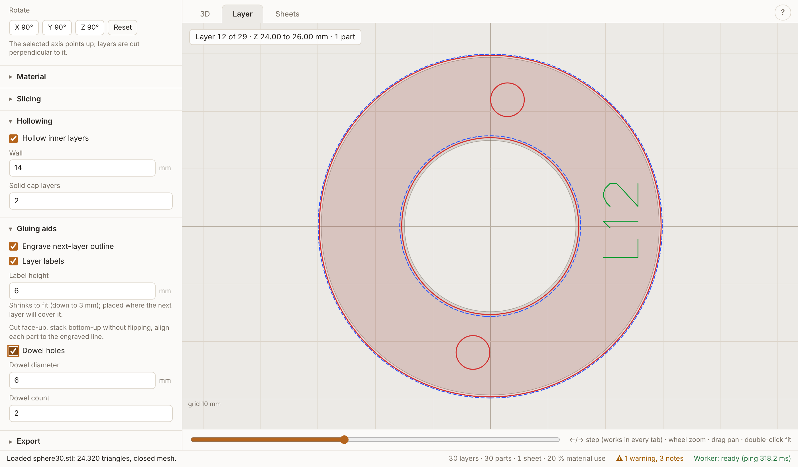
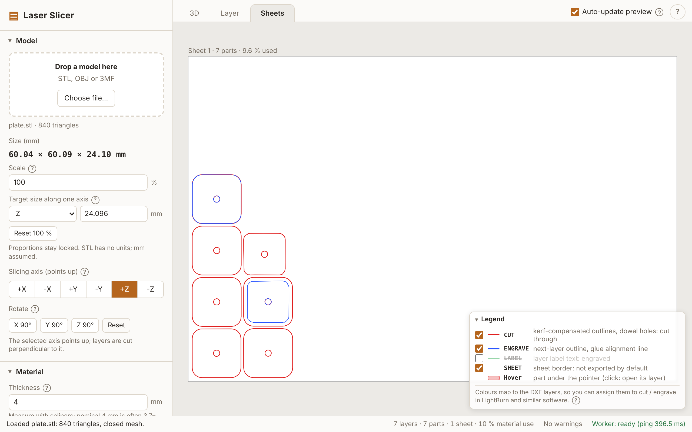
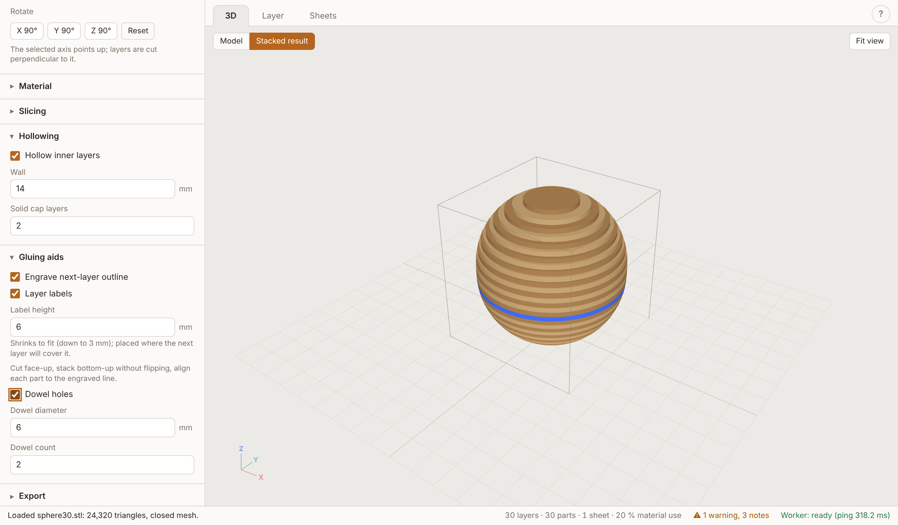

# Laser Slicer

Slices a 3D model (STL, OBJ, 3MF) into flat layers and exports laser-ready files (DXF, SVG, PNG, JPG in one ZIP) for
plywood that is stacked and glued into the shape. It is one offline HTML file: no server, no network, no install for users.





## Build

```
npm install
npm run build      # type check + produces dist/index.html (one self-contained file, about 1 MB)
npm run check      # verifies dist/ has no network references
npm test           # unit tests (Vitest)
```

Open `dist/index.html` by double-click (`file://` works; nothing is fetched). Copy that single file anywhere.
`npm run dev` starts the Vite dev server.

## Use

1. Drop a model on the page (or "Choose file..."). STL has no units, so mm are assumed; set a scale or target size if needed.
2. Pick the slicing axis (the selected axis points up) and rotate in 90 degree steps.
3. Enter the **measured** plywood thickness (calipers; "4 mm" is often 3.7-3.9), sheet size and kerf.
4. Choose an outline mode, optionally hollowing and dowels, and look at the result in the tabs: **3D** (original model or
   stacked layers), **Layer** (one layer: cut red, next layer blue dashed, labels green, dowel holes) and **Sheets** (the nested sheets).
   The **Sheets** and **Layer** tabs have a small legend (bottom right, collapsible): the trace colours are the DXF layers
   `CUT` (red), `ENGRAVE` (blue) and `LABEL` (green), so they can be assigned to cut / engrave in LightBurn and similar software.
   The checkbox in front of each legend row shows or hides that trace in both tabs (view only: it does not re-slice and
   does not change the files; remembered in the browser).
5. Export: pick formats, the layers that go into the files (CUT, ENGRAVE, LABEL and, off by default, a SHEET border; applies
   to DXF, SVG, PNG and JPG, independent of the legend checkboxes) and "Download all (ZIP)". Warnings are in the status bar; click one to jump to its layer.

**Auto-update preview** (checkbox in the tab bar, on by default) re-slices after every change. For large models turn it off:
changes are then collected, an **Update preview** button appears at the top right of every tab (or press U), and slicing
only runs when you click it. A newly loaded model is shown in 3D but not sliced until you update, and "Download all (ZIP)"
updates first, so the files always match the settings you see. The checkbox is remembered in the browser; it is not part of
the project file.

Press `?` in the app for the shortcuts: 1/2/3 tabs, arrows / PgUp / PgDn / Home / End step layers, M toggles model and stacked
result, F frames the model, U updates the preview (auto-update off). "Project" in the panel saves and loads the settings as a `.json` file (the model is not stored);
the last settings are also kept in the browser.

### Modes

- **Oversize** (default): each part covers the model everywhere inside its layer (union of the sample planes); glue up, then sand down to shape.
- **Mid-plane**: the section at the middle of the layer; closest on average.
- **Undersize**: the part never sticks out of the model (intersection of the sample planes).

Hollowing removes a cavity from inner layers, keeping a wall of the set width at every glue joint and solid cap layers at both ends.
Dowels put holes at identical positions in every layer of a run so a rod aligns the stack.

## Stacking guide

1. Cut every part **face-up** and never flip a part.
2. Stack **bottom-up**: L0 first. Each part is labelled (e.g. `L12`, `L12-b` for a second island in layer 12).
3. Glue each part **exactly on the engraved outline** that the part below carries (the outline of the next layer).
4. With dowels, thread a dowel through the holes while gluing.
5. Oversize mode: sand the glued block to the final shape.

## Export notes

- **DXF** (R12, mm, Y up) is the file to cut with: layers `CUT` (red, outlines and dowel `CIRCLE`s), `ENGRAVE` (blue), `LABEL` (green, polylines, no text entities).
- **SVG**: 1 unit = 1 mm, same three groups. **PNG/JPG**: rendered at the chosen DPI with the DPI stored in the file; for engraving or reference, not for cutting without tracing.
- Per sheet (default) or per layer. The ZIP also has a `README.txt` with the settings, stacking order and warnings.
- Kerf is applied to the cut outlines only (holes shrink, outlines grow); engrave lines are never offset.

## Limitations

- Nesting packs each part's minimum-area **rectangle** (MaxRects); round parts waste sheet area. A part larger than the sheet is reported and left out.
- Developed and tested in **Chromium** only (headless Playwright). Firefox and Edge, and LightBurn / LibreCAD import of the DXF, are not tested.
- The Hershey-style font is a hand-redrawn reconstruction, see `DECISIONS.md`. clipper2-js bugs and other deviations from `docs/PLAN.md` are listed there too.
- A hollow cavity is fully enclosed (no vent hole). Dowels need room: thin hollow walls usually leave no run of two layers.

Third-party licences: `THIRD_PARTY_LICENSES.txt` (also embedded in `dist/index.html`).
