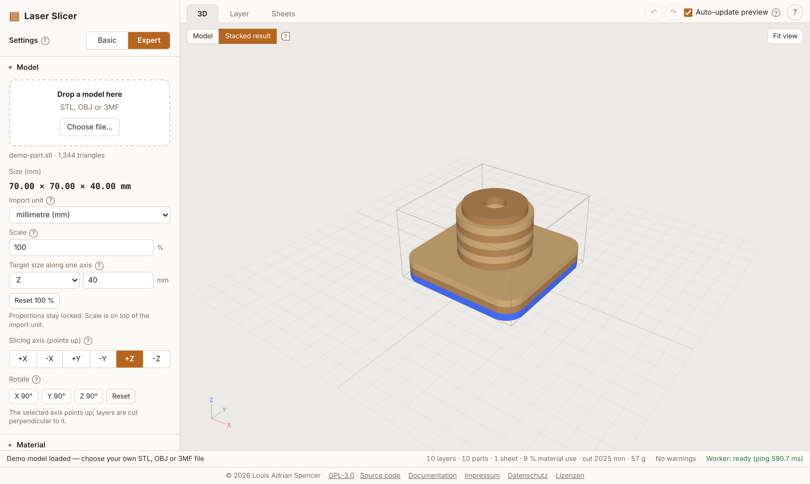
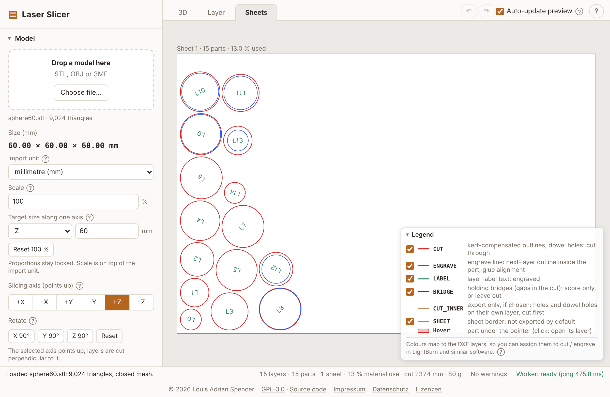
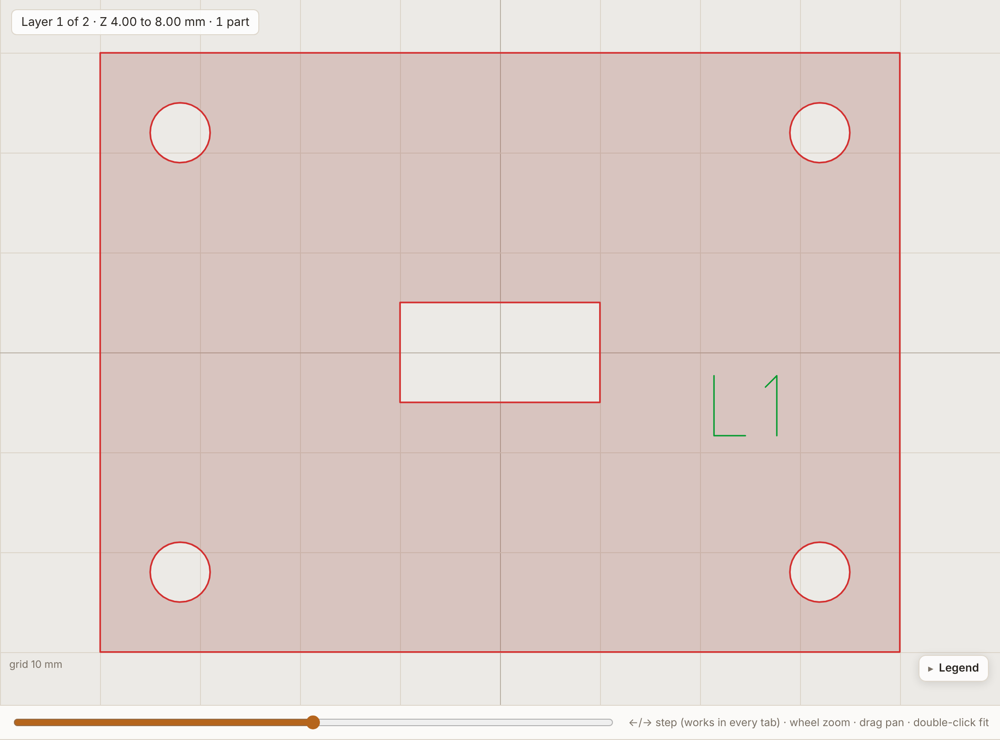
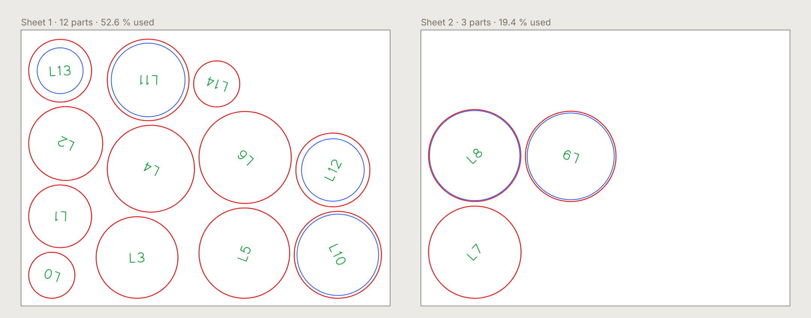
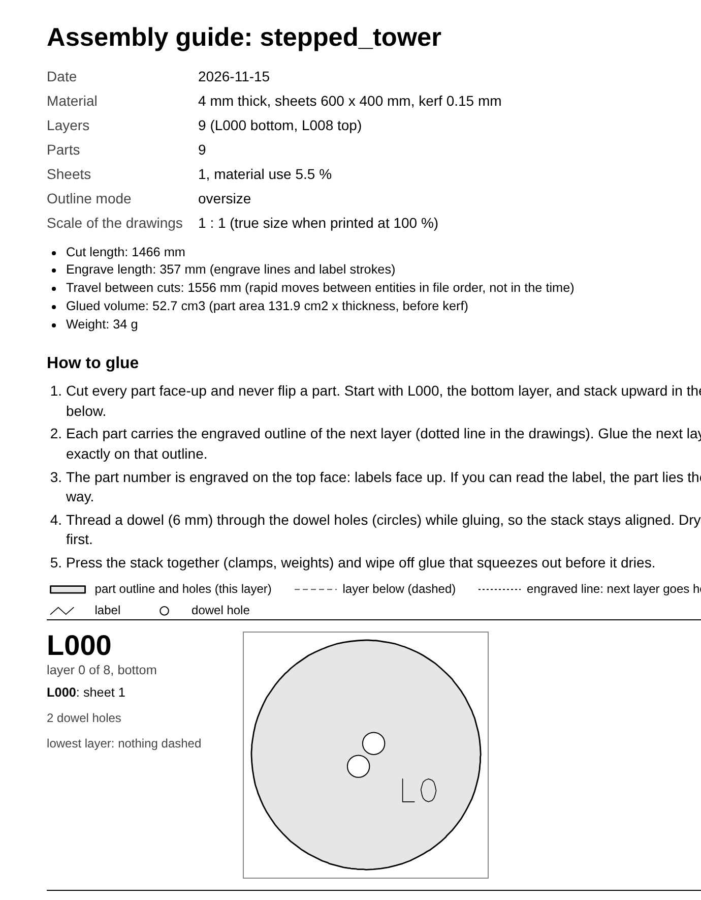

# Laser Slicer

**Turn a 3D model into flat plywood layers for your laser cutter, then stack and glue them back into the shape.**

### [Open Laser Slicer: free, runs in your browser](https://laserslicer.com)

[Online documentation](https://laserslicer.com/docs.html) · [Latest release (offline use)](https://github.com/DrKlenkk/LaserSlicer/releases/latest) · [Build from source](#build-from-source)

[](https://laserslicer.com)

## What it does

You load an STL, OBJ or 3MF model, enter your measured plywood thickness, sheet size and laser kerf, and Laser Slicer cuts the model into layers,
nests the parts onto sheets and exports laser-ready files (DXF, SVG, PNG, JPG and an assembly guide in one ZIP). Each part carries an engraved
outline of the next layer and a label, so gluing the stack is straightforward. Everything runs locally in the browser; the whole tool is one
HTML file.

## Features

- Import **STL, OBJ and 3MF** with an import unit (mm, cm, m, inch, ...); 3MF sets the unit itself; scale or target size, slicing axis, 90 degree rotation.
- Three **outline modes**: oversize (sand to shape), mid-plane, undersize.
- **Kerf compensation** on the cut outlines (holes shrink, outlines grow).
- **Nesting** of the parts onto sheets of your size (rectangle based, MaxRects).
- **Holding bridges**: short uncut tabs that keep parts in the sheet, on their own `BRIDGE` layer.
- **Inner cuts first**: optional `CUT_INNER` layer and a short cutting order (engraving, holes, then outlines) so parts do not drop early.
- **Hollowing** with a wall at every glue joint and solid cap layers.
- **Engraved next-layer outlines** and **part labels** for gluing; optional **dowel holes** for aligning the stack.
- **Calibration sheet** (ZIP with DXF and SVG) to find your kerf and dowel diameter from scrap.
- **Estimates**: cut length, rough cutting time, weight and material cost.
- **Material presets** (save your own) and **Compare materials**: slice with every preset and see layers, sheets, time and cost side by side.
- **Layer range** to recut one broken or lost layer.
- **Assembly guide** (`assembly.html`): printable A4 gluing guide with part numbers, sheets and a drawing per layer.
- **Basic / Expert mode**: Basic shows only the essentials and exports cut outlines only.
- A small **demo model** on first visit; **undo / redo** of settings.
- **Project files** (`.json`) with optionally the model embedded.
- **Offline single file** (`index.html`), also works from `file://`; **phone layout** with a settings drawer.
- **Privacy**: no tracking, no analytics, no accounts, nothing is uploaded.

## How to use

1. **Load a model** (drag it onto the page or "Choose file...") and set the [import unit and size](https://laserslicer.com/docs.html#import-unit) if it loads at the wrong size. New here? The [getting started guide](https://laserslicer.com/docs.html#getting-started) walks through the demo model.
2. **Pick the slicing axis and orientation** ([orientation](https://laserslicer.com/docs.html#orientation)).
3. **Enter your material**: the *measured* [thickness](https://laserslicer.com/docs.html#thickness) ("4 mm" plywood is often 3.7-3.9), [sheet size](https://laserslicer.com/docs.html#sheet-size) and [kerf](https://laserslicer.com/docs.html#kerf); cut the [calibration sheet](https://laserslicer.com/docs.html#calibration) if unsure.
4. **Choose how the layers look**: [outline mode](https://laserslicer.com/docs.html#outline-modes), optional [hollowing](https://laserslicer.com/docs.html#hollowing), [dowels](https://laserslicer.com/docs.html#dowels), [holding bridges](https://laserslicer.com/docs.html#bridges); check the 3D, Layer and Sheets tabs ([tabs](https://laserslicer.com/docs.html#tabs)).
5. **Export** the ZIP ([export](https://laserslicer.com/docs.html#export)), with the optional [assembly guide](https://laserslicer.com/docs.html#assembly-guide).
6. **Cut, stack, glue**: cut every part face-up, stack bottom-up and glue each part onto the outline engraved on the part below ([laser workflow](https://laserslicer.com/docs.html#laser-workflow)).

**At the laser.** The DXF layers are `CUT` (red), `ENGRAVE` (blue), `LABEL` (green), `BRIDGE` (magenta) and `CUT_INNER` (orange). Assign
cut / engrave settings to them in your laser software; see [laser workflow](https://laserslicer.com/docs.html#laser-workflow) in the documentation.

## Screenshots


*Overview: settings on the left, the 3D / Layer / Sheets tabs on the right.*


*Layer tab: cut outline, engraved next-layer outline, label and dowel holes.*


*Sheets tab: parts nested onto the sheet, trace colours match the DXF layers.*


*Assembly guide: a printable gluing guide with a block per layer.*

## Offline use

Download `laserslicer-site.zip` from the [latest release](https://github.com/DrKlenkk/LaserSlicer/releases/latest) (or the `laserslicer-site`
artifact of a [GitHub Actions run](https://github.com/DrKlenkk/LaserSlicer/actions)), unzip it and open `index.html`. It works from `file://`:
nothing is fetched and nothing needs installing. The release also has `index.html` on its own (the app without the documentation and legal pages).

## Build from source

Needs Node.js (CI uses 22).

```
npm install
npm run build      # type check + vite build, produces dist/
npm run check      # verifies the dist/ file set, no external resources, legal pages, no analytics
npm test           # unit tests (Vitest)
npm run dev        # Vite dev server
```

`dist/` is the whole site: `index.html` (the app, one file of about 1 MB), `docs.html` with its screenshots in `docs-img/`, the German legal pages
(`impressum.html`, `datenschutz.html`, `lizenzen.html`) with English translations of the first two (`legal-notice.html`, `privacy.html`), `404.html`, `LICENSE.txt`, `THIRD_PARTY_LICENSES.txt`, `robots.txt`, `sitemap.xml`,
`og-image.png`, `favicon.svg` and `apple-touch-icon.png`.

**Deployment:** upload **all** files of `dist/` to the host, including `docs-img/`, `robots.txt`, `sitemap.xml`, `og-image.png` and `404.html`.
The GitHub Actions workflow (`.github/workflows/build.yml`) runs tests, build and check, uploads `dist/` as the artifact `laserslicer-site`
and, on `v*` tags, attaches `laserslicer-site.zip` and `index.html` to the release.

## Documentation for developers

- [docs/TECHNICAL.md](docs/TECHNICAL.md): features, settings, pipeline, output formats, architecture, limitations.
- [DECISIONS.md](DECISIONS.md): design decisions and deviations from the plan.
- [docs/test-protocol/PROTOCOL.md](docs/test-protocol/PROTOCOL.md): the manual test protocol and its results.
- [docs/PLAN.md](docs/PLAN.md): the original project plan.

## Licence and credits

Free software under the **GNU General Public License, version 3 only (GPL-3.0-only)**, see [LICENSE](LICENSE).
Copyright (c) 2026 Louis Adrian Spencer. Third-party licences are listed in [THIRD_PARTY_LICENSES.txt](THIRD_PARTY_LICENSES.txt).
Legal pages on the live site: [Impressum](https://laserslicer.com/impressum.html), [Datenschutz](https://laserslicer.com/datenschutz.html), [Lizenzen](https://laserslicer.com/lizenzen.html).
