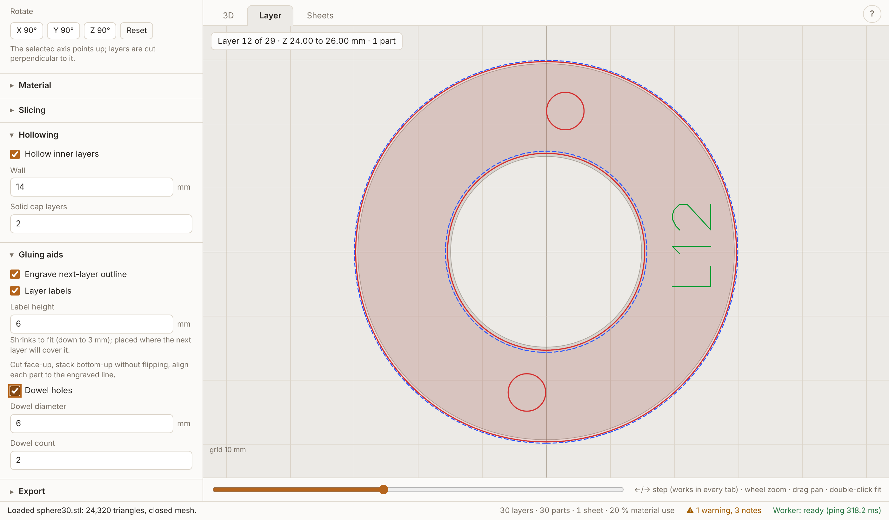
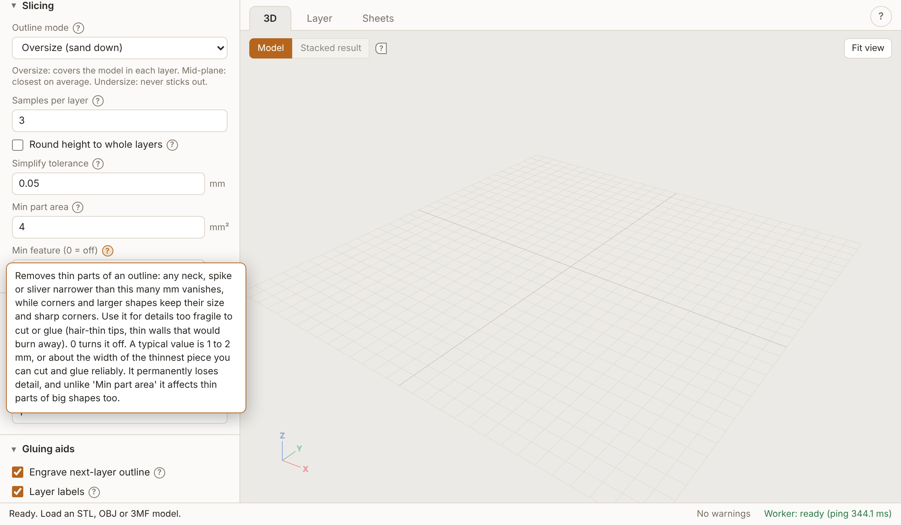
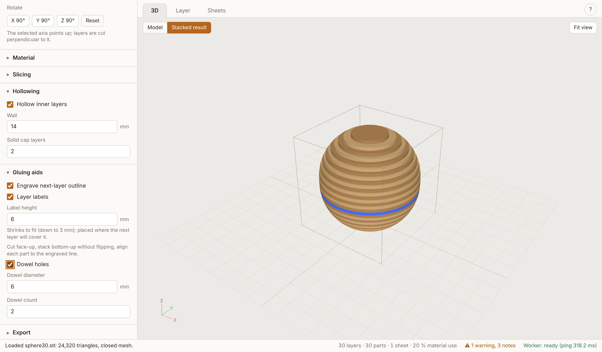
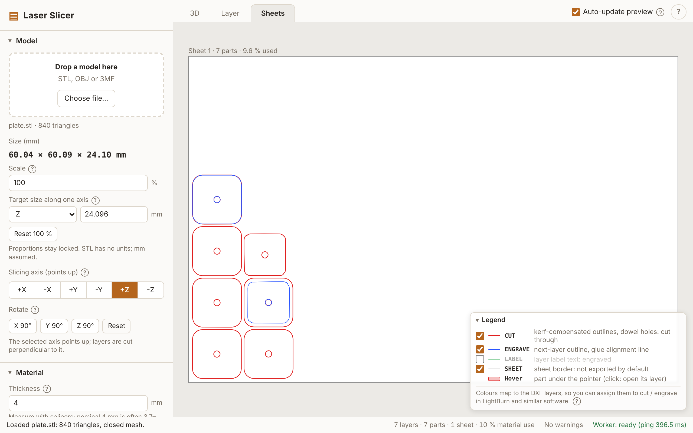
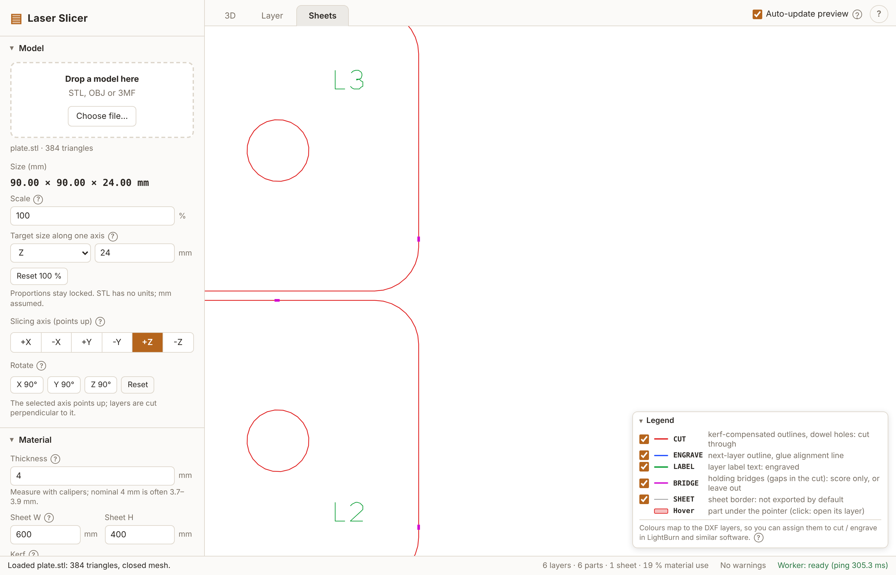
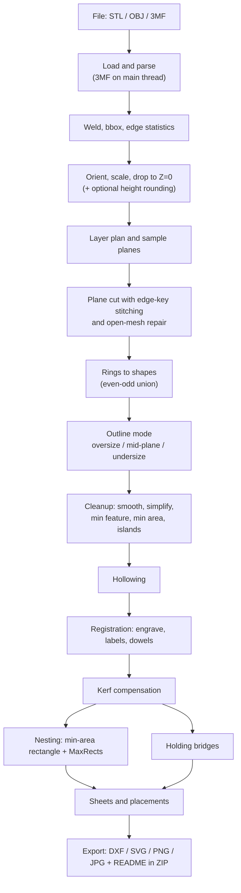

# Laser Slicer: technical documentation

This document describes what Laser Slicer does today, for someone who has not run the app and has not read the code.
Where `docs/PLAN.md` and the code differ, the code is described; the deviations are recorded in
[`DECISIONS.md`](../DECISIONS.md). Source paths are given in `code font` so claims can be checked.

Contents: [1 Overview](#1-overview) | [2 User interface](#2-user-interface-tour) | [3 Settings reference](#3-settings-reference) |
[4 Processing pipeline](#4-processing-pipeline) | [5 Outputs](#5-outputs) | [6 Warnings and errors](#6-warnings-and-error-handling) |
[7 Architecture](#7-architecture) | [8 Testing](#8-testing-and-measured-performance) | [9 Limitations](#9-known-limitations-and-unverified-items) |
[10 Glossary](#10-glossary)

---

## 1. Overview

Laser Slicer turns a 3D model (STL, OBJ or 3MF) into flat layers for a laser cutter. You cut every layer from plywood
(or any sheet material of known thickness), stack the layers bottom-up and glue them into the shape. The output is a ZIP with
DXF (the file to cut with), and optionally SVG, PNG and JPG, plus a `README.txt`.

**Workflow in one paragraph.** Drop a model on the page. Choose the slicing axis and orientation, enter the *measured* material
thickness, sheet size and laser kerf. Choose how each layer outline is derived from the model (oversize, mid-plane or
undersize), optionally add hollowing, dowel holes, engraved alignment lines, labels and holding bridges. The app slices the
model in a background worker, nests the parts onto sheets, and shows the result in three tabs (3D, Layer, Sheets). Download the
ZIP, cut each part face-up, stack bottom-up without flipping, glue each part onto the engraved outline carried by the part
below.



### Hard constraints and environment

| Constraint | Detail |
|---|---|
| One offline HTML file | `npm run build` produces `dist/index.html` (about 1 MB) with all JS, CSS and the worker inlined (`vite-plugin-singlefile`, worker as an inline Blob, `?worker&inline`). It runs from `file://` by double-click. |
| No network | Nothing is fetched at run time. `npm run check` (`scripts/check-dist.mjs`) fails the build if `dist/` holds anything but `index.html` or contains network URLs outside comments and XML namespace names. |
| Worker | All heavy geometry (parsing, welding, slicing, nesting, export, image rendering) runs in one Web Worker. The main thread does UI, 3D rendering, 3MF parsing and the cheap orientation for the 3D preview. |
| No install, no server | State lives in the page, in `localStorage` and in IndexedDB (the last model, see 2.7); nothing leaves the browser. |
| Tested browser | **Chromium only** (headless Playwright, software GL). Firefox, Safari and Edge, and `file://` behaviour there, are untested. |
| Units | Millimetres everywhere after import. STL and OBJ carry no units, so the *Import unit* setting says what the file is in (default millimetres); 3MF declares its unit and sets that setting on load. Y axis up in all outputs. |

---

## 2. User interface tour

The window has a parameter panel on the left, a main area with a tab bar on the right, and a status bar at the bottom.
The page follows the system light/dark theme (`prefers-color-scheme`).

### 2.1 Parameter panel

Collapsible groups, in this order. Model and Material start open, the rest collapsed.

| Group | Contents |
|---|---|
| **Model** | Drop zone / "Choose file..." (accepts `.stl`, `.obj`, `.3mf`), file name and triangle count, effective size readout (mm), import unit (micron, mm, cm, m, inch, foot), scale %, target size along X/Y/Z, "Reset 100 %", slicing axis (`+X -X +Y -Y +Z -Z`), 90-degree rotation buttons for X, Y, Z with "Reset". |
| **Material** | Thickness, sheet width and height, kerf, part spacing, sheet margin, density, cut speed, engrave speed, price per sheet (estimates, section 5.7), and the "Download calibration sheet" button (works without a model, section 5.5). |
| **Holding bridges** | Enable, bridges per outline, width, minimum outline length, inner holes, maximum spacing. |
| **Slicing** | Outline mode, samples per layer, round height to whole layers, smoothing radius, simplify tolerance, min part area, min feature. |
| **Hollowing** | Enable, wall, solid cap layers. |
| **Gluing aids** | Engrave next-layer outline, layer labels, label height, dowel holes, diameter, count. |
| **Export** | Format chips (DXF, SVG, PNG, JPG), "Layers in the files" chips (CUT, ENGRAVE, LABEL, BRIDGE, SHEET border), one file per sheet / per layer, raster options (DPI preset or custom, image style, grey engrave lines), summary line, **Download all (ZIP)**. |
| **Project** | "Save settings..." and "Load settings..." (JSON), the checkbox "Include the model in the project file", and the preference "Restore the last model when the page opens". |

Dropping a file anywhere on the page also loads it (an overlay says "Drop model to load"). Loading a new model resets the
selected layer to 0 and frames the camera; the settings are kept.

Every non-obvious control has an info icon with a tooltip (text in `src/ui/helpText.ts`, about 40 entries). Tooltips open on
hover, keyboard focus and tap; Esc closes them; the bubble flips above/below and clamps to the viewport.



### 2.2 The three tabs

| Tab (key) | What it shows |
|---|---|
| **3D** (`1`) | Three.js view with orbit/zoom/pan. A segmented toggle switches between **Model** (the loaded mesh in the chosen orientation and scale, 78 % opaque, with bounding box and grid) and **Stacked result** (one extruded solid per layer, two wood tones alternating, the layer selected in the Layer tab highlighted blue; shows the outlines after hollowing, before kerf; bridges are not drawn). Stacked is disabled until a result exists. "Fit view" frames the model. |
| **Layer** (`2`) | 2D canvas of one layer with a slider (and arrow keys): this layer's outline in red with a light red fill, dowel holes, the previous layer as a grey ghost, the **next** layer's outline as a dashed blue line (what is engraved on the part), labels in green, bridge gaps in magenta. Wheel zoom, drag pan, double-click fits, a 10/50 mm grid with a "grid N mm" caption. Info line: `Layer i of N - Z a to b mm - k parts`. It shows the model outline (before kerf) except that bridged parts are drawn from their cut paths. |
| **Sheets** (`3`) | All nested sheets side by side with captions, parts drawn as placed (kerf-compensated cut outlines, engraving, labels, bridges). Hover shows `L012-b (layer 12)`; click jumps to that layer's Layer tab. Wheel zoom, drag pan, double-click fits. |



### 2.3 Legend and trace toggles

The Layer and Sheets tabs have a collapsible legend (bottom right). Row names are the DXF layers so colours can be mapped in
LightBurn and similar tools. Each row except "Hover" has a checkbox that shows or hides that trace **in the view only**: it
triggers no re-slice and does not change the export. The state is shared by both tabs and remembered in the browser.

| Row | Light / dark colour | Tabs |
|---|---|---|
| CUT | `#e02020` / `#ff5c50` | both |
| ENGRAVE | `#2a55ff` / `#6f8dff` (Layer: dashed) | both |
| LABEL | `#009a2c` / `#37d067` | both |
| BRIDGE | `#d000d0` / `#f060f0` | both |
| SHEET (border, not exported by default) | `#8a8a8a` / `#9a9a9a` | Sheets |
| CUT_INNER (export only, no checkbox) | `#ff8000` | both, as a legend note |
| Previous (reference layer) | grey | Layer |
| Hover | cut colour fill | Sheets |

The on-screen colours are close to, not identical to, the AutoCAD colour indices of the DXF layers.




### 2.4 Status bar, progress, warnings

* Left: a progress bar and `<stage> <percent>%` while a run is in progress (stages: Orienting, Slicing, Outline modes, Cleanup,
  Done). Then the status message (info / warn / error colour), the run summary
  (`N layers - P parts - S sheets - U % material use`, with `- outdated` appended when stale in manual mode), the warnings button and
  a worker badge (`Worker: ready (ping x ms)` or an error).
* **Warnings button**: `N errors, N warnings, N notes`. Clicking opens a panel grouped as Errors and Warnings (open) and Info
  (collapsed). Entries that belong to a layer are buttons that jump to that layer in the Layer tab. Esc or an outside click closes it.
* Load problems are in the status bar immediately (open edges, non-manifold edges, degenerate triangles removed). Any error that
  escapes (`error`, `unhandledrejection`) also lands in the status bar, so a failure is never silent.

### 2.5 Auto-update and Update preview

A checkbox in the tab bar, **Auto-update preview** (default on). On: every slicing-relevant change starts a run after a 300 ms
debounce; loading a model starts one at once. Off: changes only mark the preview *stale*; an **Update preview** button with a
"settings changed" or "not sliced yet" note appears at the top right of every tab (shortcut `U`), and a loaded model is shown in
3D but not sliced. **Download all (ZIP)** always brings the preview up to date first, so files always match the visible settings.
Turning auto back on updates immediately if anything is stale. Settings that only affect the export (formats, per-layer, DPI,
raster style, grey engraving, export layer chips) neither start a run nor mark the preview stale (`slicingKey` in
`src/updateController.ts`). The flag is stored in the UI prefs, not in the project file.

### 2.6 Keyboard shortcuts and help

`?` or the **?** button opens a help overlay (short usage guide, gluing steps, shortcut table). Shortcuts are global and ignored
while a text/number input, a select or the layer slider has focus. `Ctrl+S` is deliberately not bound. The undo / redo keys
follow their own rule (section 2.8).

| Key | Action |
|---|---|
| `1` `2` `3` | 3D, Layer, Sheets tab |
| arrows | previous / next layer (any tab) |
| `PgUp` / `PgDn` | 10 layers up / down |
| `Home` / `End` | first / last layer |
| `M` | 3D tab: toggle Model / Stacked result |
| `F` | 3D tab: frame the model |
| `U` | update the preview (auto-update off) |
| `Ctrl+Z` / `Cmd+Z` | undo the last settings change |
| `Ctrl+Y`, `Ctrl+Shift+Z` / `Cmd+Shift+Z` | redo |
| `?` | help |
| `Esc` | close help, warnings, tooltip |

### 2.8 Undo / redo and material presets

**History.** Every settings change goes through `Store.set` and is recorded in `src/history.ts` (pure, tested): a stack of
snapshots of the full settings object from before each step, at most 100 (the oldest is dropped), plus a redo stack that any new
step clears. A change that leaves every value equal is not recorded. Rapid changes to the **same single setting** (typing, spinner
clicks, a slider) within 1 s of the previous one are one step; a bulk change (project load, preset, reset, two settings at once)
is always a step of its own. Undo and redo put the snapshot back with one store update, so the panel re-syncs, `slicingKey`
decides whether to re-slice or mark the preview stale exactly as for a manual edit, and the settings are saved to `localStorage`.
What is **not** a step: loading a model, restoring the last session, the selected tab, layer and 3D view. A 3MF load that sets the
import unit changes the unit silently and writes the new value into all stored snapshots, so undo does not bring back a unit that
no longer fits the model. A project file is one step, and loading a project with a model is one step as well.

**Buttons and keys.** The two buttons (↶ ↷) left of "Auto-update preview" are disabled when there is nothing to undo / redo. The
keys are ignored while focus is in a text-like input (text, number, search, ...), a select, a textarea or an editable element, so
the browser's own undo of the typed text keeps working; they are handled with focus on a checkbox, button, the layer slider or
the page. A number field commits when it loses focus or on Enter, so use a button or click elsewhere first.

**Material presets** (Material group, `src/presets.ts`). A preset is a name plus the values of thickness, sheet W/H, kerf, part
spacing, sheet margin, density, cut speed, engrave speed and price per sheet. The list has "Starting points" (built in, three
plywood thicknesses; they leave speeds and price out, so applying one keeps yours; not deletable) and "My presets" (saved in
`localStorage` key `laserslicer.presets.v1` as `[{ name, values }]`, validated on read, invalid entries dropped, at most 50, names
case-insensitive and at most 60 characters). Selecting a preset applies it as one undo step. **Save...** asks for a name
(`window.prompt`); an existing name is replaced after a confirm; the names of the starting points are refused. **Delete** (confirm)
removes the selected preset of yours. The list shows the preset whose values match the current ones (so it clears when you edit a
field). Presets are not part of the project file. Without usable storage the presets last for the page session and the panel says
so.

### 2.7 Project files and persistence

| What | Where | Content |
|---|---|---|
| Settings | `localStorage` key `laserslicer.settings.v1` | The full settings object, saved on every change, merged over defaults on load (new keys get defaults). |
| Material presets | `laserslicer.presets.v1` | `[{ "name", "values": { thickness, sheetW, ... } }]`, my presets only (section 2.8). Not in the project file. |
| UI prefs | `laserslicer.ui.v1` | `autoUpdate`, `hiddenTraces`, `restoreSession` (default on). Not in the project file. |
| Last model | IndexedDB database `laserslicer.session`, record `last` | `{ name, bytes, savedAt }`: the original file bytes of the last model that loaded, at most 50 MB (`SESSION_MAX_BYTES`). Written after a successful load, loaded again at start-up when `restoreSession` is on. |
| Legend state | `laserslicer.legend.collapsed` | Legend collapsed or not. |
| Project file | `laser-slicer-project.json` (download) | `{ "format": "laser-slicer-project", "version": 2, "settings": {...}, "model": { "name": "part.stl", "data": "<base64>" } }`. `model` is present only when the checkbox was ticked: the original file bytes, byte for byte. Version 1 files (settings only) load as before. |

All `localStorage` access is wrapped in try/catch; if storage is blocked the app works with defaults. Loading a project validates
every key (type, range, enum) and rejects a bad value with one sentence naming the key; keys missing from the file take their
default; unknown keys are ignored.

**Model in the project file.** A version 2 file with a `model` loads the model first, through the normal load path (STL, OBJ or 3MF parsing in the worker or, for 3MF, on the main thread), and the project's settings are applied in the same store update as the model, so there is one orient and one run, and (later) one undo step. The project's own `importUnit` wins over a unit declared inside an embedded 3MF. If the embedded data is damaged (bad base64, empty, a name without an STL/OBJ/3MF extension) or the model does not parse, one message is shown (status bar and Project group) and neither the current model nor the current settings change. A `model` key in a version 1 file is ignored; later versions are read like version 2.

**Session restore.** The main thread keeps the original bytes and name of the last loaded model (a copy; the worker receives another copy because transferred buffers are detached), used for the checkbox and for the IndexedDB record. At start-up, once the worker answers, the record is loaded through the same path if the preference is on and no model has been loaded meanwhile. A restore never changes settings (not even the unit of a 3MF): the settings are already remembered in `localStorage`. A record that cannot be loaded produces only a status-bar note and is deleted. Files over 50 MB are not stored (and the previous record is removed). Turning the preference off deletes the record. All IndexedDB access (`src/sessionStore.ts`) is in try/catch with a 4 s timeout, and returns null or false on any problem, so the app works unchanged when IndexedDB is missing, blocked or full.

---

## 3. Settings reference

Settings live in one flat object (`Settings` in `src/core/types.ts`, defaults in `src/state.ts`). All lengths are mm. The
**Re-runs** column names the first pipeline stage that is recomputed when the setting changes (see section 4.12 for the cache
keys); everything after it also re-runs. "Export" means no slicing at all.

### 3.1 Model

| Setting (UI label, key) | Default | Unit / range | What it does | Re-runs |
|---|---|---|---|---|
| Slicing axis (`axis`) | `+Z` | `+X -X +Y -Y +Z -Z` | Layers are cut perpendicular to this axis; the chosen axis points up in the stack. `+Z` and `-Z` give the same layers in opposite order. | orient |
| Rotate (`rotationSteps`) | `[0,0,0]` | 0..3 quarter turns about X, Y, Z | Extra 90-degree turns applied after axis alignment, in the order X, Y, Z. "Reset" zeroes them. | orient |
| Import unit (`importUnit`) | `mm` | `micron mm cm m in ft` | Unit of the model file, as a factor to mm (0.001, 1, 10, 1000, 25.4, 304.8) applied together with, but separate from, the scale: the Scale field stays at 100 % for a model that is only unit-converted, and the size readout is in mm. Loading a 3MF sets it from the file (status bar says so); STL and OBJ loads leave it as it is. | orient |
| Scale (`scale`) | 1 (shown as 100) | percent in the UI, > 0 | Uniform scale. The field shows the *effective* scale including target size and height rounding. Typing a scale cancels the target size. | orient |
| Target size (`targetSize`) | `null` | X/Y/Z + mm > 0 | Scales uniformly so the oriented extent along that axis (in mm, after the import unit) equals this value. Overrides `scale`. | orient |

### 3.2 Material

| Setting | Default | Unit / range | What it does | Re-runs |
|---|---|---|---|---|
| Thickness (`thickness`) | 4.0 | mm, >= 0.1 | Thickness of one sheet = height of one layer. Layer count is `ceil(height / thickness - 1e-6)`. | slice |
| Sheet W / H (`sheetW`, `sheetH`) | 600 x 400 | mm, >= 10 | Sheet (or laser bed) size for nesting and for per-sheet files. | nest |
| Kerf (`kerf`) | 0.15 | mm, >= 0 | Cut outlines grow by kerf/2 per side, holes and dowel holes shrink by it. Engrave lines are never offset. | kerf |
| Part spacing (`partSpacing`) | 3 | mm, >= 0 | Minimum gap between the final (kerfed) cut lines of neighbouring parts. | nest |
| Sheet margin (`sheetMargin`) | 5 | mm, >= 0 | Border of the sheet kept free of parts. | nest |
| Density (`density`) | 0.65 | g/cm3, >= 0 | Material density for the weight estimate. 0 = not set (no weight). | nothing (estimates only) |
| Cut speed (`cutSpeed`) | 0 | mm/s, >= 0 | For the rough time estimate. 0 = not set. | nothing |
| Engrave speed (`engraveSpeed`) | 0 | mm/s, >= 0 | For the rough time estimate. 0 = not set (engraving is left out of the time). | nothing |
| Price per sheet (`pricePerSheet`) | 0 | any currency, >= 0 | Cost = price x sheets used. 0 = not set (no cost). | nothing |

The last four are in the exclusion list of `slicingKey` (like the export settings): changing them neither starts a run nor marks the preview stale; the summary line and the estimate list update at once from the last result. They are project-file keys; files without them load with the defaults.

### 3.3 Holding bridges

| Setting | Default | Unit / range | What it does | Re-runs |
|---|---|---|---|---|
| Add holding bridges (`bridgesEnabled`) | off | bool | Leaves short uncut tabs on outlines so parts stay on the sheet. | bridges |
| Bridges per outline (`bridgeCount`) | 2 | integer 1..8 | Bridges per outline, spread evenly along its perimeter and moved onto straight edges. | bridges |
| Bridge width (`bridgeWidth`) | 0.5 | mm, >= 0.1 | Material left after the kerf. The gap in the path is `width + kerf`. | bridges |
| Min outline length (`bridgeMinLength`) | 40 | mm, >= 0 | Outlines with a shorter perimeter get no bridges. | bridges |
| Also bridge inner holes (`bridgeHoles`) | off | bool | Also bridges inner rings (cavities). Dowel holes never get bridges. | bridges |
| Max spacing (`bridgeMaxSpacing`) | 0 (off) | mm, >= 0 | If set, long outlines get more bridges so the nominal spacing is at most this (up to 64 per outline). | bridges |

### 3.4 Slicing

| Setting | Default | Unit / range | What it does | Re-runs |
|---|---|---|---|---|
| Outline mode (`mode`) | `oversize` | `oversize` / `midplane` / `undersize` | How a layer outline is derived from the samples (section 4.4). | slice |
| Samples per layer (`samplesPerLayer`) | 3 | integer >= 1 | Cross sections per layer; ignored in mid-plane (always 1). | slice |
| Round height to whole layers (`roundHeightToLayers`) | off | bool | Scales the model uniformly so its height is a whole number of layers (at most half a layer of change). | orient |
| Smooth outlines (`smoothRadius`) | 0 (off) | mm, >= 0 | Mode-aware morphological smoothing (section 4.6). | cleanup |
| Simplify tolerance (`simplifyTol`) | 0.05 | mm, >= 0 | Mode-biased Ramer-Douglas-Peucker vertex reduction. 0 = off. | cleanup |
| Min part area (`minPartArea`) | 4 | mm2, >= 0 | Removes islands and holes smaller than this (each removal warns). Also drops hollowing leftovers. | cleanup |
| Min feature (`minFeature`) | 0 (off) | mm, >= 0 | Removes necks and slivers thinner than this (morphological opening). | cleanup |

### 3.5 Hollowing

| Setting | Default | Unit / range | What it does | Re-runs |
|---|---|---|---|---|
| Hollow inner layers (`hollowEnabled`) | off | bool | Cuts an enclosed cavity into inner layers. | hollow |
| Wall (`hollowWall`) | 15 | mm, >= 0 | Solid wall kept inside the outlines of the layer below, the layer itself and the layer above. | hollow |
| Solid cap layers (`solidCapLayers`) | 1 | integer >= 0 | Layers at each end that stay solid. First and last layer are always solid. | hollow |

### 3.6 Gluing aids

| Setting | Default | Unit / range | What it does | Re-runs |
|---|---|---|---|---|
| Engrave next-layer outline (`engraveNextOutline`) | on | bool | Engraves where the next layer sits, on each part. | registration |
| Layer labels (`labels`) | on | bool | Engraves `L12` / `L12-b` text in the joint area. | registration |
| Label height (`labelHeight`) | 6 | mm, UI minimum 3 | Cap height; shrinks to fit down to 3 mm. | registration |
| Dowel holes (`dowels`) | off | bool | Round holes at identical positions through runs of layers. | registration |
| Dowel diameter (`dowelDiameter`) | 6 | mm, UI minimum 1 | Nominal hole diameter (kerf shrinks the path so the burnt hole is this size). | registration |
| Dowel count (`dowelCount`) | 2 | integer >= 1 | Holes per run, as far apart as possible. | registration |

### 3.7 Export (export-only, never re-slices)

| Setting | Default | Unit / range | What it does |
|---|---|---|---|
| Formats (`formats`) | `["dxf"]` | subset of dxf, svg, png, jpg | Files written into the ZIP. |
| Files (`perLayerFiles`) | off (per sheet) | bool | One file per nested sheet, or one per layer (not nested). |
| Resolution (`dpi`) | 300 | 1..4800 (presets 254, 300, 600, 1000, custom) | PNG/JPG resolution; stored in the file. Shown only with PNG or JPG selected. |
| Image style (`rasterStyle`) | `filled` | `filled` / `outline` | Black filled parts vs 1 px outlines. |
| Engrave lines and labels, grey (`rasterEngrave`) | on | bool | Draw engrave lines and labels in images; needs the matching layer chip too. |
| Layers in the files: CUT (`exportCut`) | on | bool | Part outlines and dowel holes. |
| ENGRAVE (`exportEngrave`) | on | bool | Next-layer outlines. |
| LABEL (`exportLabel`) | on | bool | Label strokes. |
| BRIDGE (`exportBridge`) | on | bool | Bridge gap polylines. Off: gaps are simply not drawn, leaving uncut tabs. |
| SHEET border (`exportSheet`) | off | bool | A frame around the sheet. |
| Inner cuts on own layer (`exportInnerLayer`) | off | bool | DXF and SVG: inner rings (holes, cavities) and dowel circles go on layer `CUT_INNER` (orange) instead of `CUT`, so only outer outlines stay on `CUT`. Follows the CUT chip (no CUT, no inner cuts). Images ignore it. Not a trace: no legend checkbox, no view toggle. |

At least one layer chip must stay selected, otherwise Download is disabled with a hint. Deselecting CUT shows the hint "CUT is
not included: the files will not cut the parts out."

### 3.8 Not in the project file (UI prefs)

| Pref | Default | Where |
|---|---|---|
| Auto-update preview (`autoUpdate`) | on | `laserslicer.ui.v1` |
| Restore the last model at start-up (`restoreSession`) | on | `laserslicer.ui.v1` (the model itself is in IndexedDB) |
| Hidden traces (`hiddenTraces`: cut, engrave, label, bridge, sheet, ghost) | none | `laserslicer.ui.v1` |
| Legend collapsed | expanded | `laserslicer.legend.collapsed` |
| 3D view mode, selected tab, selected layer | Model, 3D, 0 | memory only |

### 3.9 Validation

The panel's number inputs enforce `min`/`max` and silently restore the previous value on an invalid entry. Project loading
validates independently (`parseProject` in `src/state.ts`): positive (`thickness`, `sheetW`, `sheetH`, `scale`, `labelHeight`,
`dowelDiameter`, `bridgeWidth`), non-negative (`kerf`, spacing, margin, smoothing, simplify, areas, hollow, cap layers, bridge
minimum and spacing), integers (`samplesPerLayer`, `solidCapLayers`, `dowelCount`, `bridgeCount`), `samplesPerLayer >= 1`,
`dowelCount >= 1`, `bridgeCount` 1..8, `dpi` 1..4800, `rotationSteps` three integers (normalised mod 4), enums (`axis`, `mode`, `rasterStyle`, `importUnit`), `formats` subset.
Independently of the UI, the label height is clamped to at least 3 mm in the code.

---

## 4. Processing pipeline



The pipeline (`src/core/pipeline.ts`) is pure (no DOM) and runs in the worker and in Node tests. Each stage caches its result
under a key built from only the settings that influence it.

### 4.1 Load, weld and repair statistics

*Inputs:* file bytes. *Code:* `src/core/loaders.ts`, `src/core/mesh.ts`, `src/ui/load3mf.ts`.

* STL (binary or ASCII) and OBJ are parsed in the worker with three.js parser classes; 3MF is parsed on the main thread
  (`3MFLoader` needs `DOMParser`, absent in workers), all objects are flattened with their transforms into one triangle soup, and
  the soup is sent to the worker.
* **Welding:** vertices closer than `1e-5 x bbox diagonal` are merged with a spatial hash (cell edge = tolerance; a vertex's own
  cell is tried first, then the 26 neighbours). Triangles that collapse to a line or point are dropped and counted.
* **Statistics** (`MeshStats`): triangles, vertices, bbox, `openEdges` (edges used by exactly one triangle),
  `nonManifoldEdges` (used by more than two), `degenerateRemoved`. Computed by sorting a `Float64Array` of edge keys.
* The mesh is never modified to fix holes: open meshes are repaired per layer in 4.3. The status bar and warnings list report the counts.
* *Errors:* empty or truncated files, NaN/Infinity coordinates, a wrong extension and a file with no triangles each give one
  status-bar message and keep the previous model.
* *Caching:* runs once per file load (`meshVersion` in the orient key).

### 4.2 Orient, scale, layer planning

*Code:* `src/core/transform.ts`, `src/core/layers.ts` (`planLayers`, `roundHeightFactor`).

1. **Axis alignment:** a proper rotation (determinant +1, no mirroring) maps the chosen axis to +Z. Then `rotationSteps` are
   applied as quarter turns about X, then Y, then Z.
2. **Import unit and scale:** every vertex is first multiplied by the import unit factor (mm per unit, `src/core/units.ts`), so extents are in mm. Effective scale = `targetSize.mm / extent` if a target is set, else `scale`; it excludes the unit. The mesh is scaled and translated so
   its minimum Z is 0 (X and Y are not centred).
3. **Height rounding** (optional): factor `n x thickness / height` with `n = max(1, round(height / thickness))`, applied uniformly
   to all three axes. The reported scale includes it.
4. **Layer plan:** `count = max(1, ceil(height / thickness - 1e-6))` (the tolerance stops 20.0000001 / 4 becoming 6 layers);
   more than 5000 layers is an error. Layer *i* spans `[i t, (i+1) t]`; the stack overshoots the model by `count x t - height`.
5. **Sample planes:** with `k` samples (`k = 1` in mid-plane mode) the planes lie at the layer's middle (k = 1) or evenly from
   `z0 + 1e-4` to `z1 - 1e-4` inclusive. The 0.1 micrometre margin keeps samples off the faces.
6. **Vertex nudge:** a plane within `1e-6` of any vertex Z is moved up by `1e-4` (repeated up to 8 times), so a plane never passes exactly through a vertex.

The 3D preview applies the same `orientMesh` on the main thread so axis and scale changes feel instant.
*Caching:* orient key = mesh version, axis, rotation, import unit, scale, target size, and thickness only if height rounding is on.

### 4.3 Plane cutting and stitching

*Code:* `src/core/slice.ts`.

* All planes of a chunk (4 layers) are cut in one upward sweep: triangles are sorted once by minimum Z and kept in an *active
  list* while `minZ <= z <= maxZ`, so the cost is about `O(T log T + crossings)` rather than `O(T x planes)`.
* A triangle crosses the plane if its vertices are not all on one side (`z_vertex > z` test). Walking its edges in winding
  order gives a directed segment with solid on the left, so rings come out with consistent orientation.
* **Edge keys:** each intersection point is identified by the mesh *edge* it lies on (`min(a,b) x V + max(a,b)`), never by float
  coordinates, so neighbouring triangles agree on the shared point exactly and stitching needs no tolerance. The key is exact
  while `V^2 < 2^53` (about 94 million vertices); beyond that slicing refuses.
* **Stitching:** segments are chained point to point. Chains that do not close are open-mesh damage.
* **Open-mesh repair:** open chains are joined end-to-start, nearest first, when the gap is below 0.5 mm; what remains is closed
  with a straight line. Beyond 400 open chains in one plane the O(n^2) pairing is skipped and everything is force-closed. One
  warning per layer: level `warn` if a gap had to be closed with a straight line, `info` if only sub-tolerance gaps were joined.
  Rings with area under `1e-6` mm2 are discarded.
* **Rings to shapes:** `unionEvenOdd` (`src/core/poly.ts`) resolves the rings into shapes (outer CCW + holes CW) with even-odd fill.

*Caching:* slice key = orient key + thickness + mode + samplesPerLayer (mode is in the key because mid-plane uses one sample).

### 4.4 Outline modes

*Code:* `combineSamples` in `src/core/layers.ts`.

| Mode | Rule | Guarantee (relative to the sample planes) | Trade-off |
|---|---|---|---|
| **Oversize** (default) | union of the sample sections | each part covers the model at every sample plane, so no part is ever inside the model; glue up and sand down | stack is a little larger, needs sanding |
| **Mid-plane** | the single section at the layer middle | none; closest on average, steps both ways | small steps in both directions |
| **Undersize** | intersection of the sample sections | each part lies inside the model at every sample; no sanding | smaller result; thin details can vanish; empty if any sample lies outside the model |

More samples catch slopes and curves between planes; the guarantee is about the *sampled planes*, not the continuous surface.
In mid-plane mode a top layer whose middle lies above the model is empty (info "Layer N is empty").

### 4.5 Rings to shapes: islands and part IDs

After cleanup (4.6) each layer's shapes are sorted by area, largest first. A layer with one shape is part `L012`; several
islands are `L012-a` (largest), `L012-b`, ... `z`, `aa`, `ab`. Removed islands are reported under the id they would have had.
The label drawn on a part drops the zero padding (`L12`, `L12-b`).

### 4.6 Cleanup

*Code:* `cleanupLayer` in `src/core/layers.ts`, `src/core/smooth.ts`, `src/core/poly.ts`. Order matters:

1. **Smoothing** (`smoothRadius` > 0), applied first to the full-resolution outline. Round-join offset pairs, direction follows
   the mode: oversize = *closing* (grow r, shrink r): fills notches, steps and inside corners (fillet radius r), keeps outside
   corners sharp; undersize = *opening* (shrink, grow): shaves spikes, bumps and outside corners, keeps inside corners;
   mid-plane = closing then opening (sharp corners move up to r/2). The result is shifted by 6 micrometres in the permitted
   direction so the mode's promise holds exactly. Anything narrower than 2r on the removable side disappears (slots in oversize;
   thin walls, islands and spikes otherwise). If a whole layer vanishes a warning is issued. It does **not** turn the flat
   facets of a coarse arc into a curve: facets on convex arcs are outward bumps that oversize must keep (see section 9).
2. **Simplification** (`simplifyTol` > 0): Ramer-Douglas-Peucker, with bias by mode. Oversize replaces a run of vertices by its
   chord only if all are within tolerance **and** on the material side, so the chord never cuts material away; undersize is
   the mirror image; mid-plane uses plain RDP. Consequence: in oversize only concave stretches lose vertices, convex arcs keep
   theirs. A final union resolves any touching rings.
3. **Min feature** (`minFeature` > 0): morphological opening with miter joins (limit 2): erode by r = minFeature/2 then dilate by r.
   Necks and slivers thinner than `minFeature` disappear; sharp convex corners survive. This **intentionally** removes
   material in every mode, including oversize.
4. **Min part area**: shapes under `minPartArea` mm2 are removed, and so are holes under that area, each with a `warn` naming the id.

*Caching:* modes stage keyed like slice; cleanup key adds `smoothRadius`, `simplifyTol`, `minPartArea`, `minFeature`.

### 4.7 Hollowing

*Code:* `src/core/hollow.ts`. Switched off, the stage is a pass-through that does no geometry.

For layer *i*, not within `solidCapLayers` of either end (layers 0 and N-1 never hollow):

```
support = layer[i-1] ∩ layer[i] ∩ layer[i+1]     material that both neighbours also have above and below
hole    = offset(support, -hollowWall)           miter joins, limit 2
layer[i] = layer[i] − hole                       pieces of hole smaller than minPartArea are dropped
```

* The cavity lies inside the support, so each glue joint keeps a ring at least `hollowWall` wide, and the part's own outline is
  never touched. Layers too narrow for a cavity stay solid; if no layer has room an info warning says so.
* The cavity is a hole in the part and is **fully enclosed**: there is no vent hole.
* Island detection is re-run on the result; ids are reassigned. `RunResult.layers` are the *hollowed* layers, so the Layer tab,
  the next-layer outline and the 3D stack show the cavities. Leftover pieces below `minPartArea` are removed with a warning.
* With hollowing on, only the *outer* rings of `part ∩ next layer` are engraved (cavity edges would trace lines that are cut or hidden).
* *Caching:* key = cleanup key + `hollowEnabled` and, when on, wall, cap layers and `minPartArea`.

### 4.8 Registration aids

*Code:* `src/core/registration.ts`, `src/core/font/hershey.ts`. Runs on the uncompensated outlines, before kerf, so a kerf change
never re-runs it (kerf only grows outlines, so what was placed inside stays inside).

**Next-layer engraving.** The engrave lines are the closed rings of `part ∩ next layer` (the joint). When the next layer covers
the whole part (area within 0.1 %, as on the growing half of a sphere) the joint outline would just retrace the cut, so
no engrave line is written. The top layer has none. Engrave lines are never kerf-offset and may cross dowel holes.

**Labels.** Text such as `L12` or `L12-b`, drawn as single-stroke polylines (never DXF TEXT entities) from a built-in
Hershey-style font (digits, A-Z, a-z, `-`, space; unknown characters become a space). Placement:
1. Region = joint (`part ∩ next layer`) minus circles of radius `d/2 + 1 mm` around the part's dowel holes.
2. Anchor = the pole of inaccessibility of the best shape of that region (`polylabel`, precision 0.1 mm).
3. The text box plus 0.25 mm clearance must lie inside the region: first tested with the inscribed circle, then exactly with a
   polygon difference (box minus region has no area); horizontal first, then turned 90 degrees.
4. Cap height starts at `labelHeight` and shrinks in 8 % steps to 3 mm.
5. Fallback: the same procedure on the part itself (info warning when a next layer exists but the label does not fit under it). If
   even 3 mm does not fit, the text shrinks to the inscribed circle (warn); below 1 mm it is left out (warn). Top layer: inside the part, no warning.

The label is therefore usually hidden inside the glued stack. Known quirk: placement fits the box from baseline to cap height, so
a label with a descender letter (islands `-g -j -p -q -y`, i.e. the 7th, 10th, 16th, 17th, 25th of a layer) can poke up to about a third of its height below the box.

**Dowel holes** (`planDowels`):
1. Each layer's shapes are shrunk by `dowelDiameter/2 + 3 mm`, so a dowel anywhere in the remaining core keeps 3 mm from every outline and cavity.
2. Consecutive layers are grouped greedily into *runs* while the intersection of their shrunk shapes stays non-empty (area above 0.001 mm2).
3. A run of one layer gets no holes (warn: shorter than 2 layers); layers too small for any dowel are listed in one info warning;
   if no run exists at all there is a `warn`.
4. Points: candidates are the 1 mm grid points inside the core (scanline; for cores above 40 000 cells the grid coarsens to whole-mm
   multiples). The first point is the candidate farthest from the candidates' centroid, each next the one farthest from all chosen
   (farthest-point sampling). A core with no grid point uses its polylabel point. Fewer points than `dowelCount` gives an info warning.
5. Every part of a layer in the run receives the holes whose centres lie inside it. With hollowing the core is the wall ring, so on strongly curved hollow models expect few or no dowels.

*Caching:* key = hollow key + `hollowEnabled`, `engraveNextOutline`, `labels`, `labelHeight`, and `dowels` (+ diameter and count when on).

### 4.9 Kerf compensation

*Code:* `src/core/kerf.ts`. Each part's `cut` shape is offset by `+kerf/2` (miter joins, limit 2) in one operation, which grows the outer outline and shrinks
every hole. Dowel holes shrink by the full kerf in diameter (dropped if that reaches 0). Engrave and label lines are copied unchanged. If an
offset splits a part the largest piece is kept (warn); if it makes a part vanish the part is dropped (warn). With `kerf = 0` outlines are unchanged.
`layers[].shapes` stay uncompensated: the Layer tab shows the model, the Sheets tab and all exports show the kerfed cut.
Micro-edges under 5 micrometres produced by offsets are merged (`TINY_EDGE`). *Caching:* key = registration key + `kerf`.

### 4.10 Nesting, sheets and material use

*Code:* `src/core/nest.ts`.

1. **Rectangles:** each part is rotated to its minimum-area bounding rectangle (rotating calipers over convex-hull edges, long side horizontal).
2. **Fit check:** a part whose rectangle does not fit the usable area (`sheet - 2 x margin`, in either orientation) gets an `error` warning and is left out.
3. **Order:** by layer, then rectangle area, largest first.
4. **Packing:** MaxRects with best-short-side-fit, trying 90-degree turns too. `partSpacing` is added to every rectangle and to the bin, so
   edges keep that gap and the sheet edge keeps the margin. Each part is tried on all open sheets in order before a new sheet is opened.
5. **Output:** `Placement { partId, sheet, x, y, angleDeg }` (rotate CCW about the origin, then translate; `applyPlacement` applies it to cut, engrave, labels, dowel holes and bridges) and `Sheet { w, h, partIds, usedArea, usePct }`.
6. **Material use:** `sum(part area, outer minus holes) / sum(sheet area)`, shown as a percentage per sheet in the README and overall in the summary line.

The nest is **rectangle-based**, not true-shape: round parts waste sheet area (a sphere uses about 13 % of a 600 x 400 mm sheet).
*Caching:* key = kerf key + sheet size, spacing, margin. Bridges do not change a part's extent, so nesting does not depend on them.

### 4.11 Holding bridges

*Code:* `src/core/bridges.ts`. A pipeline stage after kerf, only when `bridgesEnabled` (otherwise parts pass through, nothing is cached).

**Representation.** `Part.cut` stays the closed shape (hit tests, area, filled images). `Part.bridges` lists bridged rings, each as
open `cut` polylines (the ring without its gaps) and `gaps` polylines. Writers draw the cut polylines open on CUT and the gaps on
BRIDGE. Leaving BRIDGE out of an export leaves plain uncut tabs; running BRIDGE at low power scores the web so it snaps cleanly.

**Gap and web maths.** The cut ring is the path of the beam centre; the beam burns `kerf/2` beyond each end of an open path. A gap of
length `g` therefore leaves a web of `g - kerf`. To leave `bridgeWidth` the gap is `g = bridgeWidth + kerf`, and the BRIDGE polyline covers exactly that gap.
Each bridge keeps a free path of `clearance = max(1.5 mm, bridgeWidth)` on both sides.

**Which rings.** Outer outlines, plus inner holes if `bridgeHoles`. Dowel holes are circles outside `cut.holes` and never get bridges. Rings with perimeter
below `bridgeMinLength` get none. N = `bridgeCount` (1..8), raised to `ceil(P / bridgeMaxSpacing)` when that is set (max 64), and reduced to
`floor(P / (g + 2 clearance))` if the ring is too short (one info warning per run).

**Placement algorithm** (`placeBridges`):
1. Walk the ring once: arc length per vertex, turning angle per vertex; vertices turning more than 25 degrees are *corners*.
2. Score every candidate gap centre on a grid of at most 0.5 mm from the window `gap + clearance` each side:
   `straightness = 1 / (1 + (turning in window / 6 deg)^2)` (1 on a straight edge, near 0 over a corner) times a corner factor
   from 0.5 to 1 that grows with the free distance to the nearest corner (saturating at `max(12 mm, 4 x clearance, spacing/4)`).
3. Try 48 start offsets for N evenly spaced targets (`offset + k P/N`). Each target may slide up to `min(P/N / 4, (P/N - minSep)/2)`
   (`minSep = g + 2 clearance`, so gaps can never overlap) to the best-scoring nearby spot; ties favour the target.
4. An offset scores `(mean + worst)/2 - 0.05 x slide`, multiplied by a crowding factor that drops when two bridges are spatially close (folded outlines).
   The best offset wins. Circles, having no straight edges, still get evenly spaced bridges. N = 2 lands on opposite sides, N = 4 on each side of a square.

The plan depends only on a ring's own geometry, so it is the same whatever the nesting rotation.
*Caching:* key = kerf key + the bridge settings.

### 4.12 Caching scheme

Each stage stores `{ key, value }` and re-runs only if its key (a JSON string) changed. Keys are cumulative:

| Stage | Key = previous key + |
|---|---|
| orient | mesh version, axis, rotationSteps, importUnit, scale, targetSize, thickness (only if `roundHeightToLayers`) |
| slice, modes | thickness, mode, samplesPerLayer |
| cleanup | smoothRadius, simplifyTol, minPartArea, minFeature |
| hollow | hollowEnabled (+ hollowWall, solidCapLayers, minPartArea when on) |
| registration | hollowEnabled, engraveNextOutline, labels, labelHeight, dowels (+ dowelDiameter, dowelCount) |
| kerf | kerf |
| nest | sheetW, sheetH, partSpacing, sheetMargin |
| bridges | bridge settings (from the kerf key; independent of nesting) |

Examples: a kerf change re-runs kerf, nesting and bridges only; a sheet-size change re-runs nesting only; a mode or thickness change
re-runs everything from slicing on; export settings re-run nothing. Tests count stage runs (`Pipeline.runs`).

---

## 5. Outputs

Export is a ZIP, always (even for one file), named `<model>_laser.zip`, built in the worker and saved from a Blob URL.
`<model>` is the model file name without extension, with characters outside `A-Za-z0-9._-` replaced by `_`.

### 5.1 Files and naming

| Mode | Contents | Names |
|---|---|---|
| **One file per sheet** (default) | Every nested sheet, parts at their placement, sheet lower-left = (0, 0). | `<model>_sheet01.dxf`, `_sheet02`, ... |
| **One file per layer** | Parts of one layer at model coordinates, moved so the lower-left corner of the layer is (0, 0); **not nested**, the drawing is the layer's bounding box. Layers with no parts are skipped. | `<model>_L012.dxf`, ... |

The extension follows each selected format. The ZIP also contains `README.txt`: summary (layers, parts, sheets, material use per
sheet), the estimates (section 5.7), settings used (axis, rotation, effective scale and size, thickness, kerf, spacing, margin, mode, samples, simplify,
smoothing, min area/feature, formats, layers included/left out, bridge details, raster options), stacking order, DXF layer
colours, the file list, and every warning as `[level] message`. A note is added when CUT is not included. PNG and JPG are stored
uncompressed in the ZIP (already compressed); everything else uses deflate level 6.

### 5.7 Estimates

`src/core/estimates.ts`, two pure steps. **Measurements** (`measureParts`, run in the pipeline and returned as `RunResult.measure`): cut length = perimeters of the kerf-compensated rings (outer outlines and inner rings; rings that carry bridges count as their open polylines, so the BRIDGE gaps are not included) plus pi x d of every dowel circle; engrave length = engrave polylines plus label stroke polylines (all of the parts, as written to DXF/SVG; the export layer chips are not applied, so a left-out layer still counts); part area = outer minus holes and cavities **before kerf** of the parts that survived the kerf stage; volume = area x thickness (dowel holes and rods ignored); sheets = number of nested sheets. **Pricing** (`estimate`, main thread and ZIP README): weight = volume in cm3 x density; time = cut length / cut speed + engrave length / engrave speed (a part of it is left out when its speed is 0, and the text says which); cost = price per sheet x sheets used (partial sheets count whole). A value of 0 hides that estimate.

Where it shows: the summary lines (top bar and Export section) carry cut length, rough time (prefixed with the approximation sign) when a speed is set, and cost when a price is set (else weight); the top-bar tooltip and the list under the Export summary hold all values; the ZIP README has an "Estimates" block with all values and names the settings that are 0. The time ignores travel moves between parts, acceleration, corner slowdown, multiple passes and the BRIDGE layer speed, so it is a lower bound. The estimate settings reach the ZIP through the `export` message (not through the last run's settings), so a change made after the last run is honoured.

### 5.5 Calibration sheet

The button "Download calibration sheet" (Material group, tooltip `calibration`) builds `laser-slicer-calibration.zip` on the main thread (a few hundred rectangles and strokes, no clipper, so no worker round trip) with `calibration.dxf`, `calibration.svg` and `README.txt`. It needs no model and does not touch the store, the pipeline or any cache. The sheet is about 160 x 73 mm (`src/core/calibration.ts`), written with the normal DXF and SVG writers: only layers `CUT` and `LABEL` are used.

* **Kerf test.** Seven pairs for test kerf k = 0, 0.05 ... 0.30 mm: one strip part with seven 20 mm square holes (cut path inset by k/2) and, below each hole, a loose 20 mm square (cut path outset by k/2), the same compensation the slicer applies. When the real kerf equals k both come out 20.00 mm and fit snugly. The value is engraved on the square and under the hole.
* **Dowel test.** Five round holes (`CIRCLE`s) with labels D-0.2, D-0.1, D, D+0.1, D+0.2 where D is the current Dowel diameter. The label is the value to enter as Dowel diameter; the drawn circle is the label minus the current Kerf setting, exactly as dowel holes are compensated in the main run, so do the kerf test first. The sheet grows to the right for large dowels.
* Labels use the Hershey font, which has a decimal point glyph (`.`) since this feature, so they read `0.15`, `5.9`.

### 5.2 Export layer selection

"Layers in the files" decides what is written, for all four formats, independently of the legend toggles in the views. CUT = part
outlines **and dowel holes**; ENGRAVE = next-layer outlines; LABEL = text strokes; BRIDGE = gaps; SHEET border = a frame. Excluded
layers simply have no entities (DXF keeps all five layers in its LAYER table so colour mapping stays stable; SVG writes no group).

**Entity order and CUT_INNER.** In DXF and SVG the entities of the cut family are always written inner rings first (closed holes and cavities, then bridged inner rings), then dowel circles, then outer outlines (closed, then bridged), then BRIDGE, ENGRAVE, LABEL. Across a sheet, all inner cuts of all parts precede all outlines. With `exportInnerLayer` the first two kinds are written on `CUT_INNER` instead of `CUT` (SVG: a `CUT_INNER` group before the `CUT` group). Bridge gaps stay on BRIDGE whatever ring they belong to. In LightBurn and similar software cut `CUT_INNER` first, then `CUT`. The `CUT_INNER` layer is listed in the DXF LAYER table only when the option is on, so with it off the file differs from earlier versions only in entity order. PNG and JPG ignore the option (they are pixel images, one colour for all cuts). The ZIP README names the layer and the cutting order when it is on.

### 5.3 DXF (R12)

`src/core/export/dxf.ts`. ASCII, `$ACADVER AC1009`, `$INSUNITS 4` (mm), `$MEASUREMENT 1`, `$EXTMIN/$EXTMAX` over what is drawn (or the sheet
when SHEET is on). CRLF line endings, numbers with up to 4 decimals. Sections: HEADER, TABLES (LTYPE `CONTINUOUS`, LAYER), ENTITIES, EOF. R12 has no handles.
Coordinates are mm, **Y up**, no transformation needed.

| Layer | ACI colour | Entities |
|---|---|---|
| `CUT` | 1 red | closed `POLYLINE` (flag 70 = 1) per hole, then per outer ring (holes first); **open** `POLYLINE` (flag 70 = 0) for bridged rings without their gaps; `CIRCLE` per dowel hole (diameter already kerf-reduced) |
| `ENGRAVE` | 5 blue | `POLYLINE`, closed when first and last point coincide (repeated point dropped), else open |
| `LABEL` | 3 green | `POLYLINE` strokes (no `TEXT` entities, no font dependency) |
| `CUT_INNER` | 30 orange | only with `exportInnerLayer`: the holes, bridged inner rings and dowel `CIRCLE`s that would otherwise be on `CUT`; `CUT` then holds outlines only |
| `BRIDGE` | 6 magenta | open `POLYLINE` per gap |
| `SHEET` | 8 grey | closed rectangle, only when the SHEET border is selected |

Each polyline is `POLYLINE` + `VERTEX`... + `SEQEND`. Verified only by parsing with `dxf-parser`; **not tested in LightBurn or LibreCAD**.

### 5.4 SVG

`src/core/export/svg.ts`. `width`/`height` in mm and `viewBox="0 0 W H"`, so 1 user unit = 1 mm; Y is flipped (`y_svg = height - y`).
Groups `CUT` (`#ff0000`), `ENGRAVE` (`#0000ff`), `LABEL` (`#00a000`), `BRIDGE` (`#d000d0`, only when gaps exist), `SHEET` (`#808080`, a `<rect>`),
all `fill="none" stroke-width="0.1"`. CUT: one stroke-only `<path>` per ring, inner rings first, then `<circle>` for dowel holes, then outer outlines; open bridged
polylines are separate paths. (Earlier versions wrote one `evenodd` path per shape; rings are separate paths now so the order can be inner first and holes can move to `CUT_INNER`. The strokes are identical.) With `exportInnerLayer` a `CUT_INNER` group (`#ff8000`) comes first and holds the inner rings and circles. Closed polylines end in `Z`.

### 5.5 PNG and JPG

`src/core/export/raster.ts`, `rasterBytes.ts`. Rendered on an `OffscreenCanvas` in the worker (Chromium verified). Pixel size
`round(mm / 25.4 x DPI)`, so a 600 x 400 mm sheet at 300 DPI is 7087 x 4724 px. White background, Y flipped to image rows.

| Style | Drawing |
|---|---|
| `filled` | Complete part shapes in black (even-odd, holes white), dowel circles white. Bridged parts show whole. |
| `outline` | Cut lines exactly 1 px black (bridged rings open); bridge gaps magenta `#d000d0` if BRIDGE is selected. |

On top: engrave lines and labels in grey `#808080`, 0.2 mm wide (at least 1 px) if `rasterEngrave` and the matching layer chip are both on; a 1 px grey frame for the SHEET border.
JPEG quality is 0.95. **DPI metadata:** PNG gets a `pHYs` chunk (pixels per metre = `round(dpi / 0.0254)`, unit metre) directly after `IHDR`, replacing any existing one;
JPEG gets its JFIF header patched to units = dots per inch with X/Y density = DPI (or an 18-byte JFIF APP0 inserted after SOI if the browser wrote none). The files open at true size.
**Size limits**, checked for every image before the first is rendered: at most 16384 px per side and 200 megapixels; otherwise the export fails with a message naming the image, its pixel size
and a DPI that works (rounded down to a multiple of 10). A 600 x 400 mm sheet at 1000 DPI is refused. Images are for engraving or reference, not for cutting without tracing.

### 5.6 Project file

See 2.7. Plain JSON, pretty-printed, one `settings` object with every key of section 3 (except UI prefs) and optionally one `model` object. The model adds about 4/3 of the model file size (base64); a 20 MB STL gives a 27 MB project file.

---

## 6. Warnings and error handling

A warning is `{ level, layer?, partId?, message }`; levels `info`, `warn`, `error`. Warnings with a `layer` are clickable.
The same list goes into the ZIP's `README.txt`.

| Level | Source | Message gist |
|---|---|---|
| warn | mesh | N open edges (not watertight; outlines repaired per layer); N non-manifold edges |
| info | mesh | N degenerate triangles removed |
| warn | slice | Open mesh repaired in layer N: gaps closed with a straight line |
| info | slice | Small gaps in the mesh joined in layer N |
| info | cleanup / mode | Layer N is empty |
| warn | cleanup | Part removed (area below min part area); Hole removed; smoothing removed everything in a layer |
| warn / info | hollow | Hollowing left a small piece (removed); info when no layer has room for a cavity |
| warn / info | dowels | Run shorter than 2 layers; Dowels on but no room; info: only K of N dowels fit; layers too small |
| info / warn | labels | Label does not fit under the next layer (placed inside the part); shrunk (very small part); too small for a label |
| warn | kerf | Part vanished in the offset and was dropped; offset split a part, largest piece kept |
| error | nesting | Part (w x h) larger than the usable sheet area and left out |
| info | bridges | Outlines too short for N bridges got fewer; no bridges added because every outline is below the minimum |
| error | pipeline | No parts were produced: every layer is empty (model too thin for this thickness, or min part area too large) |

**Errors that stop an action** appear in the status bar (red), keep the app and the previous model usable:
unsupported file type; "This is not a valid STL / OBJ / 3MF file"; no triangles; NaN/Infinity coordinates; "Too many layers (N); increase the material thickness"
(above 5000); "The model has no height along the slicing axis"; "Mesh has too many vertices to slice"; "Slicing failed: ..." (the preview stays stale so it can be retried).
Export errors (no format selected, "Nothing to export", image size refusal, `OffscreenCanvas` missing) are shown under the Download button.
A crashed worker sets the badge to `Worker error: ...`.

---

## 7. Architecture

### 7.1 Module map

| Path | Role |
|---|---|
| `index.html`, `src/main.ts` | Page shell; bootstrap wiring store, worker, panel, views, shortcuts, run scheduling. |
| `src/state.ts` | Defaults, observable `Store` (with the undo history), `localStorage` persistence, project file (de)serialisation and validation (including the embedded model). |
| `src/history.ts` | DOM-free undo / redo history of settings snapshots (cap, merge window, rebase); used by the store. |
| `src/presets.ts` | Material presets: validation, starting points, `PresetStore` with guarded `localStorage`. |
| `src/sessionStore.ts` | IndexedDB record of the last model; every call guarded, with timeout. |
| `src/core/base64.ts` | Chunked base64 encode/decode for the model in the project file. |
| `src/updateController.ts` | DOM-free state machine for auto/stale/running and run ids; `slicingKey`. |
| `src/uiPrefs.ts`, `src/traceVisibility.ts` | Persisted view prefs (auto-update, hidden traces, restore last model); shared trace-visibility state. |
| `src/core/types.ts` | `Settings`, `Mesh`, `Shape`, `Part`, `Layer`, `Sheet`, `Placement`, `Warning`. |
| `src/core/loaders.ts`, `mesh.ts` | STL/OBJ/soup parsing; welding, bbox, edge statistics. |
| `src/core/transform.ts` | Axis rotations, quarter turns, import unit, scale, drop to Z = 0. |
| `src/core/units.ts` | Import unit table and the 3MF unit reader (`read3mfUnit`, regex on the model tag, no DOM). |
| `src/core/layers.ts` | Layer planning, height rounding, mode combine, cleanup, part ids. |
| `src/core/slice.ts` | Sweep plane cutter, edge-key stitching, open-chain repair. |
| `src/core/poly.ts` | The only module that touches `clipper2-js`: boolean ops, offset, biased simplify, area, point-in-polygon. |
| `src/core/smooth.ts` | Closing/opening smoothing. |
| `src/core/hollow.ts` | Hollowing stage. |
| `src/core/registration.ts`, `font/hershey.ts` | Engrave outline, labels, dowels; stroke font. |
| `src/core/kerf.ts` | Kerf offset. |
| `src/core/nest.ts` | Convex hull, min-area rectangle, MaxRects, `applyPlacement`, material use. |
| `src/core/bridges.ts` | Bridge planning and ring splitting. |
| `src/core/pipeline.ts` | Staged, cached pipeline. |
| `src/core/export/common.ts` | `Drawing`, export layer flags, sheet/layer drawings, number formatting. |
| `src/core/export/dxf.ts`, `svg.ts` | Vector writers. |
| `src/core/export/raster.ts`, `rasterBytes.ts` | Canvas painting; pure PNG/JPEG DPI patching and size limits. |
| `src/core/estimates.ts` | Measurements (cut / engrave length, area, volume, sheets) and the weight / time / cost estimates, plus their texts. |
| `src/core/calibration.ts` | Calibration sheet geometry (kerf and dowel tests), its README and ZIP. |
| `src/core/export/files.ts`, `zip.ts` | File naming and selection; ZIP and `README.txt` (via `fflate`). |
| `src/worker/slicer.worker.ts`, `client.ts`, `protocol.ts` | Worker entry, promise wrapper, message types. |
| `src/ui/panel.ts`, `exportDialog.ts` | Parameter panel and export section. |
| `src/ui/viewport3d.ts`, `layerView2d.ts`, `sheetView.ts` | The three tabs. |
| `src/ui/legend.ts`, `warnings.ts`, `tooltip.ts`, `helpText.ts`, `help.ts`, `load3mf.ts`, `dom.ts` | Legend, warnings list, tooltips and their texts, help overlay, 3MF parse, DOM helper. |
| `scripts/gen-licenses.mjs`, `scripts/check-dist.mjs` | Licence file generator; dist verification. |
| `test/` | Vitest suites and fixtures (section 8). |

### 7.2 Main thread and worker

Worker: loading (STL, OBJ), welding, the whole pipeline, ZIP building and image rendering. Main thread: UI, 3D rendering (three.js),
3MF parsing, the cheap `orientMesh` for the 3D preview, view state. The worker keeps its own copy of the welded mesh (a copy of the typed arrays is transferred to the UI).

### 7.3 Worker message protocol (`src/worker/protocol.ts`)

| To worker | Meaning | Reply |
|---|---|---|
| `ping` | round-trip check | `pong` |
| `load { buffer, ext: stl/obj/soup }` | parse, weld, keep mesh | `loaded { stats, positions, indices, bbox }` |
| `run { settings }` | run the pipeline | `progress { stage, fraction }` (overall 0..1), then `result { layers, parts, placements, sheets, warnings, info, measure }` |
| `export { model, formats, perLayerFiles, dpi, rasterStyle, rasterEngrave, layers, estimate }` | ZIP of the last finished run | `file { name, mime, bytes }` (bytes transferred) |
| any | failure | `error { message }` |

**Stale-job handling.** Every request has a `jobId`. The worker remembers the newest `run` (and `load`, which also supersedes a run in
flight) and the pipeline polls `shouldAbort` at checkpoints, yielding to the event loop through a `MessageChannel` at least every 25 ms; an older run abandons
itself within about one chunk (4 layers) and its result is never posted. `WorkerClient.run` rejects a superseded run with `StaleJobError`. The main thread also ignores results whose
run id is not the latest (`UpdateController.isCurrent`). Export options travel with the message because they do not affect slicing, so the
last checkbox click counts; `ensureFresh()` runs or awaits a slicing run first, and the worker exports `pipeline.last`.

### 7.4 The clipper2-js wrapper and the bugs worked around

`src/core/poly.ts` converts mm to integer micrometres (`SCALE = 1000`; 1 unit = 1 micrometre) and back; nothing else imports the library. The npm package `clipper2-js` 1.2.4 has defects, all patched or avoided in `poly.ts` and covered by `test/poly.test.ts`:

1. **`executePolyTree` returns nothing** (uninitialised `OutRec` fields). The flat `execute` is used and the outer/hole nesting is rebuilt (each hole to the smallest outer containing it, majority vote of vertices with a ray cast). `Clipper.pointInPolygon` was unreliable and is not used.
2. **`ClipperOffset.offsetPolygon` wrong for polygons with more than 3 corners** (a no-op `k = j` instead of advancing a reference): the method is replaced on the prototype with a corrected loop.
3. **Aliasing in `getIntersectPoint` / `getClosestPtOnSegment`:** they return the segment's own endpoint object, which `addNewIntersectNode` then mutates. Union/intersection of near-identical outlines (the samples of one layer) lost area and grew hairline spikes. The two static methods are wrapped to return fresh points.
4. **Offset micro-edges:** offsetting a nearly straight stretch yields 1-5 micrometre edges with arbitrary direction; `offset` merges points closer than 5 micrometres.
5. Simplification uses an own side-constrained RDP (and Clipper's RDP for the unbiased case), not `SimplifyPaths`, which removed about twice the area on small circles.

### 7.5 Dependencies and licences

| Package | Version | Licence | Use |
|---|---|---|---|
| three | 0.187.0 | MIT | 3D view, STL/OBJ/3MF parsers |
| clipper2-js | 1.2.4 | **Boost Software License 1.0** (accepted deviation from the plan's MIT/ISC/BSD/Apache list; permissive, no binary attribution needed) | polygon booleans, offsets |
| polylabel (+ tinyqueue) | 2.1.0 / 3.0.0 | ISC | pole of inaccessibility |
| fflate | 0.8.3 | MIT | ZIP |
| Hershey single-stroke font | n/a | public-domain format (glyphs here are a reconstruction) | labels |

Dev only: Vite, `vite-plugin-singlefile`, TypeScript, Vitest, `dxf-parser` (tests), `@types/*`. The licence texts are in `THIRD_PARTY_LICENSES.txt` and embedded as an HTML comment in `dist/index.html`.

### 7.6 Build and CI

| Command | Does |
|---|---|
| `npm install` | install |
| `npm run dev` | Vite dev server |
| `npm run build` | `tsc --noEmit && vite build`; target es2022, everything inlined into `dist/index.html` |
| `npm run check` | `scripts/check-dist.mjs`: `dist/` has exactly `index.html`, no network URLs outside comments (XML namespace names allowed), no external script or stylesheet tags |
| `npm test` | `vitest run` |
| `npm run typecheck` | `tsc --noEmit` |

GitHub Actions (`.github/workflows/build.yml`): on every push, pull request, manual dispatch and `v*` tag, on Ubuntu with Node 22: `npm ci`, `npm test`, `npm run build`,
`npm run check`, then upload `dist/index.html` as the artifact `laser-slicer`. On tags matching `v*` the same file is attached to a GitHub release
(`softprops/action-gh-release`). The job has `contents: write` only for that step.

---

## 8. Testing and measured performance

`npm test` runs 294 Vitest tests in 27 files in Node (no browser). Synthetic meshes (cube, sphere, torus, filleted plate, broken meshes) are generated by `test/fixtures/`.

| Area | Files | What is covered |
|---|---|---|
| Loading and mesh | `loaders`, `mesh` | STL/OBJ/soup parsing and rejection of bad input; welding, bbox, edge statistics, degenerate removal |
| Orientation | `transform` | all axis rotations proper (det +1), quarter turns, scale and target size, drop to Z = 0 |
| Slicing and modes | `slicing`, `modes`, `pipeline` | plane cutting on cube, sphere, torus; open/broken meshes and repair warnings; oversize/undersize guarantees; islands and ids; filleted low-poly plate artefacts; stage caching (which stages re-run) |
| Geometry wrapper | `poly`, `smooth` | clipper2-js bug regressions (aliasing, offset, micro-edges); smoothing per mode and its guarantees, in the pipeline and project file |
| Cleanup, kerf | `kerf`, `modes` | offsets, vanishing/splitting parts, simplify bias |
| Hollowing, registration | `hollow`, `registration` | cavity and wall maths on a sphere, dowel runs; labels (placement, shrink, fallback), engrave-line rules, font |
| Bridges | `bridges` | placement (straight edges, N, spacing, short rings), gap maths with kerf, splitting, pipeline stage |
| Nesting | `nest` | hull, minimum rectangle, no overlaps, margins/spacing, oversize parts, multiple sheets |
| Estimates | `estimates` | lengths, area before kerf, bridged rings without gaps, hollow volume, pricing and 0 = not set, README block, the four settings are not in the slicing key, project defaults and validation |
| Export | `export`, `raster`, `project`, `base64`, `sessionStore` | DXF and SVG structure (parsed with `dxf-parser`), file naming, ZIP and README, export layer selection; CRC-32, PNG `pHYs`, JPEG JFIF, size limits, painting through a mock canvas; project file round trip, validation, version 2 with an embedded model (odd lengths, corrupt data); base64 against Node's encoder; the IndexedDB wrapper with no, throwing, hanging, failing and in-memory fake storage |
| History, presets | `history` | undo / redo stacks, merge window, cap 100, no-op not recorded, redo cleared by a new step, rebase of silent changes, store integration (bulk replace is one step); preset validation, starting points, apply / match, `PresetStore` with working, throwing and missing storage |
| UI logic | `updateController`, `helpText` | auto/manual state machine, `slicingKey`, UI prefs; every tooltip key used and non-empty, tooltip placement |
| Performance | `perf` | 500k-triangle smoke test |

**Not covered by automated tests:** the DOM UI, three.js rendering, the canvas views, the real worker round trip, and real raster rendering (a recording mock context is used; real rendering was
checked by hand in Chromium).

**Measured performance** (500k-triangle binary STL sphere, 100 layers, oversize x 3 samples; plan target was 5 s):

| Where | Result |
|---|---|
| Headless Chromium from `file://dist/index.html`, software GL | file input to result **2.3-2.5 s** (load, weld and edge statistics in the worker 0.9 s) |
| Node (build machine) | weld 0.62 s, edge statistics 0.1 s, run 1.5 s (the test prints about 2 s end to end) |
| UI responsiveness (Layer tab open) | largest requestAnimationFrame gap during the run 83 ms. With the 3D tab open there was one stall of about 1 s after load, caused by software GL drawing 500k triangles; not measured on a real GPU |

---

## 9. Known limitations and unverified items

* **Rectangle-only nesting.** Each part is packed as its minimum-area rectangle (MaxRects); no true-shape nesting, no nesting of a small part inside another's cavity. Round parts waste material. A part larger than the sheet is reported and left out. (True-shape nesting was an optional v2 in the plan.)
* **Calibration sheet is a guide, not a measurement.** It assumes the fit feel of a 20 mm square in a 20 mm hole; wood swelling, burn marks and the laser focus change the result by a few hundredths. Not cut on a real laser here.
* **Chromium only.** Firefox, Safari, Edge and `file://` there are untested. Image export needs `OffscreenCanvas` in workers.
* **DXF not tested in LightBurn or LibreCAD**, only parsed with `dxf-parser`. The same holds for the BRIDGE layer workflow and for `CUT_INNER` (colour ACI 30 and the cut-first workflow in LightBurn were not checked).
* **Hershey font is a reconstruction.** Glyphs follow the Hershey encoding and Simplex style but were drawn by hand, not copied from the original table. Only digits, A-Z, a-z, `-` and space exist. Descender letters can overshoot the label box.
* **No vent holes** in hollowed models; the cavity is sealed.
* **Dowels need room.** Thin hollow walls and strongly curved hollow models usually leave no run of two layers with a valid dowel position. Engrave lines are not routed around dowel holes.
* **Smoothing cannot remove convex facets in oversize.** Flat facets of a coarse arc are allowed material in oversize; a curve fit staying outside the outline was tried and dropped. Export a finer mesh for smooth curves. Noise comparable to `simplifyTol` leaves small kinks.
* **Mode guarantees are sampled and have exceptions.** They hold at the sample planes, within about a micrometre of integer-grid rounding; features between samples can be missed (raise samples). `minFeature` and `minPartArea` deliberately remove material in every mode; kerf then enlarges the outline.
* **Welding is tolerance-based:** vertices of one source that differ by more than `1e-5 x bbox diagonal` are not welded, the section opens and repair joins gaps with straight lines (a warning is shown). Open-chain repair is skipped above 400 open chains in a plane (everything is force-closed).
* **Limits:** at most 5000 layers; about 94 million vertices; images at most 16384 px per side and 200 MP.
* **Hollowing, bridges and the 3D view:** the stacked 3D view does not show bridges or dowel holes (it extrudes layer outlines).
* **Estimates are approximate.** The time ignores travel moves, acceleration, passes and the BRIDGE layer speed; the weight ignores dowel holes and rods and any glue; cost counts partial sheets whole and ignores waste beyond that. Not compared with a real job.
* **Undo covers settings only.** Loading a model, tab and layer selection are not undone, and the history is lost when the page closes. Undo while a number field has focus is the browser's text undo, not the app's. Merging is by time (1 s), so a slow typist gets several steps.
* **Presets are per browser** (not in the project file, not synced); the starting points are guesses for plywood, not measured values for any laser.
* **Session restore needs IndexedDB.** Under `file://` Chromium allows it, other browsers may not; then nothing is restored and nothing is reported. Only the last model is kept, files over 50 MB are not stored. Not verified in Firefox or Safari.
* **Project files with a model are large** (base64, a third bigger than the model) and are built in memory; a model of several hundred MB would not work well.
* **STL and OBJ have no units;** the Import unit setting (default millimetres) is the only information, and a model in the wrong unit loads at the wrong size until it is changed. 3MF units are read from the `unit` attribute of the model part (default millimeter when absent); the same unit also applies to an STL or OBJ loaded afterwards.
* **3MF** is parsed on the main thread (one-off cost per load); all objects are merged into one soup.
* **Milestone M10** (a Tauri `.exe` wrapper in the plan) was **not done**; the product is the single HTML file.
* On-screen trace colours are approximations of the ACI colours of the DXF layers.
* Performance was measured in Node and headless Chromium with software GL, not on real GPUs or other browsers.

---

## 10. Glossary

| Term | Meaning |
|---|---|
| **ACI** | AutoCAD Colour Index: the number-to-colour table used by DXF layers (1 red, 3 green, 5 blue, 6 magenta, 8 grey). |
| **Bridge / tab / micro-joint** | A short uncut stretch in an otherwise cut outline that keeps a part attached to the sheet until broken out. |
| **Cap layers** | The solid layers kept at the bottom and top of a hollowed stack. |
| **Closing / opening** | Morphological operations: closing (grow then shrink) fills notches and only adds material; opening (shrink then grow) removes thin features and only removes material. |
| **DXF R12** | The 1992 ASCII DXF dialect (`AC1009`): simple, universally readable, no handles. |
| **Dowel** | A wooden rod pushed through aligned holes in consecutive layers to keep them registered while gluing. |
| **Edge key** | The identifier of a plane/triangle-edge intersection point, built from the two vertex indices of the mesh edge, so stitching needs no coordinate tolerance. |
| **Hershey font** | A family of single-stroke vector fonts; each glyph is a set of polylines, ideal for engraving. |
| **Island** | A separate connected piece of one layer's outline; it becomes its own part (`L012-b`). |
| **Joint** | The overlap of a part with the next layer's outline; where glue goes and where labels are placed. |
| **Kerf** | The width of material the laser burns away. The beam centre follows the path, so outlines are offset by kerf/2. |
| **MaxRects** | A rectangle bin-packing algorithm that maintains the list of maximal free rectangles. |
| **Mid-plane / oversize / undersize** | The three ways to derive a layer outline from the model (section 4.4). |
| **Min-area rectangle** | The smallest rotated rectangle enclosing a shape (rotating calipers). |
| **Nesting** | Arranging parts on sheets without overlap. |
| **Pole of inaccessibility** | The interior point farthest from the boundary (centre of the largest inscribed circle); `polylabel` finds it. |
| **RDP** | Ramer-Douglas-Peucker polyline simplification. |
| **Registration** | The aids that align layers: engraved next-layer outline, labels and dowel holes. |
| **Soup** | A triangle list without shared vertices (3 vertices per triangle), the loader output before welding. |
| **Weld** | Merging vertices that coincide within a tolerance to make an indexed, connected mesh. |
