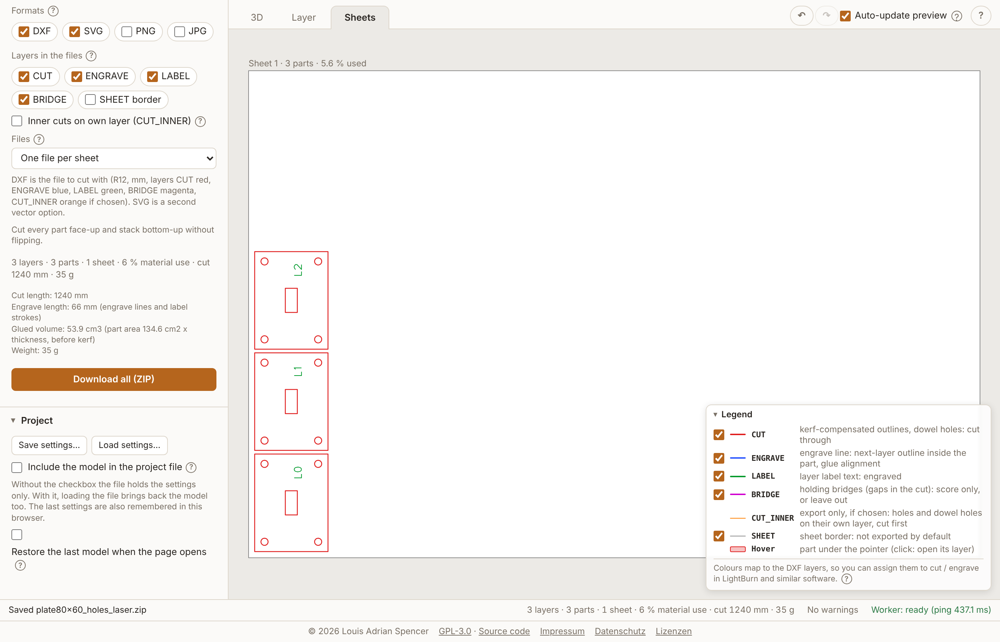
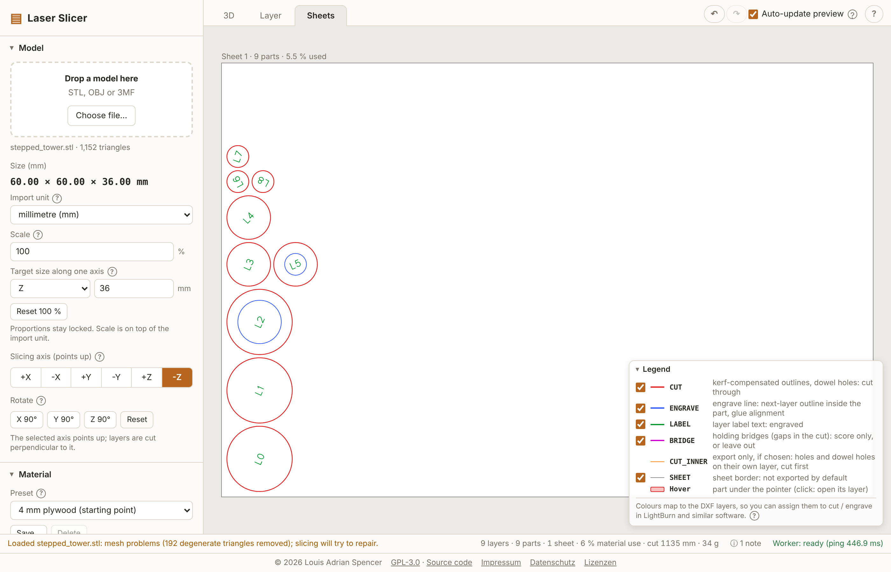
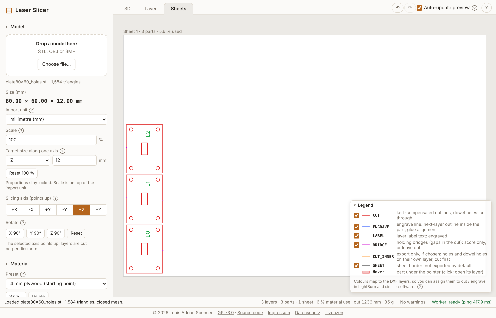
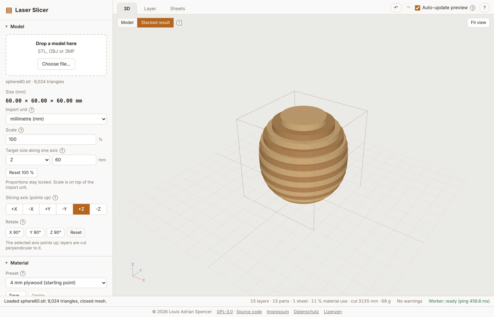
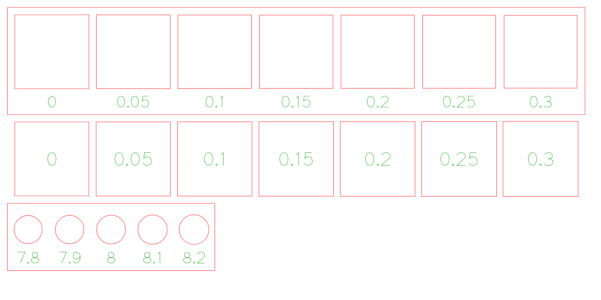
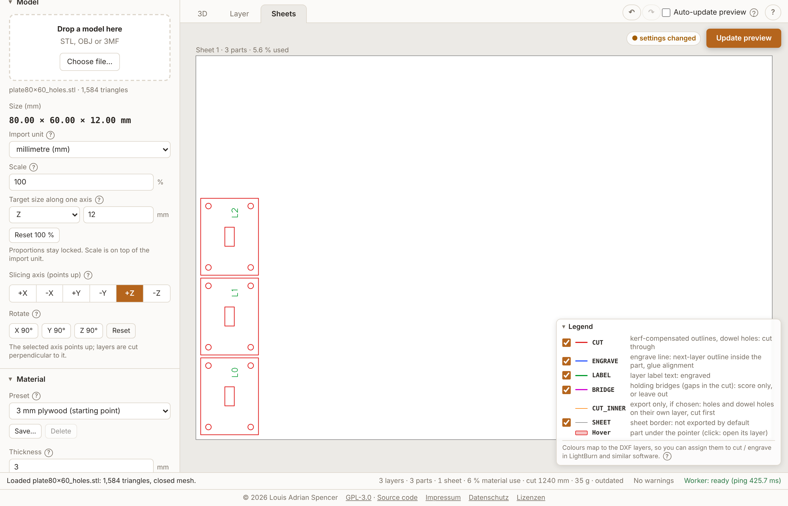

# Browser test protocol

Black-box tests of the built app, run on 15 November 2026 against the build of commit `dc08116` (branch
`claude/nice-pasteur-1894yz`). No application code was changed for or during these tests.

- **How:** `dist/index.html` opened from `file://` (T20 also over a local HTTP server) in headless Chromium driven by
  Playwright. Each test starts in a fresh browser context unless it tests persistence. Models were loaded through the
  file input; ZIP downloads were unpacked and the real DXF, SVG, PNG, JPG and README files were measured (DXF group
  codes parsed for entity counts, layers, bounding boxes, circle diameters and entity order; PNG `pHYs` and JPG `JFIF`
  density read from the bytes).
- **Models:** `models/` (13 shapes, generated by [`models/generate.mjs`](models/generate.mjs)).
- **Plan with expected values:** [TEST_PLAN.md](TEST_PLAN.md).
- **Per-test write-ups:** `results/Txx.md`; screenshots and real output files: `Txx/`.
- **Environment limits:** Chromium only, software WebGL (SwiftShader). Its "GPU stall due to ReadPixels" console
  notices appear in every test and are performance noise, not errors. No test produced a page error or app console error.

## Summary

**20 of 20 tests passed. No defects were found.** In six tests an expected value in the plan was wrong or too idealised;
the actual behaviour was checked against the documentation and is listed under "Plan corrections" below.

| ID | Feature | Verdict | Key measurements | Details |
|---|---|---|---|---|
| T01 | Load + slice basics | PASS | cube 20 mm → 5 layers, 5 parts, 1 sheet; outlines 20.150 × 20.150; no ENGRAVE; labels L0–L4 | [T01](results/T01.md) |
| T02 | All export formats | PASS | SVG 600 × 400 mm, viewBox 0 0 600 400; PNG 7087 × 4724 px, pHYs 11811 px/m; JPG 300 dpi; DXF `$INSUNITS` 4, 5 layers in table | [T02](results/T02.md) |
| T03 | Outline modes | PASS | cone L0: oversize 50.12, mid-plane 47.62, undersize 45.05 mm; 10 layers | [T03](results/T03.md) |
| T04 | Kerf compensation | PASS | kerf 0 → 20.000; kerf 0.3 → 20.300 on all parts | [T04](results/T04.md) |
| T05 | Hollowing | PASS | sphere: 11 cavity rings; equator wall 15.23 mm; first/last layer solid | [T05](results/T05.md) |
| T06 | Dowels | PASS | 2 circles Ø 5.850 (6 − kerf) on all 8 layers at identical positions; labels 7.8–9.9 mm clear | [T06](results/T06.md) |
| T07 | Holding bridges | PASS | outline split into 2 runs, 2 gaps of 0.650 mm; Ø 6 holes never bridged; slot bridged only with "bridge holes" (2 → 4 gaps) | [T07](results/T07.md) |
| T08 | Inner cuts first / CUT_INNER | PASS | default: 15 inner rings before 3 outlines (DXF + SVG); option: inner rings on CUT_INNER (ACI 30, #ff8000) | [T08](results/T08.md) |
| T09 | Calibration sheet | PASS | squares 20.00–20.30, holes 20.00–19.70; dowel circles = label − kerf; 160 × 73.2 mm | [T09](results/T09.md) |
| T10 | Estimates | PASS | cut 403 mm, 8.0 cm³, ≈ 43 s, cost 12.00; no slicing run on change; README identical | [T10](results/T10.md) |
| T11 | Import units | PASS | inch cube 25.40 mm, scale 100 %; 3MF sets cm automatically with status message, 20 mm | [T11](results/T11.md) |
| T12 | OBJ import | PASS | 30 × 20 × 10, 3 layers (ceil), outline 30.15 × 20.15 (nested rotated) | [T12](results/T12.md) |
| T13 | Project file with model | PASS | version 2 with model; fresh context restores model + kerf 0.25; corrupt file → one message, nothing lost | [T13](results/T13.md) |
| T14 | Session restore (opt-in) | PASS | off: no restore, no IndexedDB database; on: restored after reload and browser restart; off again clears it | [T14](results/T14.md) |
| T15 | Undo/redo + presets | PASS | one step per change (keys and buttons); preset = one step; preset survives reload | [T15](results/T15.md) |
| T16 | Nesting / multiple sheets | PASS | 300 × 200 → 6 sheets; 600 × 400 → 2 sheets (3 + 3); all inside margin, gaps exactly 3.00 mm, no overlaps | [T16](results/T16.md) |
| T17 | Engrave next-layer outline | PASS | (−Z) ENGRAVE only on L2 (Ø 40.00) and L5 (Ø 20.00), 10.07 mm from the cut edge; no retraced edges | [T17](results/T17.md) |
| T18 | Warnings / robustness | PASS | broken cube: "4 open edges" warning, still slices and exports; pin: labels shrunk to 2.7 / 3.1 mm with warnings | [T18](results/T18.md) |
| T19 | Auto-update, legend, export layers | PASS | no run until "Update preview"; stale note shown; hidden traces vanish; DXF without LABEL has only CUT | [T19](results/T19.md) |
| T20 | Legal pages + network | PASS | footer complete; pages render without JS at 390 px with no overflow; 5 requests, all same-origin, 0 third-party | [T20](results/T20.md) |

## Selected evidence

| | |
|---|---|
|  T08: plate with holes, inner cuts first |  T17: engrave rings only below the steps |
|  T07: holding bridges on the outer outline |  T05: hollowed sphere, stacked 3D preview |
|  T09: calibration sheet (rendered SVG) |  T19: auto-update off, "Update preview" |

## Plan corrections (expected values that were wrong, not app defects)

1. **Faceted test models (T02, T03).** The cylinder and cone are 96-sided, so round parts measure 0.02–0.03 mm under the
   ideal circle value. Within tolerance.
2. **Undersize simplification (T03).** Undersize L0 is 45.05 mm instead of 45.15: in undersize mode the default 0.05 mm
   simplification may only move the outline inwards (documented, mode-biased simplify). With simplify 0 it is 45.125.
   Undersize also leaves the top layer empty at the cone tip, as documented.
3. **Layer count (T12).** The app uses ceil(height / thickness): 10 mm / 4 mm → 3 layers. The plan said "rounded".
4. **Rotated nesting (T12, T16).** The nester turns parts by 90° when that packs better, so the box outline reads
   30.15 × 20.15 transposed, and the 250 × 180 slabs on a 600 × 400 sheet pack 3 + 3 instead of the plan's 4 + 2. Both
   results use 2 sheets and keep margins and spacing exactly.
5. **Stepped tower orientation (T17).** The generator flipped the tower, so as loaded (+Z) it is narrow at the bottom
   and, correctly, gets no engrave lines (each next layer covers the part). The test was run with slicing axis −Z, which
   gives the intended wide-bottom tower. The mistake is in the test model, not the app.
6. **Weight display (T10).** The summary shows "5 g" (rounded) for the computed 5.2 g.

## Not covered

- Other browsers (Firefox, Safari, Edge) and real GPUs.
- Importing the DXF/SVG into LightBurn, LibreCAD or Inkscape, and cutting on a real laser.
- Whether bridge gaps sit on straight edges (T07 checked counts and gap widths only).
- The live site laserslicer.com (blocked from the test environment); T20 used a local HTTP server.
- The main app at phone width: the page is 544 px wide at a 390 px viewport (known; the legal pages fit).
