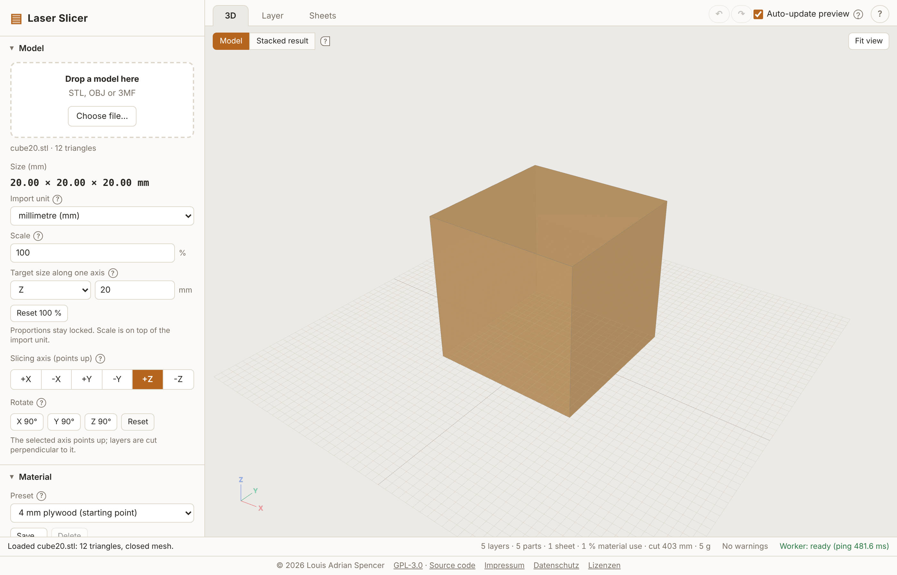
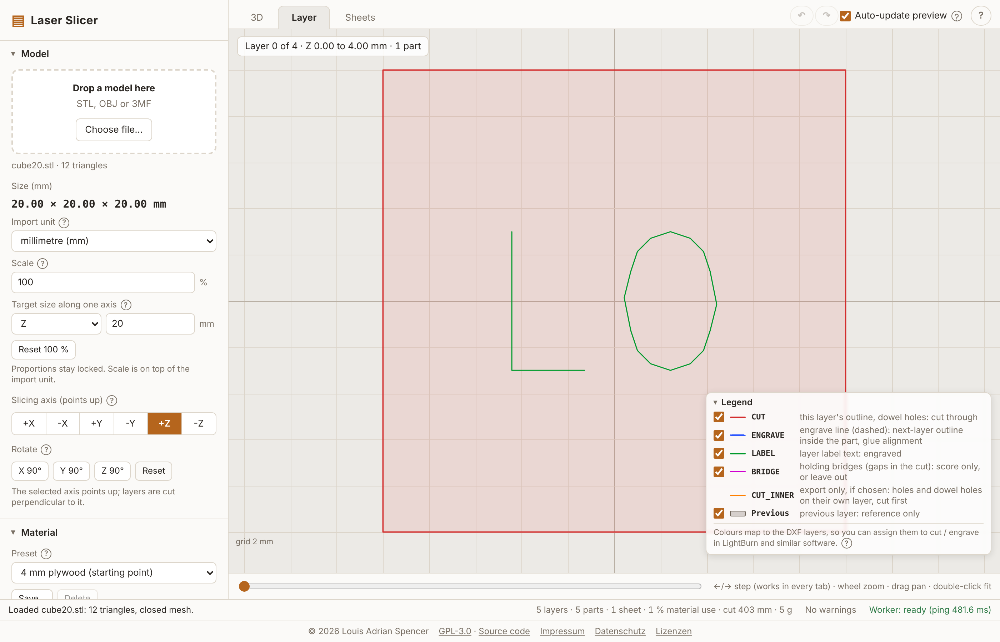
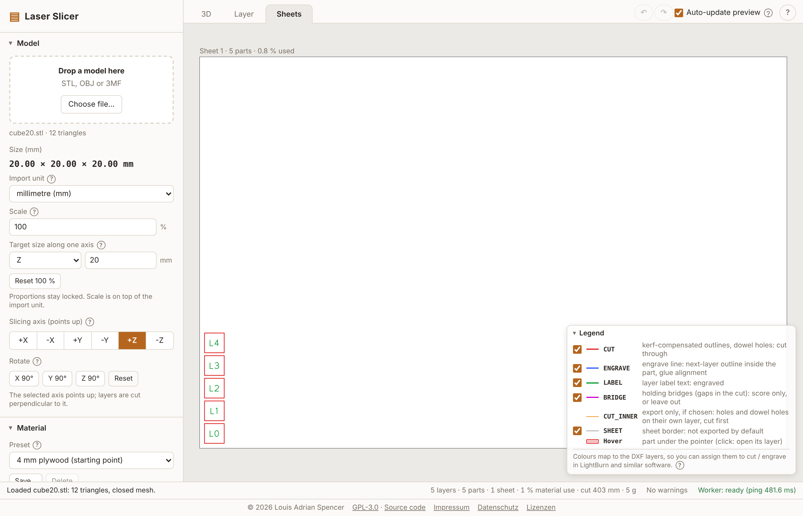

## T01 — Load + slice basics
**Verdict:** PASS
**Model:** cube20.stl   **Settings:** defaults (4 mm, kerf 0.15, 600 x 400 sheet, oversize, labels on, DXF only)
**Steps:**
1. Opened dist/index.html in a fresh context, waited for "Worker: ready", loaded cube20.stl via the file input.
2. Read size readout, summary line and status bar; screenshotted the 3D, Layer and Sheets tabs.
3. Clicked "Download all (ZIP)", unzipped, parsed the DXF (POLYLINE/VERTEX entities) and read README.txt.
**Expected:** size 20 x 20 x 20; 5 layers, 5 parts, 1 sheet; CUT outlines ≈ 20.15 x 20.15; labels L0..L4 on LABEL; no ENGRAVE lines; 3D, Layer, Sheets tabs render.
**Actual:**
| Item | Value |
|---|---|
| Size readout | 20.00 × 20.00 × 20.00 mm |
| Summary | 5 layers · 5 parts · 1 sheet · 1 % material use · cut 403 mm · 5 g |
| ZIP | README.txt, cube20_sheet01.dxf |
| DXF CUT | 5 closed POLYLINEs, each 20.150 x 20.150 (x 5.00..25.15; y 5, 28.15, 51.3, 74.45, 97.6) |
| DXF LABEL | 10 polylines, exactly 2 glyph strokes inside each part (letter "L" + digit); Sheets view shows L0..L4 bottom to top |
| DXF ENGRAVE | 0 entities (layer defined in LAYER table) |
| Status | "Loaded cube20.stl: 12 triangles, closed mesh."; "No warnings" |
**Evidence:**    [DXF](../T01/cube20_sheet01.dxf) [README](../T01/README.txt)
**Console:** no errors; only WebGL "GPU stall due to ReadPixels" performance notices (known noise).
**Notes / deviations:** The DXF has no text entities (labels are stroke polylines, as documented), so label identity L0..L4 was confirmed visually (Sheets tab, Layer tab shows "L0") and by glyph count per part, not by decoding glyphs. Material use shows 1 % in the summary and 0.8 % in README (rounding only).
