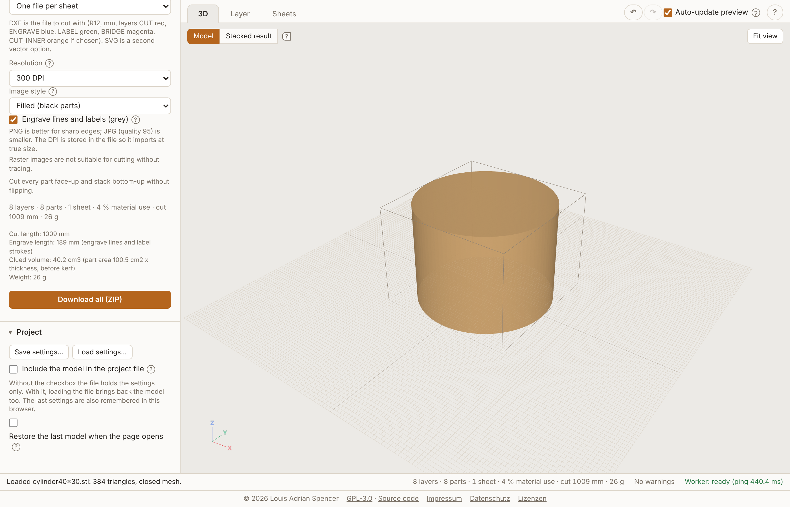

## T02 — All export formats
**Verdict:** PASS
**Model:** cylinder40x30.stl   **Settings:** formats DXF+SVG+PNG+JPG (DXF was on by default; ticked SVG, PNG, JPG), 300 DPI, otherwise defaults
**Steps:**
1. Loaded the model (8 layers · 8 parts · 1 sheet), opened the Export group, ticked svg/png/jpg, resolution 300 DPI.
2. Downloaded the ZIP and unzipped it; parsed PNG IHDR/pHYs, JPG JFIF header and SOF, SVG header, DXF header/tables/entities, README.
**Expected:** ZIP with DXF, SVG, PNG, JPG per sheet + README; SVG 600 x 400 mm with matching viewBox; PNG 7087 x 4724 with pHYs ≈ 11811 px/m; JPG JFIF 300 dpi; DXF LAYER table (CUT, ENGRAVE, LABEL, ...) and $INSUNITS = 4; circle parts ≈ 40.15 mm.
**Actual:**
| Item | Value |
|---|---|
| ZIP | README.txt, cylinder40x30_sheet01.dxf (84 KB), .svg (24 KB), .png (789 KB), .jpg (299 KB) |
| SVG | `width="600.0mm" height="400.0mm" viewBox="0 0 600.0 400.0"`; groups CUT, ENGRAVE, LABEL |
| PNG | 7087 x 4724, pHYs 11811 x 11811 px/m (unit = metre) |
| JPG | 7087 x 4724, JFIF units = 1 (dpi), density 300 x 300 |
| DXF | $INSUNITS 70 = 4; LAYER table CUT, ENGRAVE, LABEL, BRIDGE, SHEET |
| Parts | 8 closed CUT polylines, each bbox 40.128 x 40.128 |
| README | "Formats: dxf, svg, png, jpg, files per sheet"; "Raster images: 300 DPI ..."; lists all 4 files |
**Evidence:**  [DXF](../T02/cylinder40x30_sheet01.dxf) [SVG](../T02/cylinder40x30_sheet01.svg) [README](../T02/README.txt); PNG/JPG not stored (metadata above).
**Console:** no errors; GPU-stall notices only.
**Notes / deviations:** Circle parts measure 40.128, 0.022 mm under the nominal 40.15, within the 0.05 mm tolerance: the part is a polygon (125-167 vertices) and the source mesh itself is a faceted cylinder. Circles are written as polylines, not CIRCLE entities (the dowel circles are CIRCLE per README). The plan says "DXF has ... circle parts" - read as outline size.
