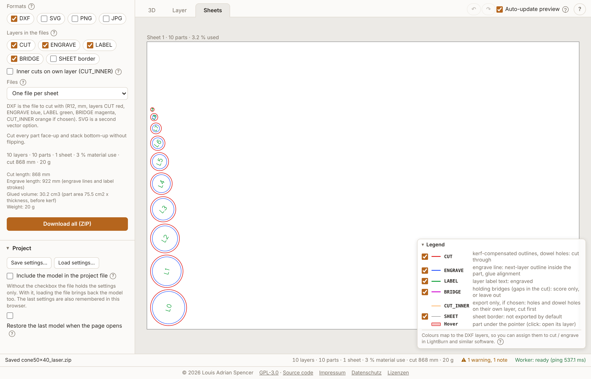

## T03 — Outline modes
**Verdict:** PASS
**Model:** cone50x40.stl (96-segment cone, d 50 at the base, h 40)   **Settings:** mode oversize / mid-plane / undersize, kerf 0.15, thickness 4 (others default)
**Steps:**
1. Loaded the cone (size 50.00 x 50.00 x 40.00).
2. For each mode set "Outline mode" (Slicing group), waited for the run, downloaded the ZIP and measured every CUT polyline bbox in the DXF (L0 is the first part).
3. Extra diagnostic: re-ran with kerf 0 and with simplify tolerance 0 to explain deviations from the ideal numbers.
**Expected:** L0 ≈ 50.15 (oversize), ≈ 47.65 (mid-plane), ≈ 45.15 (undersize), each + kerf; top layers smallest; 10 layers.
**Actual (CUT bbox, mm, L0 .. top):**
| Mode | Summary | L0 | L1 | L2 | ... | top |
|---|---|---|---|---|---|---|
| oversize | 10 layers, 10 parts | 50.12 | 45.12 | 40.13 | 35.13, 30.13, 25.14, 20.14, 15.14, 10.14 | 5.15 |
| mid-plane | 10 layers, 10 parts | 47.62 | 42.56 | 37.57 | 32.58, 27.59, 22.54, 17.57, 12.59, 7.61 | 2.60 |
| undersize | 10 layers, 9 parts | 45.05 | 40.06 | 35.07 | 30.09, 25.10, 20.05, 15.08, 10.10 | 5.05 (L8); L9 has no part |
Diagnostics: oversize with kerf 0 gives 49.973 (the STL's 96-gon has vertices at half steps: 50 x cos 1.875° = 49.973, so the nominal 50.15 cannot be reached by this mesh; 49.973 + 0.15 = 50.123 matches). Undersize with simplify 0 gives 45.125 (ideal 44.976 + 0.15), with the default simplify 0.05 it gives 45.053 (64 instead of 96 vertices).
**Evidence:**  [oversize DXF](../T03/cone_oversize.dxf) [mid-plane DXF](../T03/cone_midplane.dxf) [undersize DXF](../T03/cone_undersize.dxf)
**Console:** no errors; GPU-stall noise only.
**Notes / deviations:** (1) Oversize and mid-plane are within 0.03 mm of the plan values (mesh faceting). (2) Undersize L0 is 0.10 mm under the plan's 45.15: this is the documented mode-biased simplification (TECHNICAL.md 4.x: undersize chords stay on the material side, up to simplifyTol 0.05 per side); with simplify 0 it is 45.125. Judged PASS against documented behaviour. (3) Undersize yields 9 parts, not 10: the top layer (z 36-40) is empty because the intersection of the samples is empty at the apex (documented: "empty if any sample lies outside the model"); the layer count is still 10. The plan's mid-plane value 47.65 (z = 2) and undersize (z = 4) assume an ideal cone. Mid-plane L5 and L7/L8 differ slightly in x/y (22.54x22.59), a simplification artefact.
