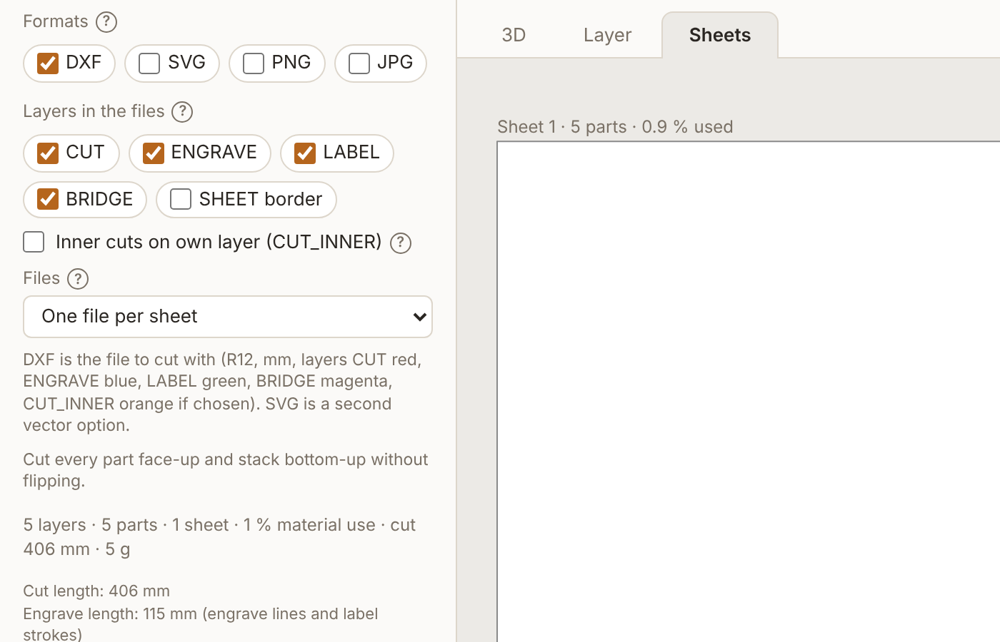

## T04 — Kerf compensation
**Verdict:** PASS
**Model:** cube20.stl   **Settings:** kerf 0, then 0.3 (field "Kerf" in Material), otherwise defaults
**Steps:**
1. Loaded cube20.stl, set kerf 0, waited for the run, downloaded the ZIP, measured CUT outlines.
2. Set kerf 0.3 and repeated; checked the README "kerf" line.
**Expected:** outline 20.00 x 20.00, then 20.30 x 20.30.
**Actual:**
| Kerf | Summary | CUT outlines (all 5 parts) | README |
|---|---|---|---|
| 0 | 5 layers · 5 parts · 1 sheet · cut 400 mm | 20.000 x 20.000 | kerf: 0 mm |
| 0.3 | 5 layers · 5 parts · 1 sheet · cut 406 mm | 20.300 x 20.300 | kerf: 0.3 mm |
**Evidence:**  [DXF kerf 0](../T04/cube_kerf0.dxf) [DXF kerf 0.3](../T04/cube_kerf0.3.dxf) [README kerf 0](../T04/README_kerf0.txt) [README kerf 0.3](../T04/README_kerf0.3.txt)
**Console:** no errors; GPU-stall noise only.
**Notes / deviations:** None. Cut length 400 mm = 5 x 4 x 20 and 406 = 5 x 4 x 20.3.
