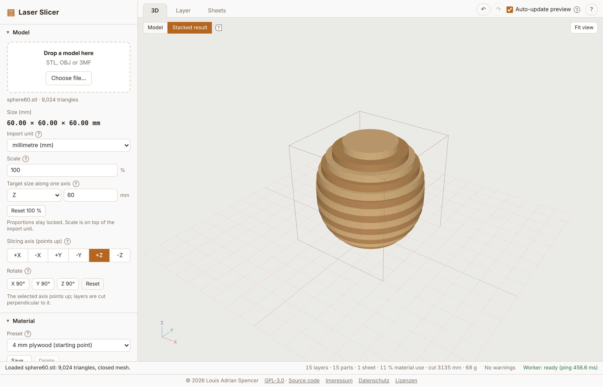
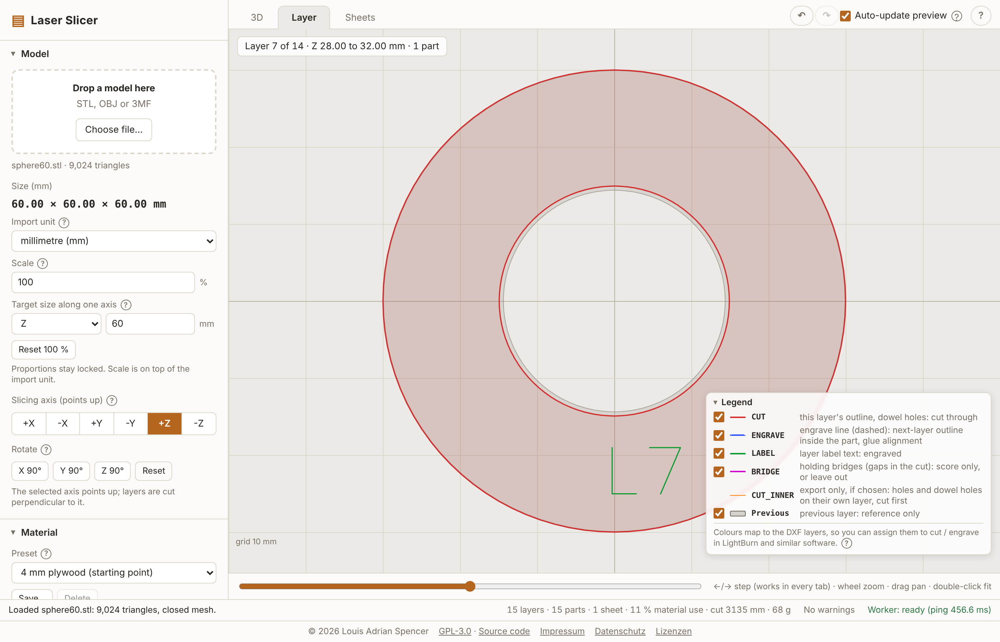

## T05 — Hollowing
**Verdict:** PASS
**Model:** sphere60.stl (60 mm sphere, 15 layers at 4 mm)   **Settings:** defaults + hollowing on, wall 15, solid cap layers 1
**Steps:**
1. Fresh context, loaded sphere60.stl (15 layers, 15 parts, cut 2374 mm, 80 g without hollowing).
2. Opened the Hollowing group, ticked "Hollow inner layers", wall 15, cap layers 1 (re-sliced: cut 3135 mm, 68 g, no warnings).
3. 3D tab, "Stacked result"; Layer tab at layer 7 (equator); screenshots.
4. Downloaded the ZIP (DXF, one sheet) and measured every closed CUT ring (bounding boxes, grouped by centre).
**Expected:** middle layers have an inner cut ring (cavity); wall >= 15 mm at the equator; first and last layer solid; 3D/Layer screenshots.
**Actual:** 15 outer rings + 11 cavity rings in the DXF (26 closed CUT polylines).

| Layer | Outer d (mm, kerf incl.) | Cavity d (mm) | Wall (outer-cavity)/2 |
|---|---|---|---|
| L0 | 29.96 | none (solid cap) | - |
| L1 | 40.85 | none | - |
| L2 | 48.08 | 10.56 | 18.76 |
| L3 | 53.14 | 17.79 | 17.68 |
| L4 | 56.66 | 22.88 | 16.89 |
| L5 | 58.88 | 26.36 | 16.26 |
| L6 | 59.97 | 28.61 | 15.68 |
| L7 (equator) | 60.12 | 29.67 | 15.23 |
| L8 | 59.97 | 28.61 | 15.68 |
| L9-L12 | 58.88 ... 48.08 | 26.36 ... 10.56 | symmetric to L5..L2 |
| L13 | 40.85 | none | - |
| L14 | 29.96 | none (solid cap) | - |

Wall at the equator is 15.23 mm (>= 15; the cavity hole is shrunk by the kerf, so the wall is slightly above the nominal 15). Layers 0 and 14 are solid. Layers 1 and 13 also have no cavity: with a 15 mm wall the support (intersection with the layer below, d 29.96) leaves no room; this is the documented behaviour (cavity = offset of the support by -wall, "Also drops hollowing leftovers"), not a defect. The cavity is fully enclosed (no vent hole), as documented in Limitations.
**Evidence:**   [DXF (truncated to < 300 KB, last lines cut)](../T05/sphere60_sheet01.truncated.dxf) [README](../T05/README.txt)
**Console:** no errors; only WebGL "GPU stall due to ReadPixels" performance notices (known noise).
**Notes / deviations:** The plan's "middle layers" is satisfied by layers 2-12 (11 of 15). Layers 1 and 13 are not hollow even though cap layers = 1; the outer layers' support is too small for a 15 mm wall. No wall measurement was taken off-equator in 3D, only from the DXF ring sizes.
