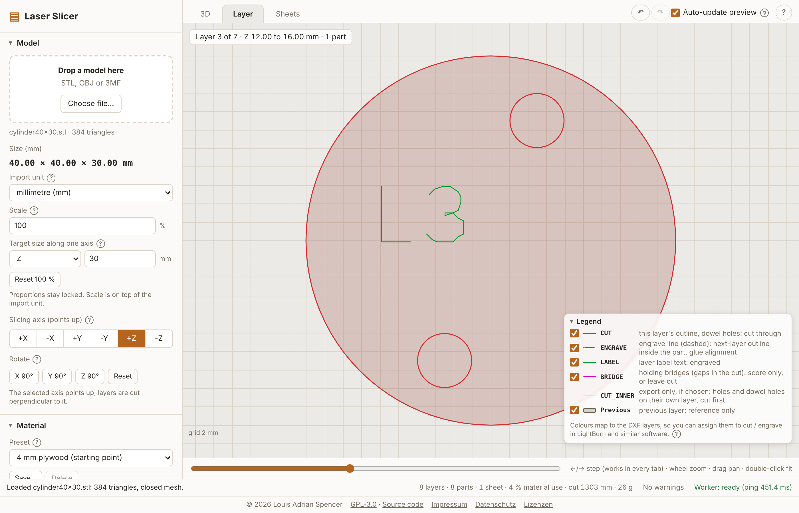
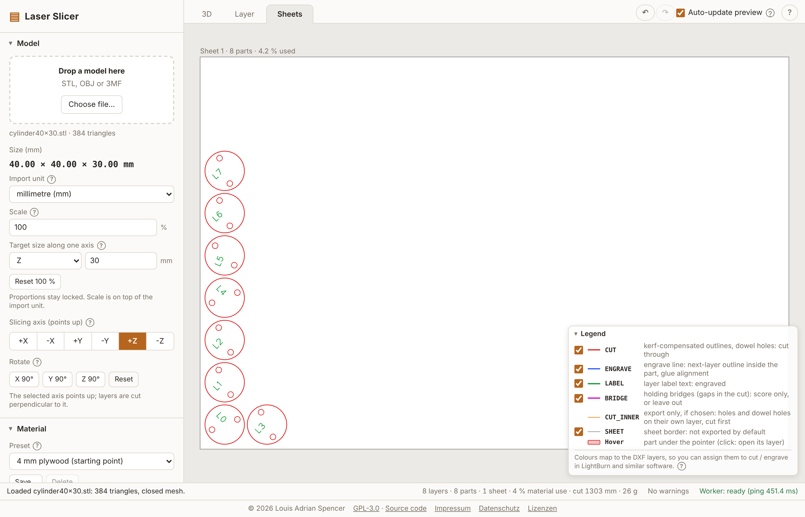

## T06 — Dowels
**Verdict:** PASS
**Model:** cylinder40x30.stl (8 layers)   **Settings:** defaults + dowels on, diameter 6, count 2, kerf 0.15; export "one file per layer" (so coordinates are not changed by nesting)
**Steps:**
1. Loaded cylinder40x30.stl, enabled Dowel holes (diameter 6, count 2). Summary: 8 layers, 8 parts, no warnings.
2. Layer tab layer 3 and Sheets tab screenshots.
3. Switched to one file per layer, downloaded the ZIP, parsed the 8 layer DXFs: CIRCLE entities, their layer, diameter, centre; LABEL bounding box vs. circles.
**Expected:** 2 dowel CIRCLEs per layer at identical positions on all layers, drawn diameter = 6 - kerf = 5.85; labels do not overlap holes.
**Actual:**
- Every layer L000-L007 has exactly 2 CIRCLE entities on layer CUT, diameter 5.850.
- Centres identical on all 8 layers: (15.075, 7.075) and (25.075, 33.075) (the part bbox is 0..40.15, so the centre of the disc is (20.075, 20.075)). Distance of each hole centre to the disc centre 13.9 mm, so the hole edge is about 3.2 mm from the rim (>= 3 mm rule).
- Label bbox vs hole clearance (edge to edge): 7.77 mm to 9.93 mm on all layers (e.g. L003: label 8.26,19.93..17.12,25.93). No overlap.
**Evidence:**   [L000 DXF](../T06/cylinder40x30_L000.dxf) [L003 DXF](../T06/cylinder40x30_L003.dxf) [README](../T06/README.txt)
**Console:** no errors; only WebGL GPU stall notices (noise).
**Notes / deviations:** Positions were compared in per-layer files (identical frame). In nested-sheet mode the parts are moved/rotated by nesting, so absolute coordinates differ per part by design; I did not check that separately.
