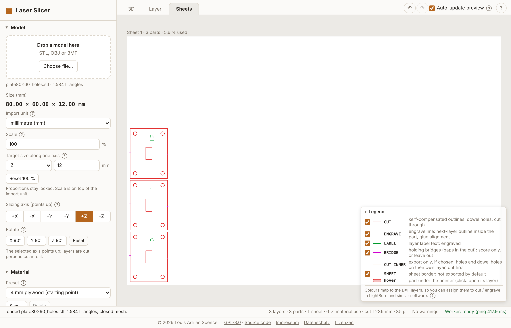
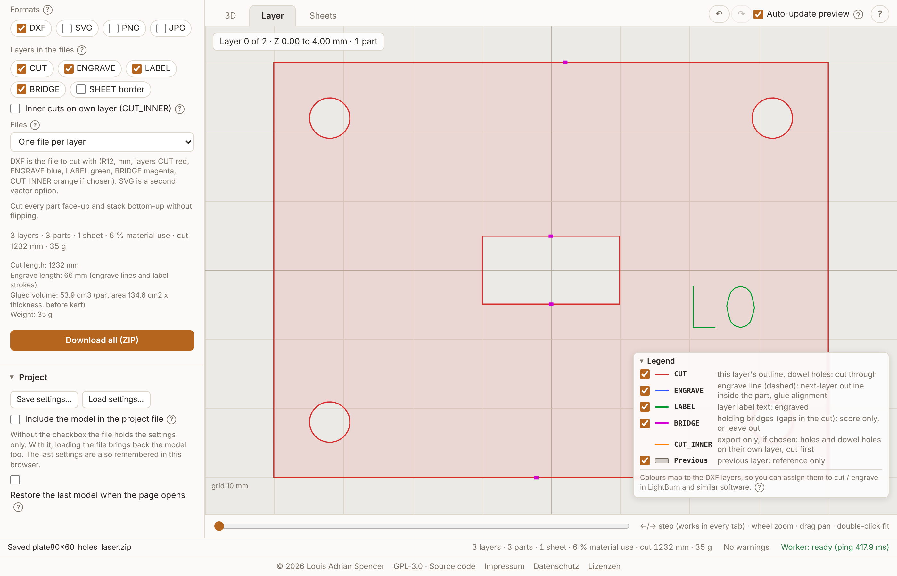

## T07 — Holding bridges
**Verdict:** PASS
**Model:** plate80x60_holes.stl (3 layers; each layer: 80 x 60 plate, four round holes, one slot)   **Settings:** bridges on, count 2, width 0.5, min length 40, kerf 0.15; then "Also bridge inner holes" on. Export one file per layer (identical frame; all three layers behave the same).
**Steps:**
1. Loaded the model, enabled bridges with the plan's values, Sheets tab screenshot.
2. Downloaded ZIP and parsed layer DXFs (CUT rings: open/closed, perimeter; BRIDGE entities: length).
3. Enabled "Also bridge inner holes", Layer tab screenshot, downloaded again and parsed.
**Expected:** outer outline (perimeter 280) has 2 gaps of width + kerf = 0.65 mm, gap segments on BRIDGE; 6 mm holes (perimeter ~19) never get bridges; slot (perimeter 60) gets bridges only with "bridge holes" on.
**Actual (per layer, identical on L000-L002):**

| Run | CUT rings | BRIDGE |
|---|---|---|
| bridges on | 4 closed holes per = 18.3; slot closed per = 59.4; outer outline = 2 OPEN polylines 139.6 + 139.7 | 2 segments, each 0.650 mm |
| + bridge holes | 4 closed holes per = 18.3 (unchanged); slot = 2 OPEN polylines 29.1 + 29.1; outer 2 OPEN 139.6 + 139.7 | 4 segments, each 0.650 mm |

Outer: 139.6 + 139.7 + 2 x 0.65 = 280.6 = perimeter of the kerfed 80.15 x 60.15 outline. Slot: 29.1 + 29.1 + 1.3 = 59.5 (closed ring 59.4 plus rounding). Hole rings (perimeter 18.3, below min length 40) never bridged in either run.
**Evidence:**   [DXF bridges only](../T07/bridges-a-plate80x60_holes_L000.dxf) [DXF + bridge holes](../T07/bridges-b-plate80x60_holes_L000.dxf) [README](../T07/README-b.txt)
**Console:** no errors; only GPU stall noise.
**Notes / deviations:** The plate has four round holes (plan says "6 mm holes"; perimeter 18.3 after kerf matches a 6 mm hole). The plan's perimeter 280 is the model outline; the kerfed outline is 280.6, which is what the DXF gap math reproduces. I did not verify geometrically that the gaps lie on straight edges (only lengths and counts).
