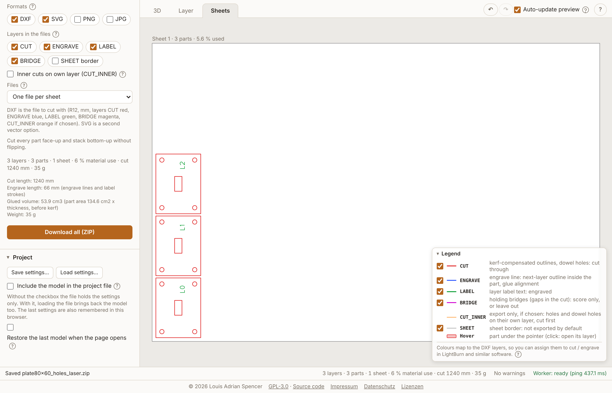

## T08 — Inner cuts first / CUT_INNER
**Verdict:** PASS
**Model:** plate80x60_holes.stl (3 layers, 3 parts on one sheet)   **Settings:** DXF + SVG, default export (one file per sheet); then "Inner cuts on own layer (CUT_INNER)" on.
**Steps:**
1. Loaded model, ticked SVG format, downloaded ZIP (default), parsed DXF entity order and SVG groups.
2. Ticked "Inner cuts on own layer", downloaded again, parsed DXF LAYER table, entities, SVG groups, README.
**Expected:** default: per sheet all hole rings before outer outlines in DXF and SVG; with option: holes on CUT_INNER (ACI 30, in LAYER table, SVG group #ff8000), only outer outlines on CUT; README mentions it.
**Actual:**
- Default DXF entity order (CUT only, ring perimeters): `c18 c18 c59 c18 c18` x3 parts (15 inner rings: holes 18, slot 59) followed by `c281 c281 c281` (3 outer outlines). SVG `CUT` group: same order, the three 60x80 outlines last. LAYER table: CUT, ENGRAVE, LABEL, BRIDGE, SHEET.
- With option: DXF has 15 entities on CUT_INNER followed by 3 on CUT. LAYER table now has `CUT_INNER aci=30`. SVG: `<g id="CUT_INNER" stroke="#ff8000">` holds the 15 inner rings, `<g id="CUT" stroke="#ff0000">` the 3 outlines. CUT_INNER is written before CUT.
- README (default): "Inner cuts (holes, cavities, dowel holes) are written before the outer outlines in every part's DXF and SVG data." With option: "Inner cuts: holes, cavities and dowel holes are on DXF layer CUT_INNER (SVG group CUT_INNER, orange); only the outer outlines are on CUT. Cut CUT_INNER first, then CUT..." plus a DXF layers line listing CUT_INNER.
**Evidence:**  [default DXF](../T08/default-plate80x60_holes_sheet01.dxf) [default SVG](../T08/default-plate80x60_holes_sheet01.svg) [CUT_INNER DXF](../T08/cutinner-plate80x60_holes_sheet01.dxf) [CUT_INNER SVG](../T08/cutinner-plate80x60_holes_sheet01.svg) [README default](../T08/default-README.txt) [README CUT_INNER](../T08/cutinner-README.txt)
**Console:** no errors; only GPU stall noise.
**Notes / deviations:** "per sheet" ordering: all inner rings of all parts on the sheet come before all outer outlines (documented behaviour). My quick SVG path-size parser was crude (some per-element sizes are meaningless); grouping and order were judged from element counts and the three 60x80 outlines being last, in the SVG text.
