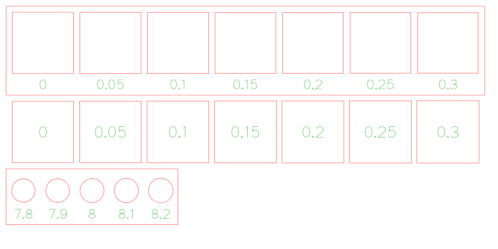

## T09 — Calibration sheet
**Verdict:** PASS
**Model:** none   **Settings:** (a) defaults (kerf 0.15, dowel 6); (b) kerf 0.2, dowel diameter 8
**Steps:**
1. Fresh context, no model, clicked "Download calibration sheet" (defaults). Status text: "Saved laser-slicer-calibration.zip: cut it from scrap, see README.txt inside."
2. Unzipped, parsed DXF (POLYLINE/VERTEX/CIRCLE) and SVG, read README.txt.
3. Fresh context, set Kerf 0.2 and Dowel diameter 8, downloaded again, same checks.
4. Rendered the SVG of run (b) in the browser for a screenshot.
**Expected:** ZIP with DXF, SVG, README.txt; 7 squares 20 + k and 7 holes 20 - k for k = 0..0.30; 5 dowel holes around the dowel diameter; overall ≈ 160 x 73 mm; labels readable.
**Actual:**
| | (a) defaults | (b) kerf 0.2, dowel 8 |
|---|---|---|
| ZIP content | calibration.dxf, calibration.svg, README.txt | same |
| DXF layers/entities | CUT: 16 closed polylines + 5 circles; LABEL: 62 polylines | same |
| Squares (bbox) | 20.00, 20.05 ... 20.30 (7, step 0.05) | same (independent of kerf setting) |
| Square holes | 20.00, 19.95 ... 19.70 (7) | same |
| Hole strip outline | 156.00 x 29.00 | 156.00 x 29.00 |
| Dowel circles, drawn diameter | 5.65 5.75 5.85 5.95 6.05 (labels 5.8..6.2, minus kerf 0.15) | 7.6 7.7 7.8 7.9 8.0 (labels 7.8..8.2, minus kerf 0.2) |
| Dowel strip | 46.00 x 16.20 | 56.00 x 18.20 |
| DXF extents | 2..158 x 2..71.2 | 2..158 x 2..73.2 |
| Sheet size (README / SVG) | 160 x 73.2 mm | 160 x 75.2 mm (SVG header 160.0mm x 73.2mm in (a)) |
Labels are stroke text (polylines on LABEL, no SVG text elements); in the rendered SVG all numbers (0, 0.05 ... 0.3 under each hole and on each square; 7.8 ... 8.2 under dowel holes) are clearly readable.
**Evidence:** , [DXF a](../T09/a_calibration.dxf), [SVG a](../T09/a_calibration.svg), [README a](../T09/a_README.txt), [DXF b](../T09/b_calibration.dxf), [SVG b](../T09/b_calibration.svg), [README b](../T09/b_README.txt)
**Console:** no errors; only the known WebGL "GPU stall due to ReadPixels" performance notices (noise).
**Notes / deviations:** Overall size is 160 x 73.2 mm (default), 160 x 75.2 mm with an 8 mm dowel (strip grows with the dowel diameter): "≈ 160 x 73" holds for the default. Dowel circles are drawn label minus kerf, as documented in the README.
