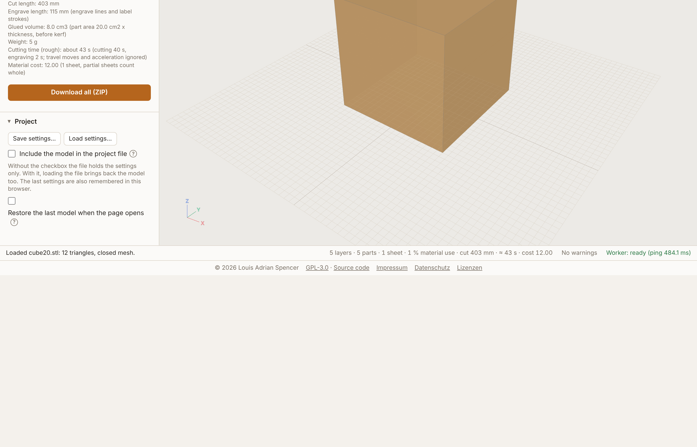

## T10 — Estimates
**Verdict:** PASS
**Model:** cube20.stl   **Settings:** defaults, then density 0.65, cut speed 10 mm/s, engrave speed 50 mm/s, price per sheet 12 (set one by one, auto-update on)
**Steps:**
1. Loaded cube20.stl, waited for the slice (summary "5 layers · 5 parts · 1 sheet · 1 % material use · cut 403 mm · 5 g").
2. Installed a MutationObserver on the progress bar (`#progress` hidden attribute) and the status bar, then entered the four values (800 ms apart, 3 s wait after).
3. Read the top-bar summary, its tooltip and the estimate list in the Export section; screenshot.
4. Downloaded the ZIP, read README.txt, parsed the DXF.
**Expected:** volume 8 cm³ → weight ≈ 5.2 g; cut length ≈ 403 mm; time ≈ cut/10 + engrave/50; cost 12.00 (1 sheet); changing the settings starts no slicing run; README lists the same values.
**Actual:**
| Item | Measured | Expected |
|---|---|---|
| Glued volume | 8.0 cm3 (part area 20.0 cm2 x 20 mm height) | 8 cm3 |
| Weight | "5 g" (shown without decimals) | ≈ 5.2 g (8.0 x 0.65 = 5.2) |
| Cut length | 403 mm | ≈ 403 mm |
| Engrave length | 115 mm | (not given) |
| Time | about 43 s (cutting 40 s, engraving 2 s) ; 403/10 + 115/50 = 40.3 + 2.3 = 42.6 s | cut/10 + engrave/50 |
| Cost | 12.00 (1 sheet) | 12.00 |
| Slicing run on change | progress bar never shown (0 appearances), no "outdated"/stale note, layers/parts unchanged; summary updated immediately | no run |
| README "Estimates" block | identical six lines as the app list | same values |
Summary line after entry: `5 layers · 5 parts · 1 sheet · 1 % material use · cut 403 mm · ≈ 43 s · cost 12.00`. With a price set the summary shows cost instead of weight (documented), weight is still in the list.
**Evidence:** , [README](../T10/README.txt), [DXF](../T10/cube20_sheet01.dxf)
```
Cut length: 403 mm
Engrave length: 115 mm (engrave lines and label strokes)
Glued volume: 8.0 cm3 (part area 20.0 cm2 x thickness, before kerf)
Weight: 5 g
Cutting time (rough): about 43 s (cutting 40 s, engraving 2 s; travel moves and acceleration ignored)
Material cost: 12.00 (1 sheet, partial sheets count whole)
```
**Console:** no errors; only WebGL GPU-stall noise.
**Notes / deviations:** The weight is displayed rounded to a whole gram ("5 g"), the plan expects ≈ 5.2 g; value agrees within rounding but one decimal would be more informative for small parts (minor UX remark, not a defect). The no-run check is observational (progress bar/stale note never appeared); the app exposes no run counter. The README "Settings used" block does not list density/speeds/price separately, they appear only through the Estimates block.
