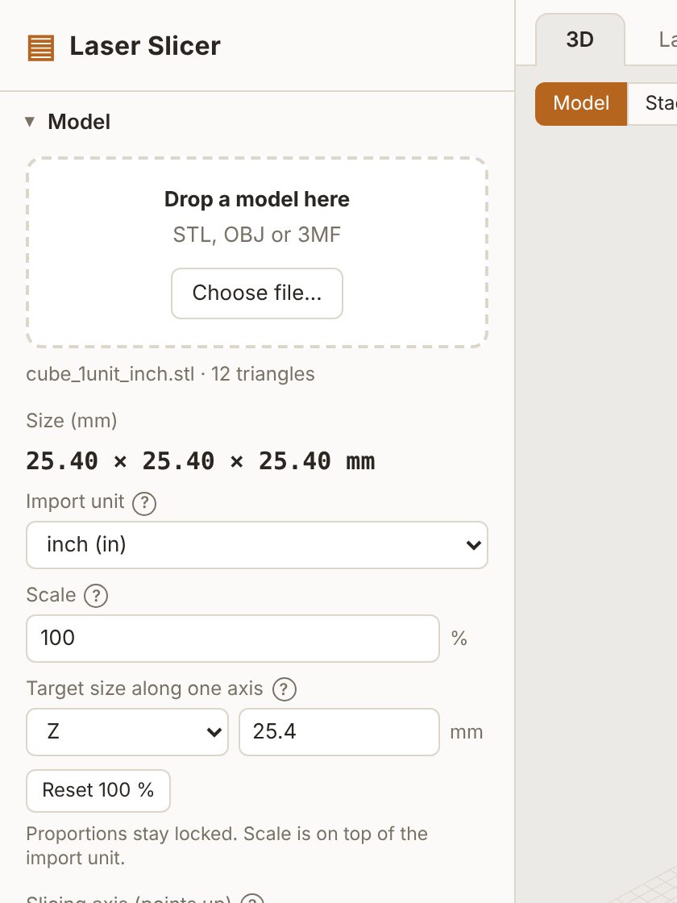
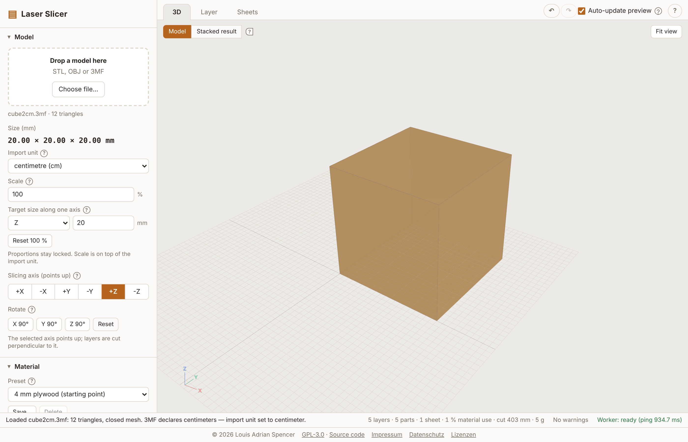

## T11 — Import units
**Verdict:** PASS
**Model:** cube_1unit_inch.stl, then cube2cm.3mf (loaded into the same session)   **Settings:** Import unit set to inch after the STL load; the 3MF load left to the app
**Steps:**
1. Fresh context; loaded cube_1unit_inch.stl with the default unit (mm), noted the readout.
2. Selected Import unit "inch (in)" in the Model group, waited for the re-slice.
3. Loaded cube2cm.3mf in the same session and read unit, size, scale and status bar.
**Expected:** inch cube reads 25.4 x 25.4 x 25.4, scale field 100 %; 3MF sets the unit to cm automatically with a status message, size 20 x 20 x 20.
**Actual:**
| Step | Unit | Size readout | Scale field | Status bar |
|---|---|---|---|---|
| STL, default unit | mm | 1.00 x 1.00 x 1.00 mm | 100 | Loaded cube_1unit_inch.stl: 12 triangles, closed mesh. |
| unit = inch | in | 25.40 x 25.40 x 25.40 mm | 100 | (unchanged, unit change is silent as documented) |
| 3MF load | cm (set automatically) | 20.00 x 20.00 x 20.00 mm | 100 | Loaded cube2cm.3mf: 12 triangles, closed mesh. 3MF declares centimeters — import unit set to centimeter. |
Slice results: inch cube 7 layers / 7 parts / 1 sheet, cut 715 mm; 3MF cube 5 layers / 5 parts / 1 sheet, cut 403 mm (same as T10's cube20).
**Evidence:** , 
**Console:** no errors, no warnings except WebGL GPU-stall noise.
**Notes / deviations:** At mm the 1-unit cube is 1 mm wide, so it yields 0 parts (below min part area 4 mm²) - expected, not a defect.
