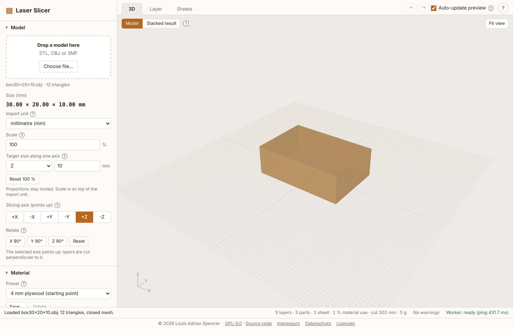
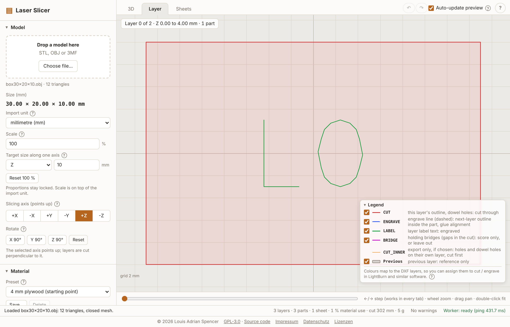

## T12 — OBJ import
**Verdict:** PASS
**Model:** box30x20x10.obj   **Settings:** defaults
**Steps:**
1. Loaded the OBJ via the file input.
2. Read status, size readout and summary; screenshotted the 3D and Layer tabs; downloaded the ZIP and measured the DXF.
**Expected:** size 30 x 20 x 10; 3 layers (10 / 4 rounded per the app's rule, record actual); outlines ≈ 30.15 x 20.15.
**Actual:**
| Item | Value |
|---|---|
| Status | "Loaded box30x20x10.obj: 12 triangles, closed mesh." |
| Size | 30.00 × 20.00 × 10.00 mm |
| Summary | 3 layers · 3 parts · 1 sheet · 1 % material use · cut 302 mm · 5 g |
| Layer count rule | ceil(10 / 4) = 3 (code uses ceil with 1e-6 tolerance, not round); layers are z 0-4, 4-8, 8-12 (Layer tab: "Layer 0 of 2") |
| DXF CUT | 3 closed outlines, each 20.150 x 30.150 (rotated 90 degrees on the sheet by nesting) |
| DXF ENGRAVE / LABEL | 0 / 6 glyph polylines (2 per part) |
**Evidence:**   [DXF](../T12/box30x20x10_sheet01.dxf) [README](../T12/README.txt)
**Console:** no errors; GPU-stall noise only.
**Notes / deviations:** The DXF outlines are 20.15 x 30.15 rather than 30.15 x 20.15 because the nester places the part rotated 90 degrees; the Layer tab shows the part unrotated at 30 x 20. Same footprint, so counted as met. No ENGRAVE lines: ring of the next layer is identical to the cut outline. The plan's "rounded" is really ceil (10 / 4 = 2.5 gives 3 under either rule). The top layer is only 2 mm of material (model ends at z = 10, layer spans to 12). No warning shown for this.
