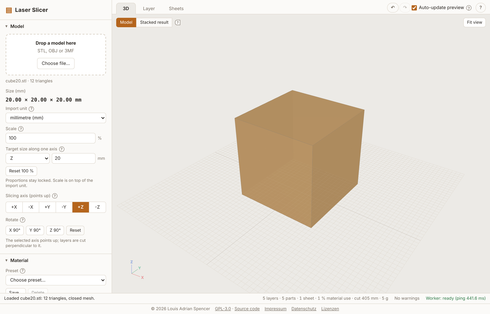
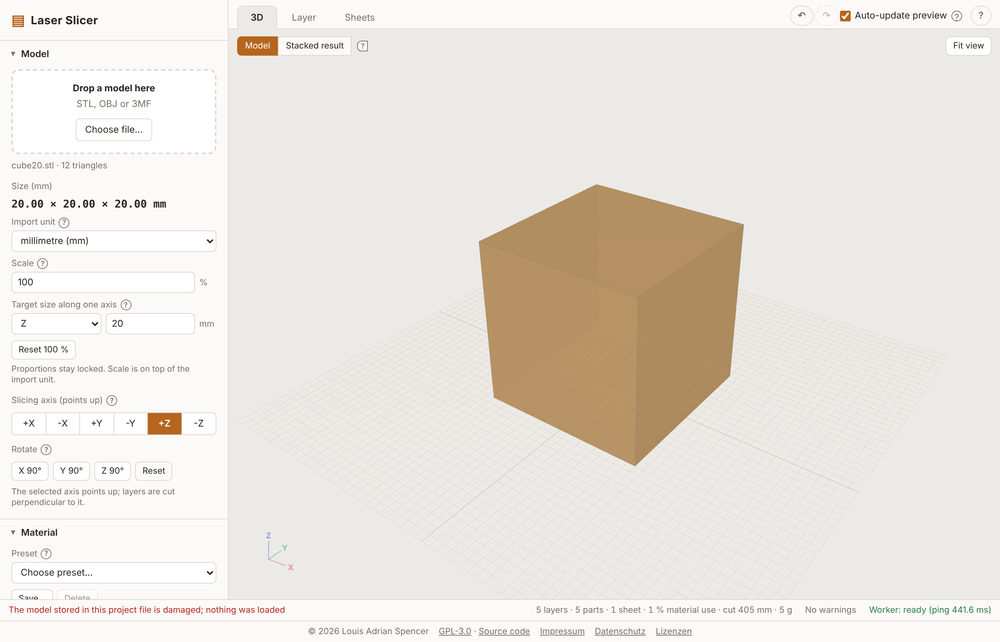

## T13 — Project file with model
**Verdict:** PASS
**Model:** cube20.stl   **Settings:** kerf 0.25 (else defaults), "Include the model in the project file" ticked
**Steps:**
1. Fresh context, loaded cube20.stl (5 layers, 5 parts, 1 sheet), set kerf 0.25, ticked "Include the model", clicked Project > Save.
2. Inspected the downloaded JSON.
3. Opened a second fresh context (kerf field shows 0.15), loaded the JSON through the project file input.
4. Made a copy with 9 invalid base64 characters (`!!!@@@###`) inserted into `model.data`; loaded it in the context from step 3 (model + kerf 0.25 present).
5. Also tried a copy with `model.data` cut to 30 characters.
**Expected:** file is version 2 with model; fresh context gets model + kerf 0.25; corrupt file gives one clear error and keeps the current model.
**Actual:**
| Check | Result |
|---|---|
| `format` / `version` | `laser-slicer-project` / 2 |
| `model` | `{name: "cube20.stl", data: <912 chars base64>}`, `settings.kerf` = 0.25 |
| Status after save | "Saved laser-slicer-project.json with the model cube20.stl" |
| Fresh context after load | kerf field 0.25 (was 0.15), size 20.00 x 20.00 x 20.00 mm, "cube20.stl · 12 triangles", summary "5 layers · 5 parts · 1 sheet · … cut 405 mm" (= 20 x 4 x 20.25, kerf applied); status "Loaded cube20.stl: 12 triangles, closed mesh."; project note "Loaded cube20.stl and the settings from project_with_model.json" |
| Corrupt base64 | one message, in the status bar and the Project note: "The model stored in this project file is damaged; nothing was loaded". Model still "cube20.stl · 12 triangles", kerf still 0.25, summary unchanged |
| Truncated base64 | same single message, state unchanged |
**Evidence:** [project file](../T13/project_with_model.json), [corrupt copy](../T13/project_corrupt.json), , 
**Console:** no errors, no page errors; 4 WebGL "GPU stall" notices (known noise).
**Notes / deviations:** none.
