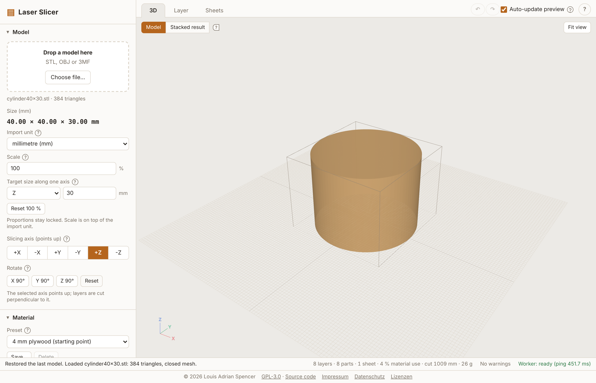

## T14 — Session restore (opt-in)
**Verdict:** PASS
**Model:** cylinder40x30.stl   **Settings:** defaults; "Restore the last model when the page opens" off, then on
**Steps:** (one persistent Chromium profile, `launchPersistentContext`)
1. Opened the app: checkbox is unticked. Loaded the cylinder (8 layers, 8 parts, 1 sheet). Looked at IndexedDB (`indexedDB.databases()`), reloaded, looked again.
2. Ticked the checkbox, loaded the cylinder again, checked IndexedDB, reloaded.
3. Closed the whole browser, opened a new one on the same profile, opened the app.
4. Unticked the checkbox, checked IndexedDB, reloaded.
**Expected:** off: nothing restored, no IndexedDB record; on: model comes back after reload with a status note.
**Actual:**
| Moment | Observation |
|---|---|
| Default | checkbox off |
| Off, model loaded | `indexedDB.databases()` = `[]` (no `laserslicer.session` database at all) |
| Off, after reload | status "Ready. Load an STL, OBJ or 3MF model.", no model, no summary, still no database |
| On, model loaded | database `laserslicer.session` with 1 record in store `session` |
| On, after reload | status "Restored the last model. Loaded cylinder40x30.stl: 384 triangles, closed mesh."; summary "8 layers · 8 parts · 1 sheet · 4 % material use · cut 1009 mm · 26 g"; checkbox still on |
| On, after full browser restart | same restore and status |
| Switched off again | record count 0; after reload: nothing restored, checkbox off |
**Evidence:** , 
**Console:** no errors; 8 "GPU stall" notices (noise).
**Notes / deviations:** my first run showed no restore, but that was caused by my own probe: it called `indexedDB.open('laserslicer.session')` on a database that did not exist yet, which created it empty (no object store) and so blocked the app's own creation. The probe was changed to check `indexedDB.databases()` first and the run above is the valid one. Not an app defect (a test artefact only).
