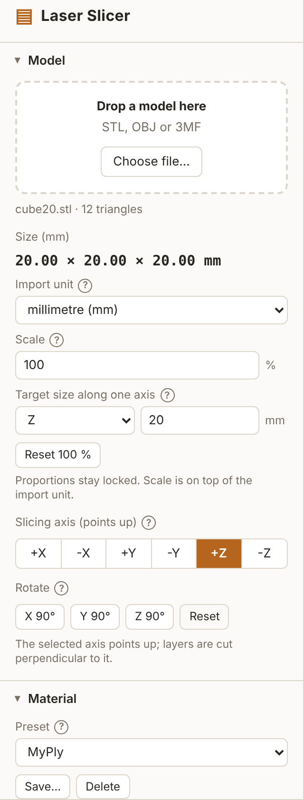

## T15 — Undo/redo + presets
**Verdict:** PASS
**Model:** cube20.stl   **Settings:** kerf and thickness edits, user preset "MyPly" (thickness 3.2, kerf 0.18, spacing 2, price 9)
**Steps:**
1. Loaded the cube. Set kerf 0.2, kerf 0.3, thickness 3.5 (each edit separated by more than 1.3 s). Ctrl+Z twice, Ctrl+Y, Ctrl+Shift+Z, then the undo button three times and the redo button three times.
2. Set my values, clicked "Save…" (prompt answered "MyPly"), changed kerf 0.1 / thickness 6 / price 20, picked "MyPly" in the list, pressed the undo button once, redo once.
3. Applied a starter preset ("3 mm plywood") and Ctrl+Z.
4. Reloaded the page, checked the list and settings, changed kerf, applied "MyPly" again.
**Expected:** each change one undo step; preset applies Material values in one step; preset survives a reload.
**Actual:**
| Action | kerf / thickness |
|---|---|
| start | 0.15 / 4 (undo and redo buttons disabled) |
| after edits | 0.3 / 3.5 |
| Ctrl+Z | 0.3 / 4 (thickness step only) |
| Ctrl+Z | 0.2 / 4 |
| Ctrl+Y | 0.3 / 4 |
| Ctrl+Shift+Z | 0.3 / 3.5, redo button disabled |
| undo button x3 | 0.3/4, 0.2/4, 0.15/4 (undo disabled at the start state) |
| redo button x3 | 0.2/4, then 0.3/3.5 |
| apply "MyPly" | thickness 3.2, kerf 0.18, spacing 2, price 9 in one step; note: `Applied "MyPly".` |
| one undo | kerf 0.1, thickness 6, price 20 (all three restored at once) |
| one redo | all preset values again, list shows MyPly |
| starter preset + Ctrl+Z | values exactly as before |
| after reload | list holds the 3 starting points + "MyPly"; current settings kept; applying MyPly after changing kerf to 0.05 restores kerf 0.18 / thickness 3.2 |
Save note: `Saved the preset "MyPly".` The preset list selection follows the current values (empty when no preset matches).
**Evidence:** 
**Console:** no errors; one expected `prompt` dialog (name for the preset); 4 "GPU stall" notices (noise).
**Notes / deviations:** edits to the same setting less than 1 s apart merge into one undo step (documented in `src/history.ts` as a design rule; in my first harness run, kerf 0.2 then 0.3 within a second undid in one step, 0.3 straight to 0.15). With normal pacing each change is its own step. The default cut and engrave speeds are 0, so the preset test did not vary them.
