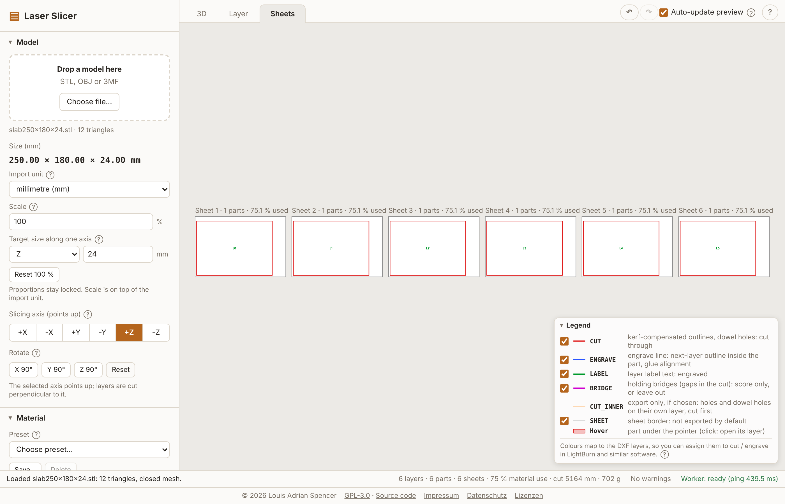
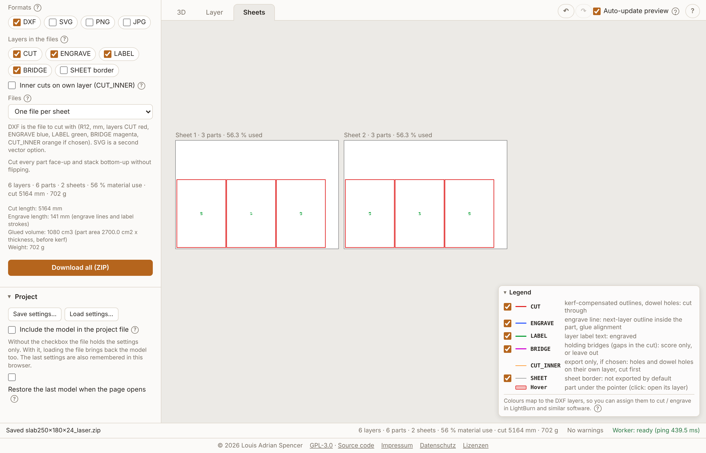

## T16 — Nesting / multiple sheets
**Verdict:** PASS
**Model:** slab250x180x24.stl (6 layers, 6 identical parts 250.15 x 180.15 after kerf)   **Settings:** defaults (margin 5, spacing 3), sheet 300 x 200, then 600 x 400; DXF per sheet.
**Steps:**
1. Loaded model (default 600x400: 2 sheets). Set sheet 300x200, screenshot, downloaded, parsed all sheet DXFs (CUT bounding boxes).
2. Set sheet 600x400, same.
**Expected:** 6 parts; small sheet: 6 sheets, one part each; big sheet: 2 sheets (4 + 2); every part inside sheet minus margin; no overlaps.
**Actual:**
- 300 x 200: 6 sheets, 1 part each, each bbox 5.00,5.00 .. 255.15,185.15 (inside 5..295 x 5..195).
- 600 x 400: 2 sheets, 3 + 3 parts, parts placed rotated (180.15 wide x 250.15 tall): x ranges 5.00-185.15, 188.15-368.30, 371.30-551.45, y 5.00-255.15; all within 5..595 x 5..395. No overlaps; gap between neighbours exactly 3.00 mm (spacing setting). 56 % material use.
**Evidence:**   [DXF 300x200 sheet1](../T16/300x200-slab250x180x24_sheet01.dxf) [DXF 600x400 sheet1](../T16/600x400-slab250x180x24_sheet01.dxf) [README 600x400](../T16/README-600x400.txt)
**Console:** no errors; only GPU stall noise.
**Notes / deviations:** The plan expects 4 + 2 on the big sheet; the app produces 3 + 3. Both give 2 sheets, and a 2x2 grid would also fit (503 x 363 within 590 x 390), but MaxRects chose 3 rotated parts in one row. The plan's "4 + 2" is an assumption about the packing, not a documented rule; the stated essential (2 sheets, inside margin, no overlap) is met.
