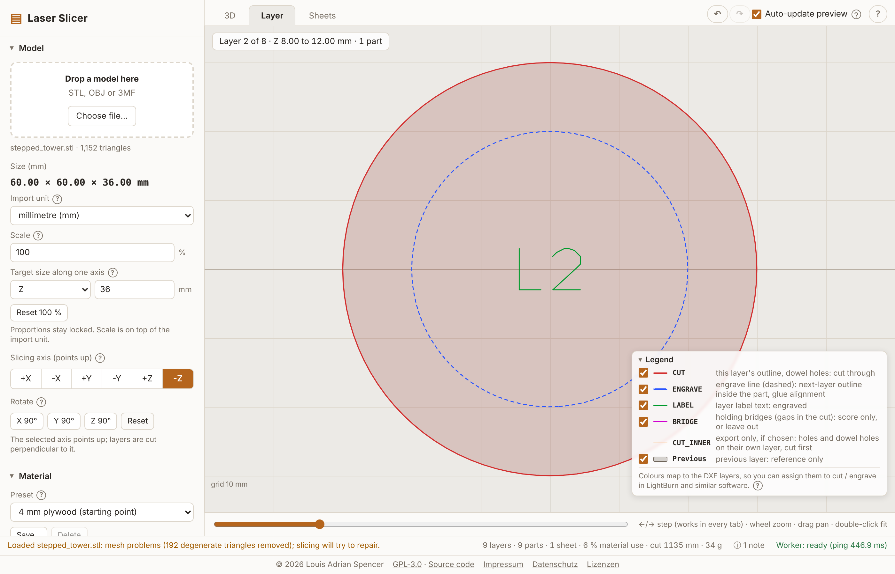
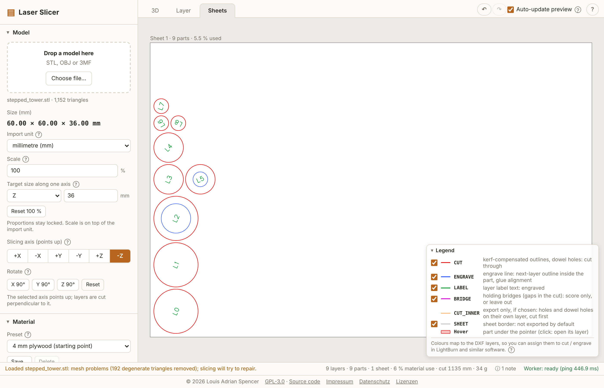
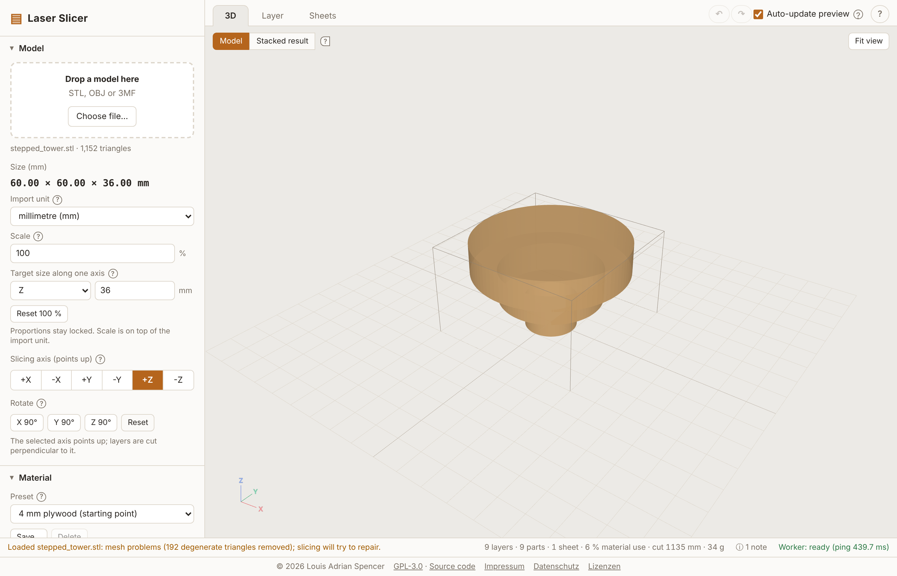

## T17 — Engrave next-layer outline
**Verdict:** PASS (with a plan/model orientation note; see Notes)
**Model:** stepped_tower.stl (60 x 60 x 36 mm; 9 layers)   **Settings:** defaults (engrave next outline on, kerf 0.15); export one file per layer so each layer's DXF is separate. Run 1: default orientation (+Z); run 2: slicing axis -Z.
**Steps:**
1. Loaded the model, summary "9 layers, 9 parts, 1 sheet". Parsed engrave lines per layer in both orientations; measured ENGRAVE bbox and its minimal distance to the part's cut outline (outline vertices and engrave edge midpoints).
2. Layer tab (layer 2) and Sheets screenshots for the -Z run.
**Expected:** 9 layers; parts directly below a step carry an ENGRAVE ring of the smaller next diameter (d ~ 40 on the d60 part, ~ 20 on the d40 part); parts whose next layer is the same size have no ENGRAVE; no engrave line retraces a cut edge.
**Actual:**
- Default (+Z): the generated tower stands with d20 at the bottom (generate.mjs rotates it by pi): layers L0-L2 are 20.15, L3-L5 40.15, L6-L8 60.15. Every next layer is the same or bigger, so there is no ENGRAVE entity on any layer (correct: a part fully covered by the next layer needs no outline).
- Axis -Z (d60 at the bottom): L0-L2 60.15, L3-L5 40.15, L6-L8 20.15. ENGRAVE appears only on L2 (closed polyline, 40.00 x 40.00, 148 points) and L5 (closed polyline, 20.00 x 20.00, 163 points); none on the other 7 layers. Engrave lines are not kerf-offset (40.00 / 20.00 exactly, as documented). Minimal distance of the engrave ring to the cut outline: 10.07 mm on both, so nothing retraces a cut edge.
**Evidence:**    [-Z L002 DXF](../T17/negZ-stepped_tower_L002.dxf) [-Z README](../T17/negZ-README.txt) [default L000 DXF](../T17/default-stepped_tower_L000.dxf) [default README](../T17/default-README.txt)
**Console:** no errors; only GPU stall noise.
**Notes / deviations:** With "defaults" literally applied the plan's expectation is not met, because the model as loaded has the large disc on top; the plan assumed the large disc at the bottom. The app's behaviour is correct for both orientations. Judged PASS on the -Z run (d60 at the bottom), which matches the plan's described result.
