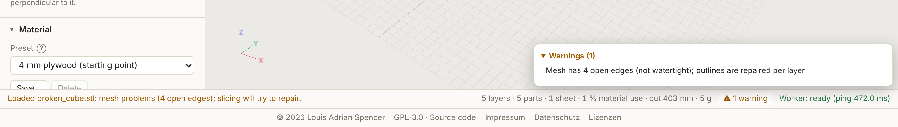
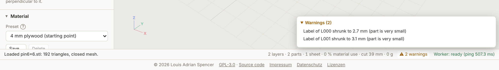

## T18 — Warnings / robustness
**Verdict:** PASS
**Model:** broken_cube.stl, pin6x6.stl (each in a fresh context)   **Settings:** defaults
**Steps:**
1. Loaded broken_cube.stl; read the status bar, waited for the slice, opened the warnings list (status bar button), downloaded the ZIP, parsed DXF and README.
2. Same for pin6x6.stl.
**Expected:** broken cube: mesh warning in the status bar, still slices; pin: label shrunk / too small warning, still exports.
**Actual:**
| | broken_cube.stl | pin6x6.stl |
|---|---|---|
| Status bar on load | "Loaded broken_cube.stl: mesh problems (4 open edges); slicing will try to repair." | "Loaded pin6x6.stl: 192 triangles, closed mesh." |
| Warning button | "⚠ 1 warning" | "⚠ 2 warnings" |
| Warnings list | warn: "Mesh has 4 open edges (not watertight); outlines are repaired per layer" | warn: "Label of L000 shrunk to 2.7 mm (part is very small)"; warn: "Label of L001 shrunk to 3.1 mm (part is very small)" |
| Slice | 5 layers · 5 parts · 1 sheet, cut 403 mm, size 20 x 20 x 20 | 2 layers · 2 parts · 1 sheet, cut 39 mm, size 6 x 6 x 6 |
| ZIP | broken_cube_sheet01.dxf + README.txt; CUT 5 polylines, LABEL 10 | pin6x6_sheet01.dxf + README.txt; CUT 2 polylines, LABEL 4 |
| README | "Warnings (1)" lists the mesh warning | "Warnings (2)" lists both label warnings |
The repaired broken cube gives the same cut length (403 mm) as the intact cube20 in T10.
**Evidence:** , , [DXF broken](../T18/broken_broken_cube_sheet01.dxf), [README broken](../T18/broken_README.txt), [DXF pin](../T18/pin_pin6x6_sheet01.dxf), [README pin](../T18/pin_README.txt)
**Console:** no errors; only WebGL GPU-stall noise.
**Notes / deviations:** The pin labels shrink to 2.7 mm, below the 3 mm minimum label height; this is the documented fallback (TECHNICAL.md: below 3 mm the text shrinks to the inscribed circle with a warning, left out below 1 mm). Warnings for the broken mesh are given in the status bar both as message and as the warning button.
