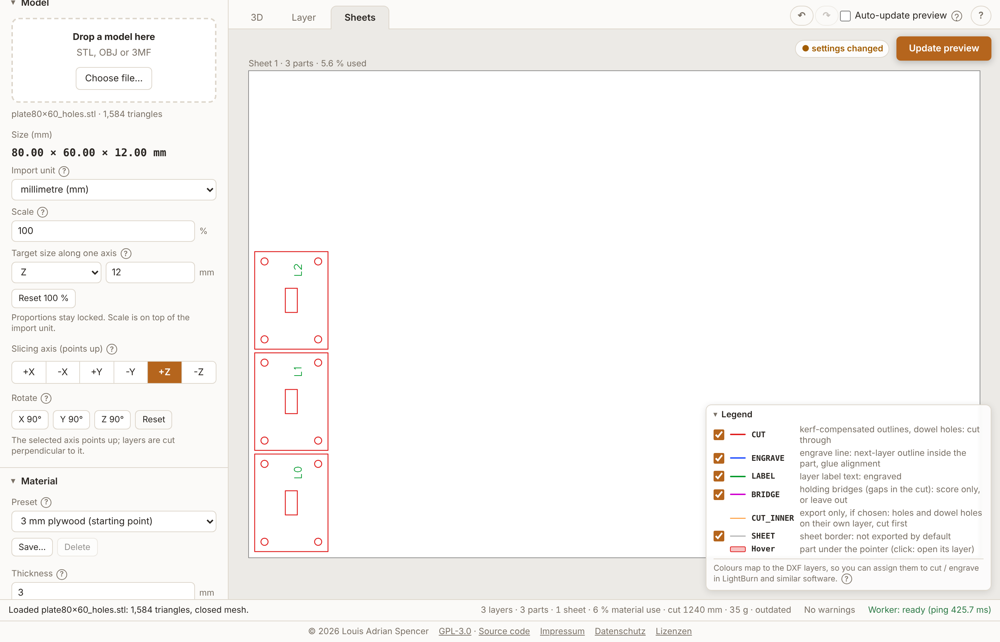
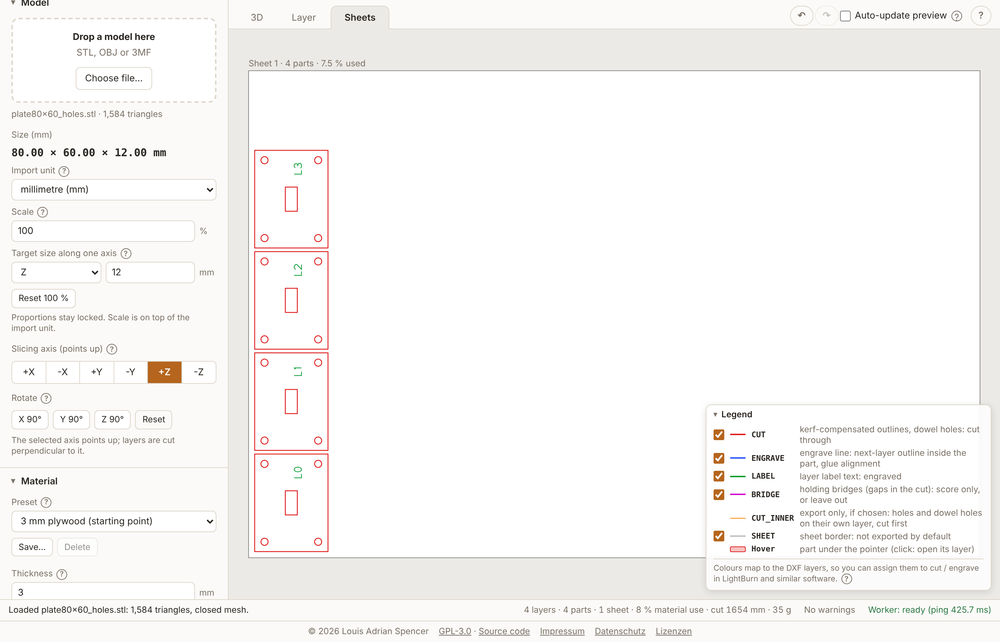
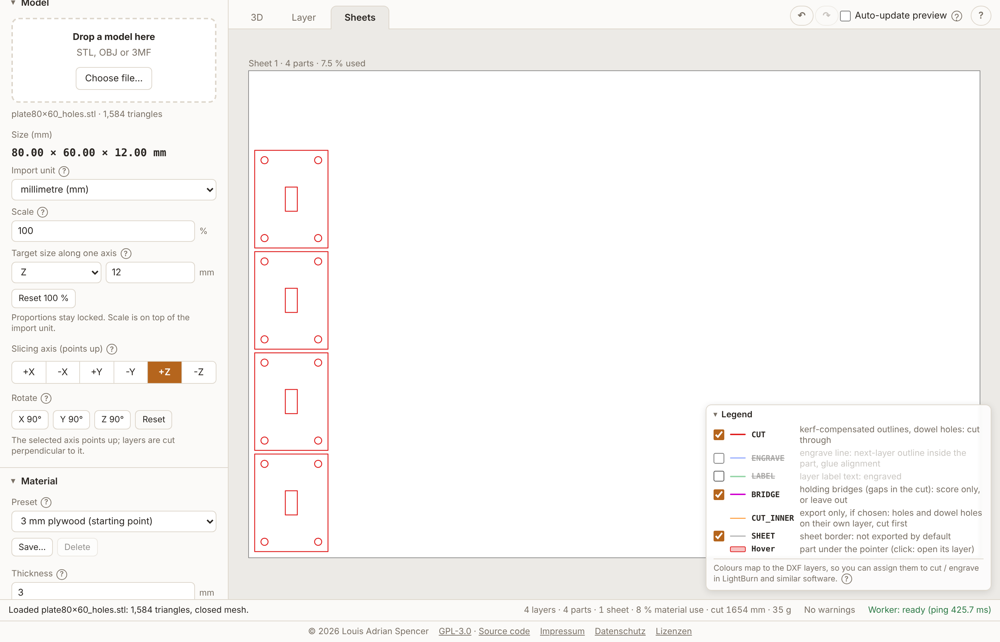

## T19 — Auto-update, legend toggles, export layers
**Verdict:** PASS
**Model:** plate80x60_holes.stl (80 x 60 x 12 mm)   **Settings:** defaults; auto-update off, thickness 4 → 3; legend ENGRAVE and LABEL hidden; export layer LABEL unchecked
**Steps:**
1. Loaded the plate with auto-update on; slice finished: "3 layers · 3 parts · 1 sheet · 6 % material use · cut 1240 mm".
2. Unchecked "Auto-update preview"; attached a progress-bar observer; set Thickness to 3; waited 5 s.
3. Took a screenshot on the Sheets tab, clicked "Update preview", waited for the result.
4. In the Sheets legend unchecked ENGRAVE and LABEL; counted red / blue / green pixels of the Sheets view before and after.
5. Unchecked LABEL in the Export layer chips, downloaded the ZIP, parsed the DXF and README.
**Expected:** no run until the button is pressed; stale note shown; hidden traces vanish from the Sheets view; DXF without LABEL layer entities.
**Actual:**
| Check | Result |
|---|---|
| After thickness change, auto off | Progress bar never appeared (0), result unchanged: summary still "3 layers · 3 parts ... cut 1240 mm · 35 g" with " · outdated" appended; "● settings changed" note and "Update preview" button visible (top right) |
| After clicking Update preview | One run (progress 1); summary "4 layers · 4 parts · 1 sheet · 8 % material use · cut 1654 mm"; note and button hidden again |
| Sheets view pixel counts, all traces | red 12381, blue 172, green 640 |
| After ENGRAVE + LABEL hidden in legend | red 12381, blue 0, green 0 (CUT unchanged; legend rows struck out) |
| DXF with LABEL unchecked | only `CUT` entities (24 polylines: 4 parts x (outline + 4 holes + slot)), no LABEL entities; README: "Layers included: CUT, ENGRAVE (left out: LABEL, SHEET border)" |
**Evidence:** , , , [DXF](../T19/plate80x60_holes_sheet01.dxf), [README](../T19/README.txt)
**Console:** no errors; only WebGL GPU-stall noise.
**Notes / deviations:** The plate produces no ENGRAVE lines (next layer covers each part), so the 172 blue pixels before hiding are the legend swatch/part of the UI, and the ENGRAVE layer is simply absent from the DXF; the ENGRAVE-trace hiding is therefore only verified for the legend state (row struck out, blue pixels gone), not on real engrave geometry. The legend toggles are view only; the export used the separate chips as documented. Stale-state check of "no run" is observational (no progress bar, summary unchanged), the app has no run counter. Preset field showed "3 mm plywood (starting point)" after typing thickness 3 because the values then matched that preset (documented behaviour).
