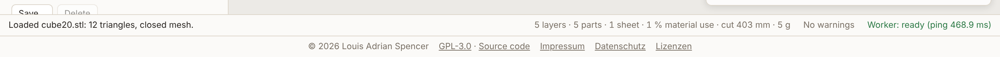
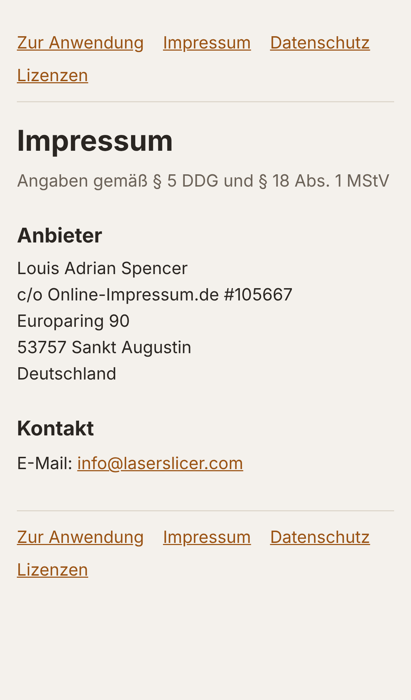
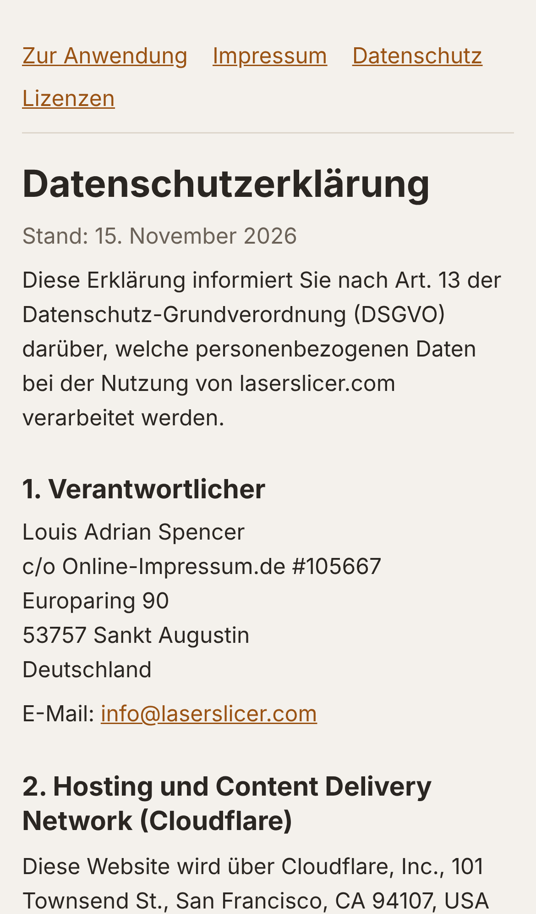
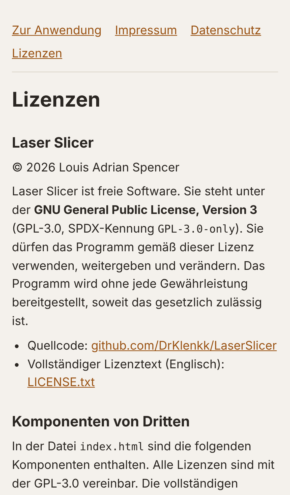

## T20 — Legal pages + network
**Verdict:** PASS
**Model:** cube20.stl (for the app session)   **Settings:** defaults; `dist/` served by a small Node http server on 127.0.0.1
**Steps:**
1. Opened the app over http, loaded the cube, visited 3D / Layer / Sheets tabs, read the footer, clicked Impressum, Datenschutz and Lizenzen (each opens a new tab). The context recorded every request (`context.on('request')`).
2. Opened the three legal pages in an iPhone 13 context (390 x 664 CSS px) with `javaScriptEnabled: false`; measured horizontal overflow.
3. Repeated the overflow check in a plain 390 px wide Chromium window with JS.
**Expected:** footer with © 2026 Louis Adrian Spencer, GPL-3.0, Source code, Impressum, Datenschutz, Lizenzen; pages render without JS, no horizontal scroll at 390 px; zero third-party requests.
**Actual:**
- Footer text: `© 2026 Louis Adrian Spencer | GPL-3.0 · Source code | Impressum | Datenschutz | Lizenzen`. Hrefs: GPL-3.0 -> lizenzen.html, Source code -> https://github.com/DrKlenkk/LaserSlicer (new tab, noopener), the three legal pages as relative links with target `_blank`. The footer is visible below the status bar, also with a model loaded.
- Each page opens and has content: Impressum (292 chars of text, provider and contact), Datenschutzerklärung (7474 chars), Lizenzen (2020 chars).
- No-JS iPhone: all three pages render (h1 and text present), `scrollWidth` = `innerWidth` = 390, no element extends past the viewport. Same at 390 px with JS.
- Requests during the whole app session: 5, all same-origin: `index.html`, one `blob:` (the Web Worker) and the three legal pages. Zero third-party requests (the file has no CDN, font, analytics or favicon request). The no-JS session requested only the three pages.
**Evidence:** [request log](../T20/requests.txt), , , , 
**Console:** no errors; 4 "GPU stall" notices (noise).
**Notes / deviations:** the main app itself at a 390 px viewport has a horizontal scroll width of 544 px (page `scrollWidth` 544 > 390). The plan only requires the legal pages to fit at 390 px, so this is not counted against T20, but the app is not phone-friendly. The privacy text mentions Cloudflare (a link inside the text, not a request made by the app). The ZIP export was not repeated in the network recording; the app code showed no network use on that path and the recorded session shows nothing but its own files.
